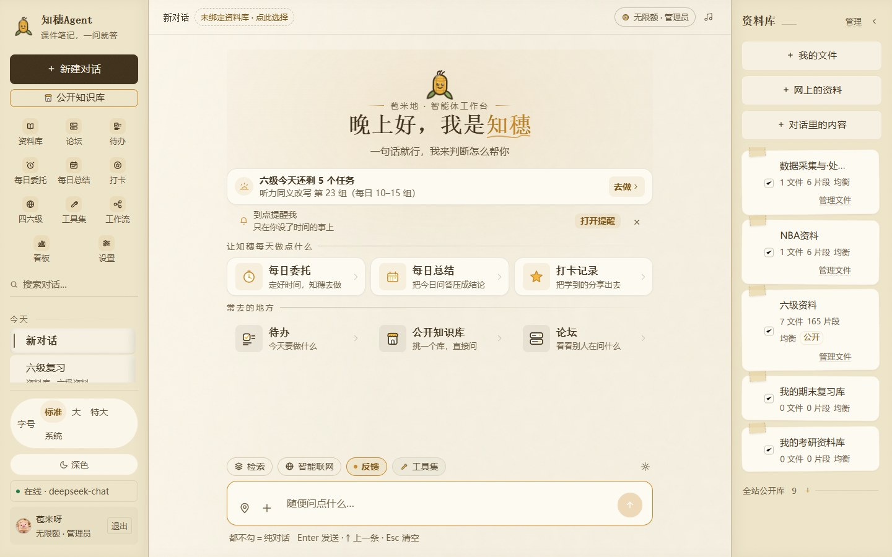
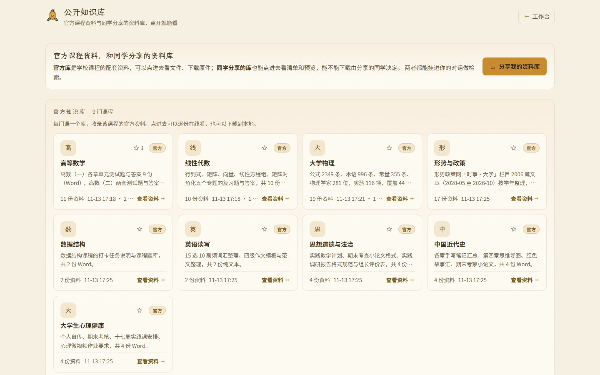
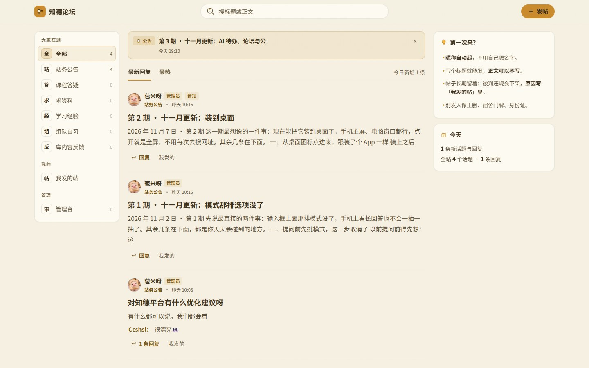
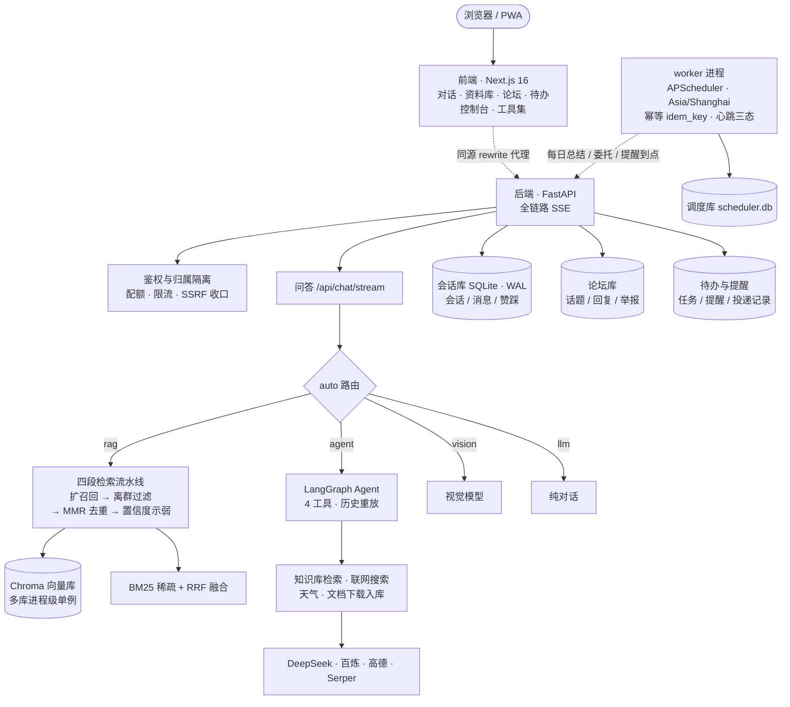

<div align="center">

# 🌽 知穗 Agent

**面向大学生的 AI 学习工作台 —— 把资料、讨论、待办和问答，收进一本摊开的纸质笔记本。**

线上环境：[myzhisui.cn](https://myzhisui.cn) · 当前版本 `0.1.0`（Beta）· MIT License

[](https://www.python.org/)
[](https://fastapi.tiangolo.com/)
[](https://python.langchain.com/)
[](https://www.trychroma.com/)
[](https://nextjs.org/)
[](https://react.dev/)
[](https://web.dev/progressive-web-apps/)
[](LICENSE)

| 浅色 · 暖米黄糙纸 | 深色 · 深棕木桌 |
|:---:|:---:|
|  |  |

</div>

---

## 目录

- [一、项目简介](#一项目简介) · [二、功能概览](#二功能概览) · [三、术语约定](#三术语约定)
- [四、架构](#四架构) · [五、环境要求](#五环境要求) · [六、安装与配置](#六安装与配置)
- [七、快速上手](#七快速上手) · [八、部署](#八部署) · [九、接口概览](#九接口概览)
- [十、测试与性能](#十测试与性能) · [十一、常见问题](#十一常见问题) · [十二、贡献指南](#十二贡献指南)
- [十三、版本与许可证](#十三版本与许可证) · [十四、文档索引](#十四文档索引)

---

## 一、项目简介

### 1.1 它是什么

知穗 Agent 是一个**自托管的多用户 AI 学习工作台**：把课程资料变成可检索的个人知识库，用对话的方式提问、追问、核对原文；把同一批人聚集在论坛里讨论；把「明天交作业」「周三晚自习」这类一句话变成带提醒的待办。

它解决的不是「AI 能不能回答」，而是**回答之后的事**：资料存在哪、结论从哪一句来的、讨论在哪继续、说完要做的事谁来盯。所以四个模块（对话 / 资料库 / 论坛 / 待办）是并立的，而不是一个聊天框加几个插件。

技术上是一个前后端分离的单体应用：后端 FastAPI + LangChain/LangGraph + Chroma 向量库，前端 Next.js App Router + 可安装的 PWA，支持浅色 / 深色两套完整主题。

### 1.2 目标用户

| 人群 | 他们的具体问题 | 本项目的对应能力 |
|---|---|---|
| **在校学生**（主要用户） | 课件太散、复习找不到原句、作业与考试时间总忘 | 资料库检索 + 引用溯源；待办与提醒；课表联动 |
| **一门课的助教 / 课代表** | 同一份资料被问几十遍，答完没有沉淀 | 官方知识库（可分享、可复制）；论坛板块答疑 |
| **教师 / 课程组** | 想给一个班提供统一的问答入口，但不希望数据外流到第三方 SaaS | 自托管部署；多用户隔离；管理员看板 |
| **二次开发者** | 想要一个「RAG + Agent + 多用户 + 前端主题」都能跑的完整参考实现 | 36 个路由文件 / 195 条端点 / 2037 项测试的完整代码库 |

### 1.3 适用场景

| 场景 | 怎么做 |
|---|---|
| 期末复习，只想看讲义里那一段 | 上传讲义 → 打开「检索」开关提问 → 点回答里的 `[1][2]` 跳到原文核对 |
| 拿到一份 PDF，想先问它几个问题 | 上传进资料库，直接对话；不再复制粘贴到聊天框 |
| 同学分享的资料，想改成自己的 | 在公开知识库「复制成自己的」，再补自己的笔记 |
| 老师只说了一句「下周三交报告」 | 待办里打一句，AI 拆成条目，逐条勾选要不要提醒 |
| 想找同班同学一起自习 | 论坛「组队自习」板块发帖，帖子会带上来源库 |
| 想把成绩算清楚 | 工具集里的 GPA 分析、番茄钟、课程表、单词卡 |

### 1.4 能力边界

**明确不做、或当前做不到的事**，避免误解：

- **不替代思考**。回答默认给出处；检索置信度不足时会明说「依据不足」，不硬编。
- **不是无门槛的公开服务**。默认需要登录；注册可关闭（`ALLOW_SIGNUP=0`）。
- **向量化走第三方 API**（阿里百炼），因此「数据完全不出校」在当前实现下不成立。对外只承诺：用户数据按 `owner` 强制隔离，不进入公共语料。
- **不支持扫描版 PDF**（无 OCR），只收 txt / md / 文字版 PDF。
- **真机回归尚未完成**：界面验证全部在 headless 浏览器里做，没有 iOS / Android 真机走查。

---

## 二、功能概览

| 模块 | 能力 | 状态 |
|---|---|---|
| **对话** | 检索 / 智能联网 / 纯对话三种模式；工具调用全过程可见；回答带可点开的引用 | ✅ |
| **资料库** | 上传 txt / md / 文字版 PDF，切片、向量化、检索；文件级管理、重建、联网导入 | ✅ |
| **公开知识库** | 广场：官方区 + 同学分享区；可收藏、可复制成自己的库、可设公开 | ✅ |
| **官方知识库** | 9 门课 73 份资料（题库 / 讲义 / 模板），在线阅读与下载，公式正常渲染 | ✅ |
| **论坛** | 6 板块、图文发帖（单帖 9 图）、楼中楼回复、搜索、举报、下架申诉 | ✅ |
| **待办与提醒** | 一句话 AI 整理、四档优先级、任务/提醒两份清单、6 个来源开关、4 种送达方式 | ✅ |
| **打卡** | 每日打卡、连续天数、月历、生成图文分享 | ✅ |
| **每日委托 / 每日总结** | 定时任务生成与复盘，独立 worker 进程调度 | ✅ |
| **工具集** | GPA 分析、番茄钟、课程表、单词卡、倒计时、群抽签 | ✅ 需登录 |
| **四六级** | 计划 / 词汇本 / 模考分数 | ✅ 桌面专属 |
| **看板** | 用户、调用、失败、反馈 | ✅ 仅管理员 |
| **工作流** | 混合编排的定义与调试面（可编辑 JSON、UUID 列表） | ✅ 管理员 + 桌面专属 |
| **学习路径** | 12 关，条件取真实数据（资料份数 / 打卡天数 / 掌握词数 / 模考分数） | ⚠️ 接口保留，导航入口已关闭 |
| **蒸馏检索** | 对话沉淀入库后参与检索 | 🚧 仅接口契约 |
| **能力评估集 / GEPA 自进化** | 样本量与验收口径待定 | 🚧 规划中 |

**移动端策略**：底部只有三格（对话 / 论坛 / 打卡）+「更多」，其余落在「更多」面板。判定标准不是「常不常用」，而是**「390 宽能不能把这件事做完」** —— 四六级与工作流要处理表格和 JSON，所以是桌面专属。

| 手机 · 待办与提醒 | 公开知识库 |
|:---:|:---:|
|  |  |

| 论坛 · 三栏 |
|:---:|
|  |

---

## 三、术语约定

界面与文档中，四个词各指一件事，不混用：

| 说法 | 指什么 | 路由 |
|---|---|---|
| **资料库** | 我自己的库（上传、切片、检索） | `/knowledge` |
| **公开知识库** | 所有人可检索的广场，含同学分享的库 | `/library` |
| **官方知识库** | 广场里官方自建的那一区（9 门课 73 份） | `/library` 顶部 |
| **AI 助手** | 对外文案（公告 / 海报 / 朋友圈）里对助手的称呼 | — |

两点约定：

- **「AI 助手」只用于对外统一**。界面里已经用惯的说法（「让助手帮我写」「助手的分析」）**不替换** —— 既有的按钮措辞是用户资产。
- 桌面图标名是 `知穗Agent`（无空格，受系统截断限制），产品名写作 **知穗 Agent**。

改名要同时改四处：侧栏标签、页面眉题、详情页副标题、后端 `source` 展示串。守卫在 `tests/test_naming_consistency.py`。完整沿革见 [`docs/品牌与界面约定_2026-11-15.md`](docs/品牌与界面约定_2026-11-15.md)。

---

## 四、架构

### 4.1 技术栈

| 层 | 选型 | 说明 |
|---|---|---|
| 后端框架 | FastAPI 0.115+ / Uvicorn | 全异步；SSE 流式；OpenAPI 自描述 |
| 编排 | LangChain 1.4.1 + LangGraph 1.2.11 | Agent 工具调用；不挂 checkpoint（见 4.4） |
| 检索 | Chroma 0.5.23 + BM25 + RRF | 稠密 + 稀疏融合；MMR 去重 |
| 存储 | SQLite（WAL）× 4 | 应用 / 会话 / 调度 / 工作流，四份物理文件，互不跨库查表 |
| 前端 | Next.js 16.3.5（App Router）+ React 19.2.8 | PWA 可安装；同源 rewrite 代理 |
| 样式 | Tailwind v4 + CSS 自定义属性 | 设计令牌集中在 `styles/tokens.css` |
| 调度 | APScheduler 3.x（独立 worker 进程） | Asia/Shanghai；幂等键去重 |
| 外部服务 | DeepSeek / 阿里百炼 / 高德 / Serper / 腾讯 ASR | 均可通过环境变量替换或关闭 |

### 4.2 请求链路



检索不是简单取 top-k，而是四段流水线：候选池扩召回（默认 3 倍、下限 12）→ 丢掉余弦相似度低于 0.25 的 → MMR（λ=0.65，字符 2-gram Jaccard）去掉互相重复的切片 → 截到 top-k。最高相似度低于 0.45 时明确示弱，不硬编。

### 4.3 模块与目录

```
知穗agent/
├── main.py                 # FastAPI 入口（路由挂载 / 尾斜杠归一）
├── core/                   # 配置 · 模型 · 会话 · 调度 · 工具注册表 · 论坛与待办核心
├── kb/                     # RAG 流水线 · 多库注册表 · 联网导入
├── agent/                  # Agent 构建与 4 件工具
├── api/                    # 36 个路由文件，195 条端点
├── service/                # 纯函数业务核心（总结 / 打卡 / 论坛配图 / 提醒投递 …）
├── worker/                 # 独立 APScheduler 进程
├── hybrid/                 # 工作流编排（定义 / 条件表达式 / 存储）
├── frontend/
│   ├── src/app/
│   │   ├── page.tsx        # 对话主页面（三栏）
│   │   ├── (console)/      # 控制台外壳（含登录门）：11 个页面
│   │   ├── forum/          # 论坛（独立三栏布局，免登录可读）
│   │   ├── library/        # 公开知识库广场 + 库详情
│   │   ├── install/        # 安装引导（免登录）
│   │   ├── reminder/       # 提醒开通说明（免登录）
│   │   ├── templates/      # 原模板广场，已重定向到 /library
│   │   └── styles/         # 设计令牌与全套样式
│   └── public/fonts/       # 离线中文字体（9 个字重）
├── tests/                  # 134 个测试文件，2037 项
├── ops/                    # systemd / nginx / 云监控
├── docs/                   # 设计文档 · 日报 · 上线清单 · 宣传物料
└── deploy.sh               # 服务器一键部署 / 更新
```

`(console)` 组内 11 个页面：`dashboard / checkin / delegate / report / reminders / knowledge / cet / path / flow / tools / settings`。论坛、公开知识库广场、登录页在组外，因为它们各有自己的外壳。

### 4.4 关键设计决策

| 决策 | 理由 |
|---|---|
| **归属校验失败返回 404 而非 403** | 403 等于告诉对方「这个 id 存在但不属于你」，可以被用来枚举 |
| **调度库与会话库是两个独立 SQLite 文件** | 跨库查表是本项目踩过的坑（`GET /api/delegate/{id}/runs` 曾因此 500） |
| **定时任务放在独立 worker 进程** | 幂等靠 `UNIQUE(idem_key)` + `ON CONFLICT DO NOTHING`；存活靠心跳年龄判三态（`up`/`stalled`/`down`） |
| **LangGraph checkpoint 装了但故意不挂** | `agent/builder.py::_make_checkpointer()` 明确返回 `None`：历史本就在 SQLite，挂上等于记两份；实测第 2 轮状态里上一轮消息会出现 2 次（3 轮后 12 条，本应 6 条），白烧 token。回归测试 `tests/test_agent_checkpointer.py` 盯着这条 |
| **SSE 全程事件化** | 状态提示、工具调用、增量 token、引用角标、会话标题都是流式推的；429 必须在发出 200 响应头之前决定，所以抢并发名额放在 `StreamingResponse` 之外 |
| **前端只跟后端说话** | 同源 rewrite 代理，无需 CORS；后端默认要登录，每个业务端点都挂鉴权依赖 |

---

## 五、环境要求

| 项 | 要求 | 说明 |
|---|---|---|
| Python | **3.10+**；生产 3.10，开发 3.12 | `datetime.UTC`、`typing.Self`、`tomllib` 是 3.11+，**不要用** —— 本地绿、部署后起不来 |
| Node.js | **≥ 20.9**（Next.js 16 的硬性要求），推荐 22 LTS | 本仓库在 22.22.2 上验证 |
| 操作系统 | Windows / Linux / macOS | 生产环境为 Ubuntu |
| 内存 | ≥ 2 GB 可用 | Chroma 索引常驻；2 核 2G 机器可跑 |
| 磁盘 | ≥ 2 GB | 向量库约 450 MB + 上传文件留档 |
| 外部服务 | DeepSeek API Key、Embedding 服务 Key | 必需；其余（天气 / 搜索 / 语音 / 邮件 / 推送）可选 |

> **不要用 Python 3.13**：`chromadb 0.5.23` 依赖的 `chroma-hnswlib` 只有 cp312 轮子。也不要单独升级 `chromadb` 到 1.x —— 它与 `langchain-chroma 0.2.3` 锁死配套，且不可逆。

---

## 六、安装与配置

### 6.1 获取代码

```bash
git clone https://github.com/baomi888/agent-hub.git
cd agent-hub
```

### 6.2 后端依赖

```bash
python -m venv venv

# Windows
venv\Scripts\activate
# Linux / macOS
source venv/bin/activate

pip install -r requirements.txt
```

**Windows 上会失败一次，这是已知的**：`chroma-hnswlib==0.7.6` 没有 cp312 轮子，会现场编译并报「Microsoft Visual C++ 14.0 or greater is required」。用同为 0.7.6 代码、但有 win cp312 轮子的预发布版绕过：

```bash
pip install chroma-hnswlib==0.7.6a9
pip install -r requirements.txt --no-deps
pip install chromadb==0.5.23 --no-deps
```

`pip check` 之后会一直提示 `0.7.6a9 != 0.7.6`，属已知噪音，运行正常。

### 6.3 前端依赖

```bash
cd frontend
npm install
```

### 6.4 配置项

复制模板，只填两个必需项即可启动：

```bash
cp .env.example .env
```

**必填**

| 变量 | 用途 |
|---|---|
| `DEEPSEEK_API_KEY` | 对话模型 |
| `EMBEDDING_API_KEY` | 文档向量化（阿里百炼 DashScope） |
| `EMBEDDING_BASE_URL` | 向量化服务地址（OpenAI 兼容端点） |

**建议显式设置（生产环境）**

| 变量 | 默认 | 说明 |
|---|---|---|
| `AUTH_SECRET` | 空（自动生成到 `data/.auth_secret`） | 签发登录令牌。留空可用，但**换机器或删 `data/` 会让所有人掉登录** |
| `ALLOW_SIGNUP` | `1` | 是否开放自助注册。只给自己用时设 `0` |
| `ADMIN_UIDS` | 空 | 管理员 uid 列表（注册时生成，不可猜、不可抢注） |

**可选集成**（不填则对应功能自动隐藏或降级）

| 变量 | 功能 |
|---|---|
| `AMAP_API_KEY` | 天气工具 + 逆地理定位 |
| `SERPER_API_KEY` | 联网搜索（缺省时用内置通道） |
| `VISION_API_KEY` | 图片理解（不填时回落 `EMBEDDING_API_KEY`） |
| `VISION_MODEL` | 视觉模型名，默认 `qwen3-vl-plus`；`qwen-vl-plus` 已下线，写它必报 `Model not exist` |
| `TENCENT_ASR_*` | 语音输入；`SECRET_ID` / `SECRET_KEY` 都填才出现麦克风，`APPID` 只影响「边说边出字」 |
| `SMTP_*` | 邮件兜底送达 |
| `VAPID_*` | Web Push 订阅 |

其余 150 余项（切片参数、检索阈值、配额、限流、压缩策略…）都有合理默认值，完整清单与逐项注释见 **`.env.example`** 与 `core/config.py`。

### 6.5 启动

**Windows 一键**：双击 `start.bat`（后端 `:8000` + 前端 `:3000`）。

手动：

```bash
# 终端 1：后端
venv/Scripts/python.exe main.py          # http://127.0.0.1:8000

# 终端 2：前端
cd frontend
npm run dev                              # http://localhost:3000
```

前端的 `/api/*` 由 Next.js rewrite 代理到后端，不用配跨域，也不在前端写后端地址。

> 若 `:3000` 被占用（VMware 常占），用 `npm run dev -- -H 127.0.0.1 -p 3100`。

### 6.6 验证安装

```bash
curl http://127.0.0.1:8000/health
# {"status":"ok"}
```

然后打开 <http://localhost:3000>，应看到登录页；注册第一个账号即可进入对话界面。

> 线上环境的 `/health` 与 `/openapi.json` **不对外**（nginx 只代理 `/` 与 `/api/*`），探活请打 `https://myzhisui.cn/`。

---

## 七、快速上手

### 7.1 完成第一次带引用的问答

1. **注册并登录**：打开 <http://localhost:3000>，注册（首个账号自动可用）。
2. **建资料库**：左侧「资料库」→ 新建，命名随意。
3. **上传资料**：拖入一份讲义（`.txt` / `.md` / 文字版 `.pdf`），等待切片与向量化完成。
4. **提问**：回到对话页，打开输入框上方的 **「检索」** 开关，问资料里的内容。
5. **核对**：回答中的 `[1] [2]` 可点开，直接跳到原文片段 —— 这是判断「有没有胡说」的唯一办法。

### 7.2 把一句话变成待办

1. 进入「待办」，输入或**直接说**一句：「明天下午三点交高数作业，周三晚上自习」。
2. AI 把它拆成若干条目，**只给建议、不写库**；每条可以单独勾选「加进待办」和「要提醒」。
3. 确认后才会真正写入。所以文案写的是「你勾一下，加入」，不是「自动帮你加」。

任务与提醒是两份清单：任务可勾选完成，提醒只能推迟或关闭来源 —— 语义不同，混在一张表里会让人反复去勾一条勾不掉的提醒。

### 7.3 调用接口

所有业务接口都需要登录态（Cookie）。先登录拿到会话，再调用：

| 入口 | 方法 | 说明 |
|---|---|---|
| `/api/chat/stream` | POST | 问答主入口，SSE 流式，事件协议见[第九节](#九接口概览) |
| `/api/kb/create` → `/api/kb/{kb_id}/upload` | POST | 建库 → 上传建索引 |
| `/api/tasks` | POST | 写待办（`/api/capture/parse` 只解析、不写库） |

本地调试时可直接用浏览器打开 <http://127.0.0.1:8000/docs> 交互式调用。

---

## 八、部署

生产环境是阿里云 2 核 2G（Ubuntu + nginx），三个进程走 systemd：`baomi-backend` / `baomi-worker` / `baomi-frontend`。

```bash
bash deploy.sh start      # 首次部署
bash deploy.sh deploy     # 完整更新（动了 frontend/src/** 必须用这条）
bash deploy.sh restart    # 只改了 Python，跳过前端构建
bash deploy.sh status     # 服务状态
bash deploy.sh logs       # 日志
```

三个必须知道的坑：

1. **`cp -a` 是覆盖合并不删旧文件**。仓库里删过或挪过的文件会在服务器上复活 —— 曾因 8 个页面挪进 `app/(console)/` 后两套路由并存，`next build` 报 two parallel pages。更新前先 `rm -rf /root/frontend/src`。
2. **部署后先校验静态资源**，别信「构建成功」。判据是 `BUILD_ID` 的 mtime 早于服务 `ExecMainStartTimestamp`，且 HTML 里每个 `/_next/static/**` 逐个 curl 200。构建后旧 HTML 引用的 chunk 会全部 404，复验必须重新抓页面。
3. **改过 `public/fonts/*` 也要传**：那是运行时读盘，不重新构建也生效，但不传就没有。

详细流程与报错对照见 [`部署说明.md`](部署说明.md)。

---

## 九、接口概览

195 条 HTTP 端点，分布在 36 个路由文件。**新端点一律不带尾斜杠**，否则 307。

| 域 | 前缀 | 条数 |
|---|---|:--:|
| 认证 | `/api/auth` | 10 |
| 会话 | `/api/sessions` | 6 |
| 问答 | `/api/chat` | 2 |
| 资料库 | `/api/kb` | 28 |
| 建库建议 | `/api/kb/proposals` | 4 |
| 论坛 | `/api/forum` | 13 |
| 待办 | `/api/tasks` | 10 |
| 提醒中心 | `/api/reminders` | 12 |
| AI 整理 | `/api/capture` | 3 |
| 推送 | `/api/push` | 5 |
| 邮件 / 日历 / 上课提醒 | `/api/mail`、`/api/calendar`、`/api/course-reminder` | 11 |
| 打卡 | `/api/checkin` | 4 |
| 每日委托 | `/api/delegate` | 7 |
| 每日总结 | `/api/report` | 3 |
| 调度 | `/api/schedule` | 5 |
| 四六级 | `/api/cet` | 11 |
| 学习路径 | `/api/path` | 1 |
| 工具集 | `/api/campus`、`/api/campus/focus` | 7 |
| 看板 | `/api/admin` | 9 |
| 工作流 | `/api/hybrid` | 13 |
| 工具元数据 | `/api/agent` | 2 |
| Prompt 自进化 | `/api/prompt-evo` | 8 |
| 其他（提醒时刻 / 指标 / 反馈 / 偏好 / 画像 / 检索增强 / 今日一屏 / 模板 / 用量 / 定位） | — | 21 |

SSE 事件协议（`POST /api/chat/stream`）：

| event | data | 说明 |
|---|---|---|
| `status` | `{text}` | 进度提示 |
| `tool` | `{name, input?}` / `{name, output?}` | 工具调用发起 / 返回 |
| `sources` | `{items}` | 引用溯源（含 `score` 与原文片段） |
| `token` | `{text}` | **增量** token，前端自己累加 |
| `title` | `{title}` | 自动生成的会话标题（仅首轮） |
| `done` | `{answer, refs, title, mode, message_id}` | 轮次结束 |
| `error` | `{detail}` | 已翻译成中文，不吐英文栈 |

---

## 十、测试与性能

```bash
venv/Scripts/python.exe -m pytest tests -q     # 2037 项
```

**134 个测试文件，2037 项**（2026-11-15 实测），全量跑一遍需要几分钟。

`tests/` 里混着两类文件：pytest 风格（定义 `test_*` 函数）和脚本式自测（模块级执行 + `sys.exit`）。后者被 `pytest.ini` 逐文件 ignore —— 它们一旦被收集，会在收集阶段就把 `monkeypatch` 执行掉，撞上「临时库里没有 users 表」这种假错误。

这个项目在测试上有个不太常见的坚持：**全绿也要反证**。「该出现的东西出现了」不等于闸门正确，每条新守卫都要先故意改坏一次，确认它真的会红。靠这条抓出来的假绿包括：

- `aria-disabled={!unlocked}` 命中了 `disabled={!unlocked}` 的子串断言
- 扫描断言没有数量下限，路径写错时扫到 0 个文件也算通过
- 删掉文件后 `not in src` 永真
- CSS 断言扫到注释里的规则，注释能红也能绿

性能基线（`tools/stress_test.py` / `tools/stress_live.py`，零第三方依赖；阿里云 2 核 2G 实测，全程 0 失败）：

| 场景 | 并发 | P50 |
|---|---|---|
| 只读接口 | 8 | 33.7 ms |
| SSE 问答（端到端） | 3 | 1.64 s |
| 文档上传 | 3 | 2.78 s |

并发从 1 涨到 3，问答延迟基本持平（没有排队）；上传接近线性，瓶颈在外部向量化接口。

---

## 十一、常见问题

**Q：`pip install` 在 Windows 上编译 `chroma-hnswlib` 失败？**
见 [6.2](#62-后端依赖)，用 `0.7.6a9` 预发布轮子。

**Q：`pip check` 一直报版本不匹配？**
`0.7.6a9 != 0.7.6` 是已知噪音，不影响运行。

**Q：后端起来了，线上 `/health` 却 404？**
正常。nginx 只代理 `/` 与 `/api/*`，`/health` 与 `/openapi.json` 不对外。线上探活打 `/`。

**Q：上传 PDF 之后检索不到内容？**
先确认是**文字版** PDF。扫描件没有 OCR，抽不出文字；另外单份文件受 `DAILY_EMBED_LIMIT` 限制（默认 1000 片段/日），一次传大批资料会被闸门挡下。

**Q：改了界面上的字，字体看起来变细/变粗了？**
命中了**字体子集缺字**：中文字体是离线分片裁好的（9 个字重），不在子集里的字会逐字回退到系统字体。跑 `tools/subset_fonts_project.py` 重裁，并部署 `frontend/public/fonts/*`。

**Q：截图时深色模式拍出来还是浅色？**
站点的深色**不跟随系统**（`tokens.css` 只认 `html.dark`）。给 `<html>` 加 `dark` class，`Emulation.setEmulatedMedia` 对它无效。

**Q：所有人都掉登录了？**
`AUTH_SECRET` 留空时会自动生成到 `data/.auth_secret`，换机器或删 `data/` 就会换密钥。生产环境请显式设置。

**Q：能不能只给自己用、不让别人注册？**
`ALLOW_SIGNUP=0`。注册完再改回 0 也行。

**Q：为什么界面上不叫「知识库」？**
三个库指三件不同的事，混用会让人以为导航里那个是另一处。见[第三节](#三术语约定)。

---

## 十二、贡献指南

代码、文档、测试、界面的完整约定见 [`CONTRIBUTING.md`](CONTRIBUTING.md) 与 [`规范/`](规范/README.md)。最小要求：

1. **分支**：`feat/xxx`（新功能）或 `fix/xxx`（修复），从 `main` 切出。
2. **提交信息**：带类型前缀 `feat:` / `fix:` / `docs:` / `chore:` / `refactor:`。
3. **合并前**：`ruff check .` 通过 + 离线测试全绿（`pytest tests -q`）。
4. **新增守卫要反证**：先故意改坏，确认它会红，再提交。
5. **绝不提交 `.env`**：仓库里只有 `.env.example` 模板。测试占位用 RFC 5737 文档地址（`203.0.113.x`）。
6. **接口契约变更**要同步前端调用方与测试；**改对外文案**要同时检查命名守卫与字体子集覆盖。

安全相关问题请勿公开提 issue，按 [`security/`](security/README.md) 下的流程私下联系维护者。

---

## 十三、版本与许可证

| 项 | 值 |
|---|---|
| 当前版本 | `0.1.0`（`pyproject.toml`），开发状态 Beta |
| 发布线 | `main` —— 每一批改动合入即上线；`dev` 仅作历史分支保留 |
| 变更记录 | [`CHANGELOG.md`](CHANGELOG.md)（按日回填至 2026-11-15） |
| 语义化版本 | 尚未打 tag，以「日期」为发布单元 |
| 许可证 | **MIT**，见 [`LICENSE`](LICENSE) |
| 版权 | Copyright © 2026 Jinghao Feng（冯靖豪） |

```
MIT License —— 允许商用、修改、分发、私用，需保留版权声明与许可声明；
软件按「原样」提供，不含任何明示或暗示担保。
```

**尚未完成、不假装完成的事**：

| 欠账 | 状态 |
|---|---|
| 蒸馏检索（对话沉淀后参与检索） | 只有接口契约，无实现 |
| 能力评估集 / LLM-as-Judge / GEPA 自进化 | 规划中，样本量未定 |
| 论坛页未并入控制台外壳 | 进论坛后侧栏与底栏消失，手机上只能靠浏览器返回（审计 P0-2） |
| 控制台 7 个页面的纸张未铺到边 | 仍是同色浮卡 + 四周留白 |
| 真机走查 | 全部验证在 headless 里完成，没有真机回归 |

---

## 十四、文档索引

| 想了解 | 去哪看 |
|---|---|
| 界面任何改动前 | [`docs/知穗_UI设计规范_v0.1.md`](docs/知穗_UI设计规范_v0.1.md) |
| 品牌沿革与界面硬规矩 | [`docs/品牌与界面约定_2026-11-15.md`](docs/品牌与界面约定_2026-11-15.md) |
| 令牌真实值 | `frontend/src/app/styles/tokens.css`（照抄，不凭记忆） |
| 11/8–11/15 上了什么 | [`docs/11月8-15日上线清单_2026-11-15.md`](docs/11月8-15日上线清单_2026-11-15.md) |
| 第 3 期版本更新怎么写的 | [`docs/版本更新_第3期_2026-11-15.md`](docs/版本更新_第3期_2026-11-15.md) |
| 部署与排障 | [`部署说明.md`](部署说明.md) |
| AI 模块那一轮的完整交付 | [`docs/AI模块-20261013/`](docs/AI模块-20261013/README.md) |
| 变更历史 | [`CHANGELOG.md`](CHANGELOG.md) |
| 参与开发 | [`CONTRIBUTING.md`](CONTRIBUTING.md) |

---

<div align="center">

🌽 知穗 Agent · 对话 · 资料库 · 论坛 · 待办

<sub>辅助学习，而非替代思考。</sub>

</div>
