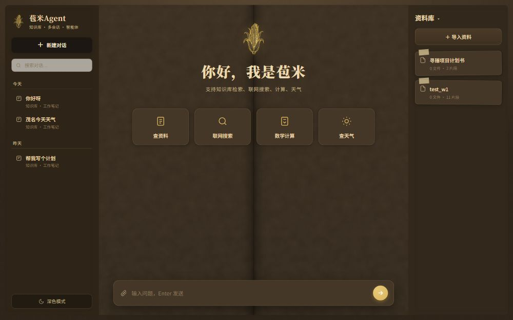
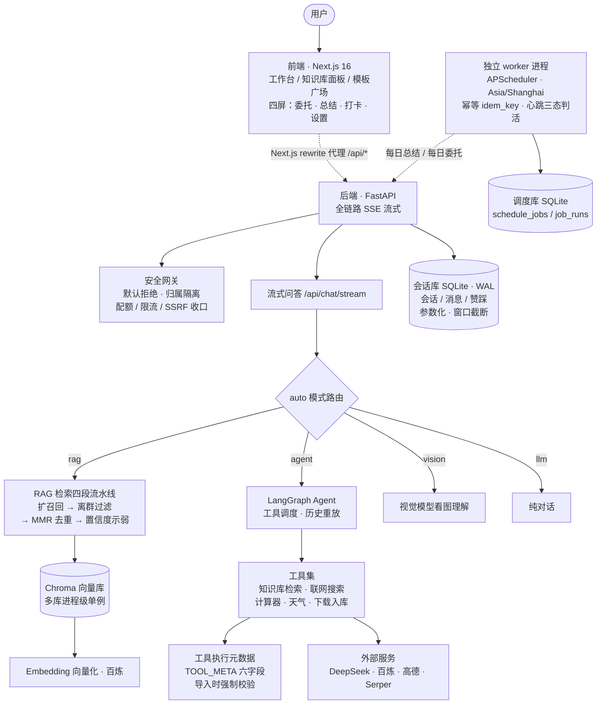

<div align="center">

# 🌽 知穗 Agent

**把 RAG 知识库、多会话和工具调用，装进一本摊开的纸质笔记本 —— 并让它在后台慢慢记住你。**

面向大学生的 **Agent 个性化学习助手**，覆盖**备考**（试卷 / 知识梳理）与**求职**（简历 / 面试演练）两条主线，底层 Agent 逻辑复用。核心理念是「**辅助学习而非替代思考**」。


| 浅色 · 暖米黄糙纸 | 深色 · 深棕木桌 |
|:---:|:---:|
|  |  |

</div>

---

## 📌 实现状态（先说清楚，免得上手扑空）

全部功能分支（`feat/ai-module-20261013`、`docs/team-standards-20261013` 等）**已合并进 `main`**，
`main` 即最新、可部署、可现场演示的版本。后端与前端**均已合入 `main` 并真实跑通**，已部署至线上。

| 能力 | 状态 |
|---|---|
| 知识库问答 / 多会话 / 五工具 / SSE 流式 / 模板广场 / 校园工具集 | ✅ 已上线（main） |
| 四屏控制台**前端**（每日委托 / 每日总结 / 打卡记录 / 设置） | ✅ 前端已上线 |
| 对应后端接口（委托 / 总结 / 调度 / 工具元数据 / hybrid 工作流） | ✅ 已合入 main 并部署 |
| 独立调度 worker（APScheduler，每日总结与委托定时执行） | ✅ 已上线（`deploy.sh` 自动拉起第三进程） |
| 对话**蒸馏**入库 · **标签钩子** · 学习画像 · 蒸馏检索 | 🚧 **规划中**（仅接口契约 / 静态目录，无独立实现） |
| 打卡记录**后端**接口 `/api/checkin/*` | 🚧 **未实现**——前端按本地记录推算连续天数，页面如实标注「接口待上线」 |

> 想本地看完整功能：`git checkout main` 后按下方「快速开始」启动即可。四屏里**打卡记录页**因后端接口尚未实现，
> 目前显示「接口待上线」+ 本地推算（这是如实标注，不是故障）；每日委托 / 每日总结两屏已是真实后端驱动。

**已知取舍**：知识库存储当前是 **Chroma 向量库**，「可读可改的文本文件 + 结构化标签 + 全文检索」是**规划方向**，尚未实现。向量化走阿里百炼 API —— 因此「数据不出校」的说法在当前实现下**不成立**，本项目对外只声称「用户数据按 owner 强制隔离、不进入公共语料」。

---

## 它能做什么

**知识库问答，带出处。** 上传 txt / Markdown / PDF，切片、向量化、检索、生成一条龙。回答里的 `[1][2]` 角标能点开原文片段核对；知识库里没有的，它会明说，不硬编。

检索不是简单取 top-k，而是**四段流水线**：候选池扩召回（默认 3 倍，下限 12）→ 丢掉余弦相似度低于 0.25 的 → 用 MMR（λ=0.65，字符 2-gram Jaccard）去掉互相重复的相邻切片 → 截到 top-k —— 避免「三条引用里两条是同一段话」把名额占满。

**说不准就说说不准。** 最后一道是**置信度示弱**：最高相似度低于 0.45 时，回答会明确提示「依据不足」，而不是硬编一个像模像样的答案。切片长度 500 / 重叠 50。

**多会话，各管各的。** 新建、切换、重命名、删除；每个会话有独立历史，可以绑定不同的知识库。聊完第一轮，标题自动起好。回答可以赞/踩，反馈按消息 id 落到库里。

**四种回答模式。** `auto` 自己判断走检索还是走 Agent，也可以手动锁死 `rag` / `agent` / `llm`。

**会调工具，五个。** 知识库检索、联网搜索（Serper）、数学计算、天气查询（高德 + Open-Meteo 双源）、文件下载入库。调了哪个工具、传了什么参数、返回了什么，界面上实时可见。

**图片也看得懂。** 输入框别上一枚回形针，发图片走视觉模型理解；绑了知识库的话，检索结果会一并拼进上下文。

**联网资料直接入库。** 给一个 URL 就能抓进来；也可以先搜索预览，勾选之后批量导入，网页正文自动清洗成知识片段。

**流式到字节。** 全链路 SSE：状态提示、工具调用、增量 token、引用角标、会话标题，全是流式推送，不用干等。

**问天气不用报城市。** 开了定位就自动带上。这条链路做过专门降级：浏览器定位（HTTPS / localhost 才有）→ 服务端按来源 IP 推断城市 → 手动输入，三级都不会卡死你。

**模板广场（已转型）。** 原先的 8 个校园场景模板（考研 / 论文 / 期末 / 求职 / 四六级 / 社团 / 文献 …）仍在，但**它的定位变了**。盘完现状后确认：模板广场是「一次性的起点供给」（建库 + 开场白，用一次就完），而每日委托 / 每日总结是「持续性的陪伴机制」（天天用）；而模板谁来都一样，恰恰**不体现个性化**。首屏因此从「四宫格平级」改成**主次两层** —— 主线放天天用的三个入口（每日委托 / 每日总结 / 打卡记录），模板广场退到辅路；同时给每个模板加「设为每日委托」，把一次性资产接进持续机制。

**四屏控制台（本轮新增）。** 侧栏四个入口，各自一屏：**每日委托**（填写当日产出、原理与问题 → Agent 反馈）、**每日总结**（思维导图式打卡复盘）、**打卡记录**、**设置**。手机端整体可滚动 —— 用的是 `100dvh` 而不是 `vh`，因为移动端地址栏收放会改变视口高度。

**工具执行元数据（本轮新增）。** 每个工具在 `core/tool_registry.py` 里声明七件事：类别 / 是否延迟发现 / 可重试 / 需审批 / 输出上限 / 成本提示。**导入时强制校验与工具集一一对应，漏配直接起不来** —— 宁可启动失败，也不要运行到一半才发现某个工具没有元数据。

**定时任务跑在独立进程里（本轮新增）。** APScheduler 单独一个 worker，按 `Asia/Shanghai` 时区调度。幂等靠 `UNIQUE(idem_key)` + `ON CONFLICT DO NOTHING`；存活靠心跳年龄判三态（`up` / `stalled` / `down`，见 `GET /api/schedule/health`）。诚实的代价是：`deploy.sh` 要多管一个进程。

**成本有护栏。** 定时任务单独配额（`auto` 120/日）。此前定时任务烧的 token **不在任何配额里**，是个敞口 —— 现在补上了。

## 🎨 一本笔记本该有的样子

界面没走 SaaS 后台的路子。它是暖米黄的糙纸、深棕的墨、一点成熟的玉米金（`#C8892A`）—— 金只做点缀，很克制。中间有一道书脊装订线，知识库卡片像贴在本子上的便签，输入框旁边别着一枚回形针。

这套视觉不是拍脑袋画的，背后有一套完整的设计令牌体系：

- 明暗双主题：暖米黄纸 ↔ 深棕木桌，一键切换
- 明度三级阶梯、圆角四档、字号七档、中性填充四级
- 语义色成对出现：实心版压白字，文字版上纸底，逐档验过 WCAG AA（≥4.5:1）
- 令牌体系参照 [LobeHub 的 DESIGN.md](https://github.com/lobehub/lobehub) 做过逐层对照，过程记录在 [`docs/设计令牌对照_LobeHub.md`](docs/设计令牌对照_LobeHub.md)

## 🚀 快速开始

**Windows 一键启动**：双击 `start.bat`，后端 `:8000` + 前端 `:3000` 一起起。

**手动启动**：

```bash
# 1. 后端
pip install -r requirements.txt

# 2. 配置密钥：复制 .env.example 为 .env，填入你的 key
python main.py                # 后端 http://localhost:8000

# 3. 前端（另开一个终端）
cd frontend
npm install
npm run dev                   # 前端 http://localhost:3000
```

前端的 `/api/*` 请求会由 Next.js rewrite 代理到后端，所以不用配跨域，也不用在前端写后端地址。

需要配置的密钥：

| 变量 | 必填 | 用途 |
|---|:---:|---|
| `DEEPSEEK_API_KEY` | ✅ | 对话模型（DeepSeek） |
| `EMBEDDING_API_KEY` | ✅ | 文档向量化（阿里百炼 DashScope） |
| `EMBEDDING_BASE_URL` | ✅ | 向量化服务地址（ OpenAI 兼容端点） |
| `AMAP_API_KEY` | 可选 | 天气工具 + 逆地理（高德地图） |
| `SERPER_API_KEY` | 可选 | 联网搜索（Serper） |
| `VISION_API_KEY` | 可选 | 图片理解，不填时回落到 `EMBEDDING_API_KEY` |

健康检查：`GET http://localhost:8000/health`

> 版本锁死的坑：`langchain-chroma 1.x` 要求 `chromadb 1.x`，部分环境装不上。本项目固定用
> `langchain-chroma==0.2.3 + chromadb==0.5.23`，两者互相兼容，别单独升级其中一个。

## 🛠️ 部署到服务器

项目自带 `deploy.sh`，一条命令完成拉代码、装依赖、构建前端、重启服务：

```bash
bash deploy.sh start      # 首次部署
bash deploy.sh deploy     # 完整更新（动了 frontend/src/** 必须用这条）
bash deploy.sh restart    # 只改了 Python，跳过前端构建
bash deploy.sh status     # 看服务状态
bash deploy.sh logs       # 看日志
```

详细流程、踩坑记录和报错对照表见 [`部署说明.md`](部署说明.md)。

## 🏛️ 系统架构



> 设计要点：前端只跟后端说话（同源代理，无需配 CORS）；后端**默认要登录**，每个业务端点都挂了鉴权依赖；多用户数据按 `owner` 强制隔离，归属校验失败返回 404 而非 403，避免 id 可枚举。
> 调度库与会话库是**两个独立的 SQLite 文件** —— 跨库查表是本项目踩过的坑（`GET /api/delegate/{id}/runs` 曾因此 500）。

## 🏗️ 技术栈

| 层 | 选型 |
|---|---|
| 对话模型 | DeepSeek `deepseek-chat`（OpenAI 兼容接口） |
| 视觉模型 | 阿里百炼 `qwen-vl-plus`（图片理解） |
| 向量化 | 阿里百炼 `text-embedding-v3` |
| Agent 框架 | LangChain `create_agent` + LangGraph（**依赖已就绪，但当前 checkpointer = `None`**） |
| 向量库 | Chroma（多 collection 隔离，进程级单例） |
| 会话存储 | SQLite（WAL 模式，参数化查询，30 轮窗口截断） |
| 调度存储 | SQLite 独立文件 `data/scheduler.db`（与 APScheduler JobStore 共用） |
| 定时调度 | APScheduler 3.x，**独立 worker 进程**，cron 按 `Asia/Shanghai` |
| 后端 | FastAPI + uvicorn，SSE 手写 `StreamingResponse` |
| 联网搜索 | Serper API（统一入口 `core/serper.py`，连接复用 + TTL 缓存 + single-flight） |
| 天气 | 高德地图 + Open-Meteo 双数据源 |
| 前端 | Next.js 16 · React 19 · Tailwind CSS v4 · LXGW WenKai |

> **关于 LangGraph checkpoint：依赖装了，但代码里故意没挂。**
>
> `requirements.txt` 里 `langgraph-checkpoint` 与 `langgraph-checkpoint-sqlite` **都已就绪**，
> 但 `agent/builder.py::_make_checkpointer()` **明确返回 `None`** —— 这是三条实测结论，不是遗漏：
>
> 1. **等于记两份。** 会话历史本来就在 SQLite（`core/session.py`），`api/chat.py` 每轮把完整历史
>    重建成 messages 喂进来。再挂 checkpoint，这份还只在进程内存里。
> 2. **会重复累积（已实测）。** 第 2 轮状态里第 1 轮的消息出现 2 次，白烧 token，
>    模型还会看到重复提问（3 轮后状态 12 条，本应 6 条）。
> 3. **两个直觉改法都是错的。** `SqliteSaver.from_conn_string()` 返回的是上下文管理器不是 saver，
>    每次对话直接抛 `TypeError`；改成 `SqliteSaver(sqlite3.connect(...))` 也不行 —— 同步 saver
>    不支持 `astream`，必须用 `AsyncSqliteSaver` 并在 lifespan 里 async 打开。
>
> **将来真要挂，必须同时做两件事**：改用 `AsyncSqliteSaver`，**并且**让 `api/chat.py` 只发当前
> 这一条消息、别再重放历史 —— 否则就是上面第 2 条的重演。完整论证在
> `agent/builder.py:_make_checkpointer()` 的注释里，回归测试是 `tests/test_agent_checkpointer.py`。

## 📁 目录结构

> 下面是 **`main` 分支**的完整结构（AI 模块已合并进来，不再有独立功能分支）。

```
知穗agent/
├── main.py                # FastAPI 入口（路由挂载 / CORS / 尾斜杠归一中间件）
├── core/
│   ├── config.py          # 集中配置（密钥 / 路径 / 检索策略参数）
│   ├── llm.py             # get_llm() / get_embeddings() / get_vision_llm()
│   ├── session.py         # SQLite 会话 / 消息 / 赞踩存储
│   └── upload.py          # 流式上传（大小预检 + 分块写盘 + 失败清理）
├── kb/
│   ├── rag_core.py        # RagPipeline + Chroma 单例 + select_diverse 检索重排
│   ├── pipelines.py       # 多知识库注册表（按库并发锁 / 原子写文件清单）
│   └── importer.py        # 联网导入（Serper 搜索 / URL 抓取 / 文件下载）
├── agent/
│   ├── builder.py         # build_agent()（create_agent + 5 工具）
│   └── tools.py           # kb_search / web_search / calculator / get_weather / download_file
├── api/
│   ├── chat.py            # SSE 流式问答（vision / rag / agent / llm）
│   ├── kb.py              # 知识库路由（上传 / 文件级管理 / 重建 / 导入）
│   ├── sessions.py        # 会话 CRUD + 整轮删除
│   ├── feedback.py        # 赞踩反馈
│   ├── geo.py             # 公网 http 下的服务端 IP 定位兜底
│   └── schemas.py         # Pydantic 模型
├── tools/                 # 性能压测脚本（stress_test.py / stress_live.py）
├── frontend/              # Next.js 16 前端（苞米地笔记本主题）
│   └── src/app/styles/    # 设计令牌与全套样式
├── 规范/                   # 团队规范（架构 / 数据结构 / 分支与提交 / 决策记录）
├── deploy.sh              # 服务器一键部署 / 更新
├── docs/                  # 设计文档 / 视觉审查 / 每日扫描报告 / 截图
└── tests/                 # W1–W3 全链路 + 7 个离线回归
```

**AI 模块（原 `feat/ai-module-20261013`，已合并进 main）**：

```
├── core/
│   ├── scheduler.py       # 调度底座：schedule_jobs / job_runs / worker_heartbeat 三表
│   └── tool_registry.py   # TOOL_META 六字段，导入时强制校验
├── worker/
│   └── scheduler.py       # 独立 APScheduler 进程（Asia/Shanghai）
├── service/
│   └── daily.py           # 总结与委托的纯函数核心（LLM 可注入）
├── api/
│   ├── delegate.py        # 每日委托（7 条端点）
│   ├── report.py          # 每日总结（5 条端点）
│   ├── schedule.py        # 调度可观测：health / jobs / run-now / runs / retry
│   └── agent.py           # 工具元数据：GET /api/agent/tools 等（2 条端点）
├── kb/distill*            # 蒸馏检索 —— 只有接口契约，未实现
└── docs/AI模块-20261013/   # 该轮完整交付（六个决定 / 接口契约 / 测试用例 / 验证记录）
```


## 🔌 API 一览

<details>
<summary><b>会话 <code>/api/sessions/</code></b></summary>

| 方法 | 路径 | 说明 |
|---|---|---|
| POST | `/` | 新建会话（`{title, kb_id?}`） |
| GET | `/` | 列出所有会话（按更新时间倒序） |
| GET | `/{sid}/` | 会话详情 + 消息历史（最近 10 轮） + 全量 `message_count` |
| PATCH | `/{sid}/` | 重命名 / 绑定知识库（`kb_id` 传 `null` 解绑） |
| DELETE | `/{sid}/` | 删除会话 |
| DELETE | `/{sid}/messages/{msg_id}/` | 删除这一整轮（user + 后续 assistant） |

</details>

<details>
<summary><b>知识库 <code>/api/kb/</code></b></summary>

| 方法 | 路径 | 说明 |
|---|---|---|
| POST | `/create` | 登记知识库（中文名亦可），返回内部 `kb_id` |
| GET | `/` | 列出所有知识库（含片段数与文件清单） |
| GET | `/{kb_id}/` | 查看库状态（chunks / 切片参数 / 文件） |
| DELETE | `/{kb_id}/` | 删除知识库（连原始留档一起清） |
| POST | `/{kb_id}/upload` | 上传 txt/md/pdf，`mode=append`（默认）或 `rebuild` |
| GET | `/{kb_id}/files` | 列出库内文件 |
| DELETE | `/{kb_id}/files` | 删除单个文件（清片段 + 删留档 + 更新清单） |
| GET | `/{kb_id}/file-content` | 预览文件正文（优先读留档，老库从向量片段拼回） |
| POST | `/{kb_id}/rebuild` | 按新切片参数重建整库 |
| POST | `/{kb_id}/query` | 同步问答（返回 `{answer, refs}`） |
| POST | `/import-search` | 联网搜索预览（返回候选 URL 供勾选） |
| POST | `/{kb_id}/import-url` | 抓取单个 URL 入库 |
| POST | `/{kb_id}/import-batch` | 批量抓 URL 入库 |
| GET | `/download` | 把远程文档代理下载到浏览器 |

</details>

<details>
<summary><b>流式问答 <code>/api/chat/stream</code>（SSE）</b></summary>

请求体：`{sid, question, top_k?, kb_id_override?, mode?, attachments?, location?}`
`mode` 默认 `auto`（绑定了非空知识库走 RAG，否则走 Agent）；带图片附件时自动进 `vision` 分支。

事件协议：

| event | data | 说明 |
|---|---|---|
| `status` | `{text}` | 进度提示（正在检索 / 检索到 N 条 / 正在生成…） |
| `tool` | `{name, input?}` / `{name, output?}` | Agent 工具调用发起 / 返回 |
| `sources` | `{items: [...]}` | 引用溯源条目（含 `score` 余弦相似度、原文片段） |
| `token` | `{text}` | **增量** token，前端自己累加（`text` 不是全文） |
| `title` | `{title}` | 自动生成的会话标题（仅首轮） |
| `done` | `{answer, refs, title, mode, message_id}` | 轮次结束，`message_id` 供赞踩按 id 落库 |
| `error` | `{detail}` | 错误信息（已翻译成中文，不吐英文栈） |

</details>

<details>
<summary><b>其他</b></summary>

| 方法 | 路径 | 说明 |
|---|---|---|
| POST | `/api/chat/upload` | 上传聊天附件（图片），返回服务端路径供视觉模型消费 |
| POST | `/api/feedback/` | 赞踩反馈（`{sid, message_id, rating}`） |
| GET | `/api/geo/locate` | 服务端按来源 IP 推断城市（浏览器定位不可用时的兜底） |
| GET | `/api/config/defaults` | 前端默认参数（chunk_size / chunk_overlap / top_k） |
| GET | `/health` | 健康检查 |

</details>

## 🧪 测试

```bash
python tests/test_w1.py   # RAG 全链路（需后端已启动）
python tests/test_w2.py   # 会话 + SSE 流式（需后端已启动）
python tests/test_w3.py   # Agent 多工具 + 联网导入（需后端已启动）
```

另有 7 个**离线回归**（不联网、不起服务，跑几十毫秒，专门盯住踩过的坑）：

```bash
python tests/test_retrieve_select.py      # 检索四段流水线（含相似度换算守卫与置信度示弱）
python tests/test_chroma_singleton.py     # Chroma 客户端单例
python tests/test_upload_stream.py        # 上传分块写盘 + 失败清理
python tests/test_pipelines_concurrency.py# 多库并发读写
python tests/test_slash_no_redirect.py    # 尾斜杠不再 307
python tests/test_agent_checkpointer.py   # 确认不挂 checkpoint
python tests/test_geo_locate.py           # IP 定位三级降级
```

### AI 模块（已合并进 `main`）

```bash
python -m pytest -q                       # 72 passed + 18 subtests（改动前基线 28，只增不减）
```

| 项 | 结果 |
|---|---|
| 自动化测试 | **72 passed + 18 subtests** |
| 新增端点 | **34 条**（工具 2 / 调度 5 / 总结 5 / 委托 7 / 蒸馏 5 / 编排 10） |
| 真机冒烟 | 29 项全过（起真实 uvicorn 打真实 HTTP） |
| 接口文档 | 静态 13 项 + headless Edge 25 项双校验通过 |
| 未完成 | 蒸馏检索实现 · 标签钩子 · 打卡记录后端接口 · 学习画像 |

> 手上没有 Python 3.12 会装不上：`requirements.txt` 钉死的 `chromadb==0.5.23`
> 在 3.14 上装不了。详见 `docs/AI模块-20261013/README.md`。

## 📊 性能实测

`tools/stress_test.py`（留档用）/ `tools/stress_live.py`（现场演示，**零第三方依赖**）。
以下为阿里云 2 核 2G 机器上的实测基线，**全程 0 失败**：

| 场景 | 并发 | P50 |
|---|---|---|
| 只读接口 | 8 | 33.7 ms |
| SSE 问答（端到端） | 3 | 1.64 s |
| 文档上传 | 3 | 2.78 s |

并发从 1 涨到 3，问答延迟基本持平，说明没有排队。上传那条接近线性，瓶颈在外部向量化接口。

## 🗺️ 路线图

项目起自一份 8 周课程的三次作业（RAG、会话、Agent），后来长成了现在这个样子。

- **W1** RAG 全链路 ✅
- **W2** SQLite 多会话 + SSE 流式 ✅
- **W3** Agent + 5 工具 + 联网导入 ✅
- **W4** 前端界面（苞米地笔记本主题，明暗双态）✅
- **W5** 打磨交付 ✅ —— 设计令牌收敛四轮（填充 / 字号 / 语义色 / 间距）；赞踩反馈打通；
  移动端四屏可滚动；模板广场转型为「委托模板」并让位给持续机制
- **W6** AI 模块 ✅（已合并 `main` 并部署）—— 工具执行元数据注册表、独立调度 worker、
  每日总结与每日委托端点已完成并通过 72 项测试并上线；**蒸馏检索与标签钩子、打卡后端接口、学习画像仍为规划项**

每日的代码扫描报告在 `docs/前后端可更新点_YYYY-MM-DD.md`，里面记了每一轮查出来的问题、
哪些已修、哪些还欠着 —— 包括踩过的坑和当时的实测数据。

AI 模块那一轮的完整交付（六个决定与否决理由、接口契约、测试用例、验证记录）在
[`docs/AI模块-20261013/`](docs/AI模块-20261013/README.md)。

---

<div align="center">

🌽 知穗 Agent · 知识库 · 多会话 · 智能体

</div>
