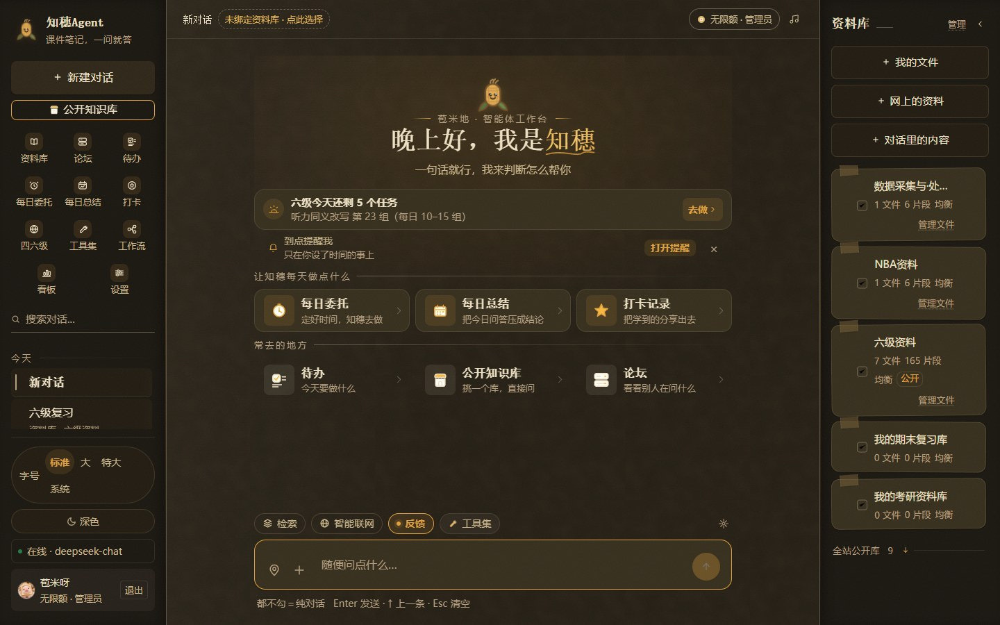
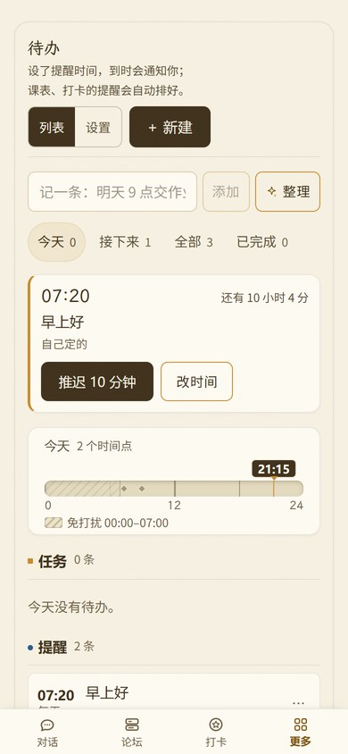

<div align="center">

# 🌽 知穗 Agent

**把资料、讨论、待办和问答，收进一本摊开的纸质笔记本。**

面向大学生的 AI 学习工作台。线上在跑：[**myzhisui.cn**](https://myzhisui.cn)

[](https://www.python.org/)
[](https://fastapi.tiangolo.com/)
[](https://python.langchain.com/)
[](https://www.trychroma.com/)
[](https://nextjs.org/)
[](https://react.dev/)
[](https://tailwindcss.com/)
[](https://web.dev/progressive-web-apps/)
[](LICENSE)

| 浅色 · 暖米黄糙纸 | 深色 · 深棕木桌 |
|:---:|:---:|
|  |  |

</div>

---

## 一、这个仓库现在是什么

三周前这份 README 写的是「RAG 知识库 + 多会话 + Agent 工具集」。现在的东西比那多：

| 这三周长出来的 | 一句话 |
|---|---|
| **论坛** | 6 个板块的图文讨论区，先发后审，可举报、可申诉 |
| **待办与提醒** | 一句话交给 AI 整理成条目，自己勾选要不要放进待办、要不要提醒；课表与截止时间同一条时间轴 |
| **公开知识库** | 同学分享的库可以浏览、收藏、复制成自己的；里面还有一区**官方知识库**（9 门课 73 份资料） |
| **命名收口** | 界面里「知识库」这个混着技术味的词被拆成三个各指一件事的说法（见第二节） |
| **界面重排** | 首屏从四宫格改成六格两组；对话页正文每行 16.8 → 19.4 字；纸张铺到视口边缘 |

对话、资料库、论坛、待办是现在并立的四件事。**备考与求职**仍是定位，但用户每天真正打开它，是因为这四件事在同一个地方。

## 二、品牌：两次改名、一次改口、一套命名

这一段单独写，因为它是这三周里改动最"轻"、返工最多的一块 —— 代码一行没错，但每改一次都要同时动界面、文案、海报、公告和守卫。

### 2.1 名字改过两次，而且是在同一天晚上

| 时间 | 从 | 到 | 说明 |
|---|---|---|---|
| 2026-10-12 22:00 | 苞米Agent | 知慧Agent | 第一次改名，玉米吉祥物与「苞米地笔记本」设计语言都保留 |
| 2026-10-12 23:51 | 知慧Agent | **知穗Agent** | 同一天深夜定稿；README、CHANGELOG、部署脚本、模板目录一起改 |

「苞米」留在了设计语言里：纸是糙纸、墨是深棕、金是玉米金，中间一道书脊装订线。名字换了，但那本笔记本没换。

### 2.2 图标：从方块贴纸到 App

2026-11-07 之前，Windows 桌面快捷方式是一张**直角方块**。用户的原话是"像贴纸，希望像抖音、豆包那样是圆角"。桌面系统和必应都不会替应用切圆角，只能在图里烘进去（22%）：

- 新增 `icon.svg`（圆角 + 纸色底），favicon 的 SVG 入口改指它
- `favicon.ico`、`icon-192/512` 全部换圆角版
- 另出 `icon-maskable-*`（满铺）：Android 自己会套遮罩，给圆角图会被切成双层
- `apple-touch-icon` 保持满铺 —— iOS 同理，圆角套圆角会很难看
- 桌面图标名从「知穗Agent · 大学生 AI 素养平台」精简为 **「知穗Agent」**，不再被截成「知穗Agent · 大学…」

### 2.3 界面命名：三个词，各指一件事

这是最容易被忽略、也最容易出错的一处。原先界面上「知识库」同时指三样东西，用户会以为导航里那个是另一处。

| 说法 | 指什么 | 在哪 |
|---|---|---|
| **资料库** | 我自己的库（上传、切片、检索） | `/knowledge` |
| **公开知识库** | 所有人可检索的广场，含同学分享的库 | `/library` |
| **官方知识库** | 广场里**官方自建**的那一区：9 门课、73 份资料 | `/library` 顶部分区 |

改口的顺序是：先「知识库 → 资料库」（2026-11-14 15:28，侧栏与页标题原本就不一致），再「广场 → 公开知识库」（2026-11-15 11:44），最后「官方课程库 → 官方知识库」（2026-11-15 晚，用户原话"那个不叫课程库"）。

改一个名字要同时改四处：**侧栏标签、页面眉题、详情页副标题、后端返回的 `source` 展示串**。少改一处，收藏卡片上就会出现「来源：官方课程库」而它上面那区写着别的词。守卫 `tests/test_naming_consistency.py` 按**整词**白名单检查（`公开知识库` / `官方知识库` 两个词豁免，写「个人知识库」照样红）。

### 2.4 「AI 助手」是对外称呼，不是全站替换

2026-11-15 定：对外文案（公告、海报、朋友圈）统一叫 **「AI 助手」**。

但界面里已经用惯的说法**一个都没改**：待办里仍是「让助手帮我写」，对话沉淀窗仍是「助手的分析」，新手引导仍是「知穗是个会自己动手的学习助手」。

第一版我按"术语统一"把这几处全换了，用户当场否掉：「那个说辞不要改变，就是不要全站替换」。理由是站得住的 —— **界面里用惯的说法是资产**，为了术语整齐让用过的人重新认一遍按钮，换来的只是文档好看。守卫因此改成窄的一条：只禁**新造的名字**（`AI助手`/`AI助理`/`智能助手`…），绝不查裸「助手」。

> 一句话总结这块的分寸：**名字对外统一，界面尊重既有习惯，改内容必须换公告 id**（`2026-11-c` → `2026-11-d`，否则读过的人永远停在旧文案，而且不报错）。

## 三、线上现在有什么

| 模块 | 是什么 | 状态 |
|---|---|---|
| **对话** | 检索 / 智能联网 / 纯对话三种模式，工具调用全过程可见，回答带可点开的引用 | ✅ |
| **资料库** | 上传 txt / md / 文字版 PDF，切片、向量化、检索；文件级管理、重建、联网导入 | ✅ |
| **公开知识库** | 广场：官方区 + 同学分享区；可收藏、可复制成自己的库、可设公开 | ✅ |
| **官方知识库** | 9 门课 73 份资料（题库 / 讲义 / 模板），在线阅读与下载，公式正常渲染 | ✅ |
| **论坛** | 6 板块、图文发帖（单帖 9 图）、楼中楼回复、搜索、举报、下架申诉 | ✅ |
| **待办与提醒** | AI 一句话整理、四档优先级、任务/提醒两段、6 个来源开关、4 种送达方式 | ✅ |
| **打卡** | 每日打卡、连续天数、月历、生成图文分享 | ✅ |
| **每日委托 / 每日总结** | 定时任务生成与复盘，独立 worker 进程调度 | ✅ |
| **工具集** | GPA 分析、番茄钟、课程表、单词卡、倒计时、群抽签（独立单页，免登录） | ✅ |
| **四六级** | 计划 / 词汇本 / 模考分数 | ✅ 桌面专属 |
| **看板** | 用户、调用、失败、反馈（仅管理员；手机也能进） | ✅ 管理员 |
| **工作流** | 混合编排的定义与调试面（可编辑 JSON、UUID 列表） | ✅ 管理员 + 桌面专属 |
| **学习路径** | 12 关，条件取真实数据（资料份数 / 打卡天数 / 掌握词数 / 模考分数） | ⚠️ 页面与接口保留，**导航入口已按用户要求关闭** |
| **蒸馏检索** | 对话沉淀入库后参与检索 | 🚧 规划中，仅接口契约 |
| **能力评估集 / GEPA 自进化** | 样本量与验收口径待定 | 🚧 规划中 |

手机端底部只有三格（对话 / 论坛 / 打卡）+「更多」，其余落在「更多」面板里；**四六级与工作流是桌面专属** —— 判断标准不是"常不常用"，而是"390 宽能不能把这件事做完"（工作流要编辑 JSON，做不了）。

## 四、四条主线

### 4.1 问：说一句就行

输入框上方两枚开关：「检索」先翻你的资料再答，「智能联网」才会上网查最新信息，两个都不开就是纯对话。剩下的它自己判断 —— 直接答、翻资料、还是先给你排一个计划。

检索不是简单取 top-k，而是**四段流水线**：候选池扩召回（默认 3 倍、下限 12）→ 丢掉余弦相似度低于 0.25 的 → MMR（λ=0.65，字符 2-gram Jaccard）去掉互相重复的切片 → 截到 top-k。最高相似度低于 0.45 时明确示弱「依据不足」，不硬编。

Agent 手里 4 件工具：**知识库检索 / 联网搜索 / 天气查询 / 文档下载入库**。调了哪个、传了什么参数、返回了什么，界面上实时可见。

全链路 SSE：状态提示、工具调用、增量 token、引用角标、会话标题，都是流式推的。

### 4.2 存：资料库、公开知识库、官方知识库

上传文件后切片、向量化（阿里百炼 `text-embedding-v3`）、检索。回答里的 `[1][2]` 能点开原文片段核对；资料里没有的，它会明说。

官方知识库那 9 门课是**逐库数出来的**：高数 11 / 线代 10 / 大物 19 / 形势与政策 17 / 数据结构 2 / 英语读写 2 / 思想道德与法治 4 / 中国近代史 4 / 大学生心理健康 4，合计 73 份。

同学的库可以「复制成自己的」再改，也可以把自己那份设为公开。公开前会确认可见范围。

### 4.3 聊：论坛

回答的是「资料讨论完，然后呢」—— 留言板挂在每个库下面，只能一条条库去看，没有"最近大家在聊什么"。

几条定下来的规矩：

- **6 个板块按话题类型分，不按课程分**：站务公告 / 课程答疑 / 求资料 / 学习经验 / 组队自习 / 库内容反馈。按库里分，左栏最后会变成第二个资料广场。
- **每条帖子都能追回来源库**（操作行右侧的库名 chip），论坛不是平行世界。
- **先发后审**：发出去就是公开的，管理员事后看到违规才下架，下架必填原因，作者在「我发的帖」里能看到原因并申诉 —— 所以这里没有"审核中"这个状态。
- **昵称自动起**，登录的署真名，没登录的拿设备 cookie 叫「玉米NNNN」。

视觉是贴吧式三栏（板块 / 帖子 / 说明），正文行宽从 52 字收到 40 字 —— 52 字一行在 1080 宽下读起来要左右摇头。

### 4.4 安排：待办与提醒

这是用户自己用了一周之后要求重点讲的一块。

- **一句话录入**：说一句或打几个字（"明天下午三点交高数作业，周三晚上自习"），`/api/capture/parse` 调模型拆成条目，**只出建议、不写库**；你在界面上逐条勾选，才调 `/api/tasks` 写入。所以文案写的是"你勾一下，加入"，不是"自动帮你加"。
- **任务与提醒是两份清单**：任务可勾选完成，提醒只能推迟或关闭来源 —— 它们的语义本来就不同，混在一张列表里会让人反复去勾一条勾不掉的提醒。
- **每条单独选要不要提醒**，时间说不清它会先问，不猜。
- **6 个来源可单独关**（四六级 / 打卡 / 番茄钟 / DDL / 背单词 / 每日委托），**4 种送达方式**（推送 / 站内 / 日历 / 本地）。
- 课表默认提前 20 分钟提醒；推送没送达时以邮件作为备用通道。

## 五、界面：一本摊开的笔记本

没走 SaaS 后台的路子。暖米黄的糙纸、深棕的墨、一点成熟的玉米金（`#C8892A`）—— 金只做点缀，表示"选中的 / 这是主操作"，hover 一律中性色。

| 手机 · 待办与提醒 | 公开知识库 |
|:---:|:---:|
|  |  |

| 论坛 · 三栏 |
|:---:|
|  |

几条硬规矩（违反即返工，`docs/知穗_UI设计规范_v0.1.md`）：

- **界面里不得出现 emoji 或花体字符当图标**，图标一律走手绘 `CornIcon`
- 明度只有三级（`--step-0/1/2`），面板与画布同档，分区靠 **1px 描边**而不是明度差
- 圆角四档，**不许出现直角**；抬起只有两档阴影，不出现重投影
- 浅底上的金字必须用 `--accent-ink`（`#875B10`），直接上 `#C8892A` 对比度不够
- 中文字体**全部离线**（`frontend/public/fonts/`，9 个字重）。字体子集缺字时会**逐字回退**成系统字体，看着像排版事故 —— 所以改文案引到子集外的字，要重跑 `tools/subset_fonts_project.py`
- 手机正文每行约 **19.4 字**。写文案贴着上限写，多一个字就会把末尾两个字挤到下一行（"…不受影 / 响"这种孤字，行数断言测不出来，只能截图看）
- 深色模式下的吉祥物重绘过一版：眼睛原先是一个发光点，深棕底上会散开，改成实色高光

页面可以「添加到主屏幕」当 App 用（`manifest.webmanifest` + 九张 iOS 启动图，避免打开瞬间闪白）。iOS 另有一条 Ad Hoc 内测线：100 台设备/年、按 UDID 登记，装完不需要「信任开发者」那一步。

## 六、本地运行

### 6.1 环境

| 项 | 要求 |
|---|---|
| Python | **3.12**（本地）／3.10（线上）。**不要用 3.13+**：`chromadb 0.5.23` 依赖的 `chroma-hnswlib` 只有 cp312 轮子 |
| Node | 20+（Next.js 16） |
| 依赖 | `pip install -r requirements.txt`、`npm install` |

Windows 上 `chroma-hnswlib==0.7.6` 没有 cp312 轮子，会现场编译并报 "Microsoft Visual C++ 14.0 or greater is required"。解法是用同为 0.7.6 代码、但有 win cp312 轮子的预发布版 `0.7.6a9`：

```bash
pip install chroma-hnswlib==0.7.6a9
pip install -r requirements.txt --no-deps
pip install chromadb==0.5.23 --no-deps
```

`pip check` 会一直提示 `0.7.6a9 != 0.7.6`，属已知噪音，运行正常。

### 6.2 启动

**Windows 一键**：双击 `start.bat`（后端 `:8000` + 前端 `:3000`）。

手动：

```bash
# 1. 后端
venv/Scripts/python.exe main.py          # http://localhost:8000

# 2. 前端（另开一个终端）
cd frontend
npm install
npm run dev                              # http://localhost:3000
```

前端的 `/api/*` 由 Next.js rewrite 代理到后端，不用配跨域，也不用在前端写后端地址。

> 本机若 `:3000` 被占用（VMware 常占），用 `npm run dev -- -H 127.0.0.1 -p 3100`。

### 6.3 密钥

| 变量 | 必填 | 用途 |
|---|:---:|---|
| `DEEPSEEK_API_KEY` | ✅ | 对话模型 |
| `EMBEDDING_API_KEY` | ✅ | 文档向量化（阿里百炼 DashScope） |
| `EMBEDDING_BASE_URL` | ✅ | 向量化服务地址（OpenAI 兼容端点） |
| `AMAP_API_KEY` | 可选 | 天气工具 + 逆地理（高德） |
| `SERPER_API_KEY` | 可选 | 联网搜索 |
| `VISION_API_KEY` | 可选 | 图片理解，不填时回落 `EMBEDDING_API_KEY` |

健康检查：`GET http://localhost:8000/health`

> 版本锁死：`langchain-chroma` 必须配 `chromadb 0.5.23`（1.x 要求 chromadb 1.x，装不上）。**不要单独升其中一个**。

## 七、部署

服务器是阿里云 2 核 2G（Ubuntu + nginx），三个进程走 systemd：`baomi-backend` / `baomi-worker` / `baomi-frontend`。

```bash
bash deploy.sh start      # 首次部署
bash deploy.sh deploy     # 完整更新（动了 frontend/src/** 必须用这条）
bash deploy.sh restart    # 只改了 Python，跳过前端构建
bash deploy.sh status     # 服务状态
bash deploy.sh logs       # 日志
```

三个必须知道的坑：

1. **`cp -a` 是覆盖合并不删旧文件**。仓库里删过或挪过的文件会在服务器上复活 —— 曾因 8 个页面挪进 `app/(console)/` 后两套路由并存，`next build` 报 two parallel pages。更新前先 `rm -rf /root/frontend/src`。
2. **部署后先校验静态资源**，别信"构建成功"。判据是 `BUILD_ID` 的 mtime 早于服务 `ExecMainStartTimestamp`，且 HTML 里每个 `/_next/static/**` 逐个 curl 200。构建后旧 HTML 引用的 chunk 会全部 404，复验必须重新抓页面。
3. **改了 `public/fonts/*` 也要传**：那是运行时读盘，不重新构建也生效，但不传就没有。

详细流程与报错对照见 [`部署说明.md`](部署说明.md)。

## 八、架构


设计要点：

- 前端只跟后端说话（同源代理，无需 CORS）；后端**默认要登录**，每个业务端点都挂鉴权依赖。
- 多用户数据按 `owner` 强制隔离，归属校验失败返回 **404 而非 403**，避免 id 可枚举。
- 调度库与会话库是**两个独立的 SQLite 文件** —— 跨库查表是本项目踩过的坑（`GET /api/delegate/{id}/runs` 曾因此 500）。
- 定时任务在**独立 worker 进程**里跑，幂等靠 `UNIQUE(idem_key)` + `ON CONFLICT DO NOTHING`，存活靠心跳年龄判三态（`up` / `stalled` / `down`）。

### 关于 LangGraph checkpoint：依赖装了，但故意没挂

`agent/builder.py::_make_checkpointer()` **明确返回 `None`**，这是三条实测结论，不是遗漏：

1. **等于记两份**：历史本来就在 SQLite，`api/chat.py` 每轮重建 messages 喂进来。
2. **会重复累积（已实测）**：第 2 轮状态里第 1 轮的消息出现 2 次，3 轮后状态 12 条（本应 6 条），白烧 token。
3. **两个直觉改法都是错的**：`SqliteSaver.from_conn_string()` 返回的是上下文管理器不是 saver；`SqliteSaver(sqlite3.connect(...))` 也不行 —— 同步 saver 不支持 `astream`。

将来真要挂，必须同时改用 `AsyncSqliteSaver` **并且**让 `api/chat.py` 只发当前这条消息。回归测试 `tests/test_agent_checkpointer.py` 盯着这条。

## 九、目录结构

```
知穗agent/
├── main.py                 # FastAPI 入口（路由挂载 / 尾斜杠归一）
├── core/                   # 配置 · 模型 · 会话 · 调度 · 工具注册表 · 论坛与待办核心
├── kb/                     # RAG 流水线 · 多库注册表 · 联网导入
├── agent/                  # Agent 构建与 4 件工具
├── api/                    # 36 个路由文件，195 条端点（见下节）
├── service/                # 纯函数业务核心（总结 / 打卡 / 论坛配图 / 提醒投递 …）
├── worker/                 # 独立 APScheduler 进程
├── hybrid/                 # 工作流编排（定义 / 条件表达式 / 存储）
├── frontend/
│   ├── src/app/            # App Router
│   │   ├── (console)/      # 控制台外壳：对话外的 11 个页面
│   │   ├── forum/          # 论坛（独立布局，三栏）
│   │   ├── library/        # 公开知识库广场 + 库详情
│   │   ├── login/ install/ # 登录 / 安装引导
│   │   └── styles/         # 设计令牌与全套样式
│   ├── public/fonts/       # 离线中文字体（9 个字重）
│   └── public/tools.html   # 工具集单页（GPA / 番茄钟 / 课表 …）
├── tests/                  # 134 个测试文件，2037 项
├── ops/                    # systemd / nginx / 云监控
├── docs/                   # 设计文档 · 日报 · 上线清单 · 宣传物料
└── deploy.sh               # 服务器一键部署 / 更新
```

`(console)` 组内 11 个页面：对话以外的 `dashboard / checkin / delegate / report / reminders / knowledge / cet / path / flow / tools / settings`。论坛、资料广场、登录页在组外，因为它们各有自己的外壳。

## 十、API

195 条 HTTP 端点，36 个路由文件。按域分组（**新端点一律不带尾斜杠**，否则 307）：

| 域 | 前缀 | 条数 | 说明 |
|---|---|:--:|---|
| 认证 | `/api/auth` | 10 | 注册 / 登录 / 登出 / 当前用户 / 改密 |
| 会话 | `/api/sessions` | 6 | CRUD + 整轮删除 |
| 问答 | `/api/chat` | 2 | SSE 流式 + 附件上传 |
| 资料库 | `/api/kb` | 28 | 建库 / 上传 / 文件级管理 / 重建 / 导入 / **公开库与官方库** / 收藏 / 复制 |
| 建库建议 | `/api/kb/proposals` | 4 | AI 建议的确认 / 忽略 / 查询（三态 + 过期） |
| 论坛 | `/api/forum` | 13 | 板块 / 话题 / 回复 / 图片 / 举报 / 我的 / 审核队列 |
| 待办 | `/api/tasks` | 10 | 增删改查 / 排序 / 批量 / 四档优先级 |
| 提醒中心 | `/api/reminders` | 12 | 列表 / 摘要 / 来源开关 / 偏好 / 到点记录 / 推迟 |
| AI 整理 | `/api/capture` | 3 | 一句话 → 条目建议（**只读，不写库**） |
| 推送 | `/api/push` | 5 | Web Push 订阅 / 退订 / 设备管理 / 自测 |
| 邮件 / 日历 / 上课 | `/api/mail`、`/api/calendar`、`/api/course-reminder` | 11 | 另外三条送达与联动通道 |
| 打卡 | `/api/checkin` | 4 | 连续天数 / 月历 / 生成 / 分享 |
| 每日委托 | `/api/delegate` | 7 | 委托 CRUD + 运行记录 |
| 每日总结 | `/api/report` | 3 | 生成 / 读取 |
| 调度 | `/api/schedule` | 5 | health / jobs / run-now / runs / retry |
| 四六级 | `/api/cet` | 11 | 计划 / 词汇本 / 复习 / 模考分数 |
| 学习路径 | `/api/path` | 1 | 12 关进度（入口已关，接口保留） |
| 工具集 | `/api/campus/focus`、`/api/campus` | 7 | 番茄钟同步 / 校园快照 |
| 看板 | `/api/admin` | 9 | 用户 / 调用 / 失败 / 反馈（非管理员 404） |
| 工作流 | `/api/hybrid` | 13 | 定义 / 规则 / 运行 |
| 工具元数据 | `/api/agent` | 2 | 工具清单与六字段元数据 |
| Prompt 自进化 | `/api/prompt-evo` | 8 | 评测与候选 |
| 其他 | 提醒时刻 / 指标 / 反馈 / 用户反馈 / 偏好 / 画像 / 检索增强 / 今日一屏 / 模板 / 用量 / 定位 | 21 | — |

SSE 事件协议（`/api/chat/stream`）：

| event | data | 说明 |
|---|---|---|
| `status` | `{text}` | 进度提示 |
| `tool` | `{name, input?}` / `{name, output?}` | 工具调用发起 / 返回 |
| `sources` | `{items}` | 引用溯源（含 `score` 与原文片段） |
| `token` | `{text}` | **增量** token，前端自己累加 |
| `title` | `{title}` | 自动生成的会话标题（仅首轮） |
| `done` | `{answer, refs, title, mode, message_id}` | 轮次结束 |
| `error` | `{detail}` | 已翻译成中文，不吐英文栈 |

## 十一、测试

```bash
venv/Scripts/python.exe -m pytest tests -q     # 2037 项
```

134 个测试文件，**2037 项**（2026-11-15 实测）。全量跑一遍需要几分钟。

`tests/` 里混着两类文件：pytest 风格（定义 `test_*` 函数）和脚本式自测（模块级执行 + `sys.exit`）。后者被 `pytest.ini` 逐文件 ignore —— 它们一旦被收集，会在收集阶段就把 `monkeypatch` 执行掉，撞上"临时库里没有 users 表"这种假错误。

这个项目在测试上有个不太常见的坚持：**全绿也要反证**。"该出现的东西出现了"不等于闸门正确，每条新守卫都要先故意改坏一次，确认它真的会红。这几周靠这条抓出来的假绿包括：

- `aria-disabled={!unlocked}` 命中了 `disabled={!unlocked}` 的子串断言
- 扫描断言没有数量下限，路径写错时扫到 0 个文件也算通过
- 删掉文件后 `not in src` 永真
- CSS 断言扫到注释里的规则，注释能红也能绿

## 十二、性能

`tools/stress_test.py` / `tools/stress_live.py`（零第三方依赖）。以下是阿里云 2 核 2G 上的实测基线，**全程 0 失败**：

| 场景 | 并发 | P50 |
|---|---|---|
| 只读接口 | 8 | 33.7 ms |
| SSE 问答（端到端） | 3 | 1.64 s |
| 文档上传 | 3 | 2.78 s |

并发从 1 涨到 3，问答延迟基本持平（没有排队）；上传接近线性，瓶颈在外部向量化接口。

## 十三、路线图与欠账

项目起自一份 8 周课程的三次作业（RAG / 会话 / Agent），后来长成了现在这样。

- **W1–W3** RAG 全链路 · SQLite 多会话 + SSE · Agent 工具与联网导入 ✅
- **W4–W5** 前端笔记本主题（明暗双态）· 设计令牌收敛四轮 ✅
- **W6–W7** 工具元数据、独立调度 worker、上下文工程与运维强化 ✅
- **第 8 周之后**（2026-11-08 → 11-15，8 天 159 次提交）论坛 · 待办与提醒重做 · 公开知识库与官方知识库 · 界面重排 · PWA 与 iOS 内测 ✅

**仍未做，且不假装做了：**

| 欠账 | 状态 |
|---|---|
| 蒸馏检索（对话沉淀后参与检索） | 只有接口契约，无实现 |
| 能力评估集 / LLM-as-Judge / GEPA 自进化 | 规划中，样本量未定 |
| 论坛页未并入控制台外壳 | 进论坛后侧栏与底栏消失，手机上只能靠浏览器返回（审计 P0-2） |
| 控制台 7 个页面的纸张未铺到边 | 仍是同色浮卡 + 四周留白 |
| 真机走查 | 全部验证在 headless 里完成，没有真机回归 |

**已知取舍**：向量化走阿里百炼 API，所以「数据不出校」在当前实现下不成立。对外只说「用户数据按 owner 强制隔离、不进入公共语料」。

## 十四、文档

| 想了解 | 去哪看 |
|---|---|
| 界面任何改动前 | [`docs/知穗_UI设计规范_v0.1.md`](docs/知穗_UI设计规范_v0.1.md) |
| 令牌真实值 | `frontend/src/app/styles/tokens.css`（照抄，不凭记忆） |
| 11/8–11/15 上了什么 | [`docs/11月8-15日上线清单_2026-11-15.md`](docs/11月8-15日上线清单_2026-11-15.md) |
| 第 3 期版本更新怎么写的 | [`docs/版本更新_第3期_2026-11-15.md`](docs/版本更新_第3期_2026-11-15.md) |
| 部署与排障 | [`部署说明.md`](部署说明.md) |
| AI 模块那一轮的完整交付 | [`docs/AI模块-20261013/`](docs/AI模块-20261013/README.md) |
| 变更历史 | [`CHANGELOG.md`](CHANGELOG.md)（停在 10-16，尚未补齐这三周） |
| 参与开发 | [`CONTRIBUTING.md`](CONTRIBUTING.md) |

---

<div align="center">

🌽 知穗 Agent · 对话 · 资料库 · 论坛 · 待办

<sub>辅助学习，而非替代思考。</sub>

</div>
