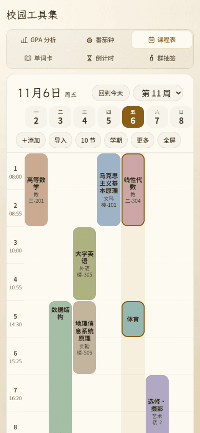
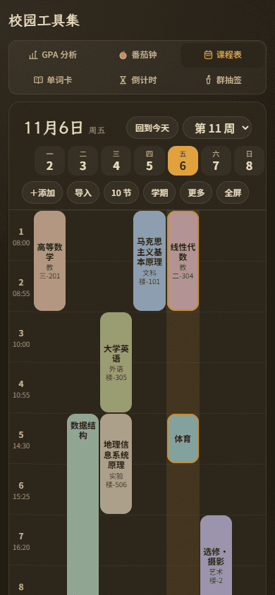
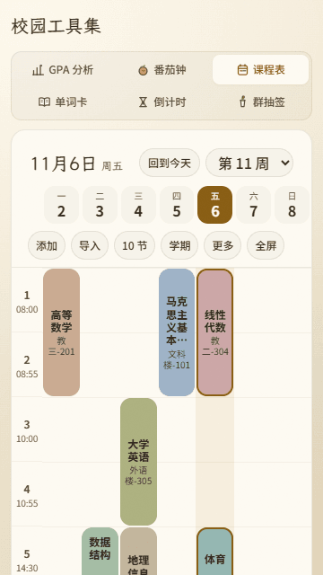
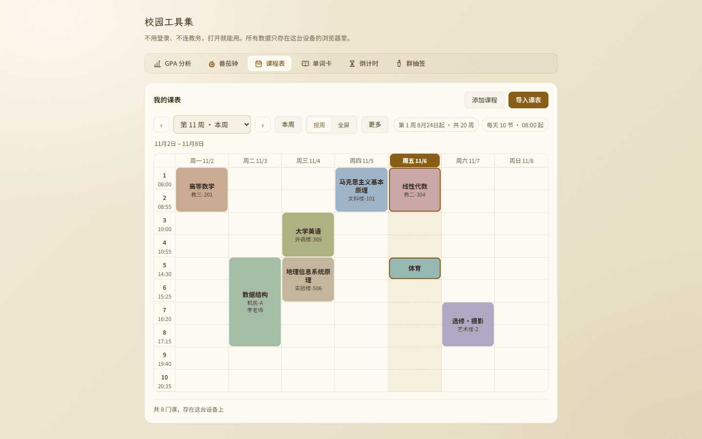
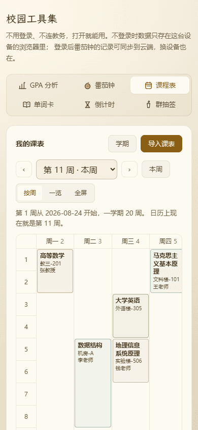
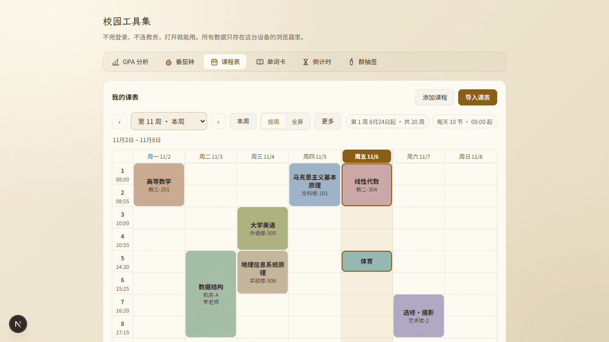
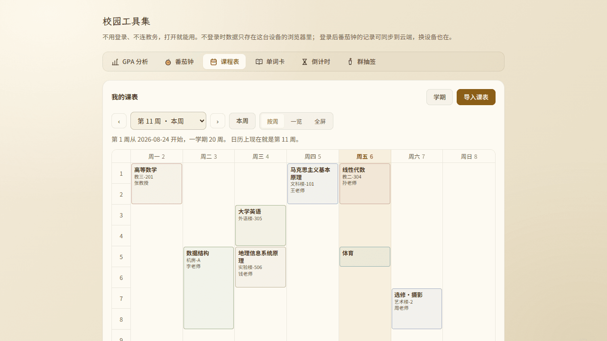
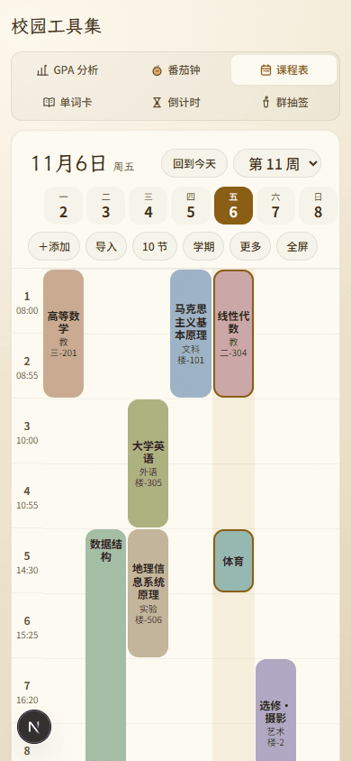

# 审核报告 · 本地端接真实线上 + 测试账号核验

> 审核通过前不得推送（本地 commit 可以，防丢失）。
> 本文件是**核验记录**，不是功能交付；不改变 `0.6.0–0.6.9` 各批的签章结论。

---

| 项 | 内容 |
| --- | --- |
| 报告日期 | 2026-11-06 |
| 开发者 | 橙子 |
| 审核人 | @baomi888 |
| 分支 | `school-tools` |
| 板块版本 | 0.6.9（本地开发版，未推送） |
| 线上地址 | `https://myzhisui.cn` |
| 核验账号 | `zsverify1106`（专用测试账号，口令已单独告知负责人，**不写进仓库**） |
| 浏览器控制 | 本机 Edge + CDP 完成首轮核验；Playwright MCP 已于 21:40 完成信任（`state=ready`、25 个 `browser_*` 工具），21:48 客户端 `restart + adopt` 后全量挂载；21:43–21:45 与 21:53 两次用同一配置端到端复验通过，见第 6 节 |

---

## 1. 做了什么

本地开发版知穗接到了**真实线上后端**：本地打开 `http://localhost:3000/tools`，登录的是线上站点的账号，
`/api/*` 实际打到 `https://myzhisui.cn`；再用同一个专用测试账号、同一份课表数据，在浏览器里把本地
与线上逐值量了一遍并截图。审核员不用自己搭环境，看下面的图和数据就能判断本地效果。

## 2. 为什么做

负责人口径：「在本地也接一个真实线上同步的本地端知穗，用一个测试账号专门用来核验本地效果，
然后使用浏览器控制插件」；确认单选择：**本地前端接线上后端 / 自己注册测试账号 / 安装 Playwright MCP /
核验范围为校园工具集 `/tools`**。

## 3. 改动文件

| 文件 | 改动 |
| --- | --- |
| `~/.workbuddy/mcp.json` | 新增，按官方标准写入并定稿为 `npx -y @playwright/mcp@latest --browser msedge --headless`（用户目录，不在仓库内）。**此后不得再改**，改配置会使信任审批失效 |
| `.workbuddy/tmp/local-verify-proxy.mjs` | 新增（临时、被 `.gitignore` 忽略）：本地 8000 转发代理 → 线上 |
| `.workbuddy/tmp/verify-register.mjs`、`verify-local.mjs`、`verify-tutorial.mjs` | 新增（临时、被忽略）：浏览器注册与逐值核验脚本 |
| `campus/previews/shots/verify-local/` | 新增 5 张首轮核验截图 + `measure.json`；21:45 补 6 张 Playwright MCP 复验截图（`mcp-*.png`）；21:53 补最终状态图 `mcp-final-state.png` |
| `frontend/src/campus/tools/pomodoro/StatsPanel.tsx` | **补上一轮上传前优化漏的 import** `downloadTextFile` |
| `frontend/src/campus/tools/schedule/CourseEditor.tsx` | **补上一轮漏改的引用**：星期下拉 `DAY_NAMES` → 公共 `DAY_LABELS` |

**仓库文件**：`next.config.ts` 等公共配置**未改**。做法是利用它既有的
`/api/:path* → http://localhost:8000` rewrite，在本地 8000 放一个转发代理，零配置改动接通线上。
**板块外文件**：无。

## 4. 验证方式

### 链路（不是靠「页面能开」猜的）

| 验证项 | 命令 / 操作 | 结果 |
| --- | --- | --- |
| 线上探活 | `curl https://myzhisui.cn/` | 200，证书校验通过；`/tools` 200 且含 `campus-panel-schedule` |
| 注册开关 | `GET /api/auth/config/`（跟随 308） | `{"allow_signup":true}` |
| 本地前端 | `curl http://localhost:3000/tools` | 200（2.3s） |
| 代理链路 | 代理日志 | `POST /api/auth/login -> 200`、`GET /api/auth/me -> 200` |
| 浏览器登录 | 页面内 `fetch('/api/auth/login/')` | 200，返回用户 `zsverify1106`；`me` 200，账号一致 |
| 类型检查 | `npx tsc --noEmit` | 通过（0 error） |
| 代码规范 | `npx eslint src/campus` | 通过（0 error / 0 warning） |
| 构建 | `npm run build` | 通过（15/15 静态页，13 条路由全 Static） |

> 线上 cookie 是 `baomi_session`（HttpOnly / SameSite=Lax / Secure）。代理把 `Domain`、`Secure` 去掉、
> `SameSite=None` 降为 `Lax`，登录态才能落到 `localhost`；这是本地专用改写，不影响线上。

### 逐值实测（同一浏览器、同账号、同一份 8 门课 seed）

| 项 | 本地 390 | 本地 360 | 本地 1440 | 本地 390 深色 | 线上 390 |
| --- | --- | --- | --- | --- | --- |
| 横向溢出 | 0 | 0 | 0 | 0 | 0 |
| 课程列数 | 7 | 7 | 7 | 7 | 7 |
| 课块数 | 8 | 8 | 8 | 8 | 8 |
| 七格日期条 | 7 格 | 7 格 | —（桌面本就无） | 7 格 | **0（线上无此版式）** |
| 日期条 / 表格起点 | 13 / 13 | 13 / 13 | — / 315 | 13 / 13 | — / **31** |
| 逐列中心偏差 | 全 0 | 全 0 | — | 全 0 | — |
| React 水合 | 是 | 是 | 是 | 是 | 是 |

**教程（B7.1）补测**：点「导入课表」→ 弹窗打开，`summary` =
「第一次导入？不用会写 JSON：截图发给知穗就行」，三步齐全；提示词 589 字，
含「截图」「表头」「留空」三处承重点；弹窗内横滚 0。
（提示词是发给 AI 的指令，正文不出现「知穗」二字属正常，教程文案里才有。）

## 5. 风险与未做的事

- **线上 UI 比本地旧，这是预期内的**：线上 390 没有七格日期条（`dayCells=0`、表格起点 31px），
  本地有且逐列对齐（13px、偏差全 0）。原因是 `0.6.0–0.6.9` 十批**全部只在本地、未推送**
  （推送红线：审核通过 + 明确说「上传」）。**这不是本地接错环境，也不是回归**，恰好证明本地改动确实领先线上。
- **课表数据不是后端同步来的**：按板块铁律，课表是纯前端 `localStorage`，两边分别注入同一份 seed 才可比；
  云端同步的是番茄钟专注记录（`/api/campus/focus`），本轮没动它。
- **测试账号写在生产库**：由负责人明确授权自助注册，账号 `zsverify1106`、`is_admin=false`、
  配额用量 0；除注册/登录外未新增任何业务数据。口令只单独告知负责人，不进仓库、不写进本报告。
- **Playwright MCP 服务端已全绿，但「对话内直接调用」需在真正新建的空对话里**：21:40 重新
  信任后 `state=ready`、25 个 `browser_*` 工具注册；21:48 客户端对 11 个 controller 做了
  `restart + adopt`（`settle-batch adopted=11 fresh=0`），注册表 `mcp-tool-list.json` 于 21:48:05
  更新并含 `playwright` 的 25 个工具。**但工具索引是会话创建时的快照**：本轮会话仍查不到
  `mcp__playwright__*`，直接调用返回 `not found in the deferred tools index`。这不是插件故障，
  是「回来的仍是旧对话」；需点侧栏「新建对话」开一个**没有任何历史消息**的空对话，不用重启、
  不用再点信任。
  为不阻塞核验，本轮已用与 `mcp.json` 完全一致的参数启动同一 MCP server，走完整 stdio 握手，
  21:43–21:45 与 21:53 两次把导航 / 缩放 / 快照 / 点击 / 注入 localStorage / 量测 / 截图全跑通
  （`passed=true`、`dayCells=7`、`scrollX=0`），见第 6 节。**配置此后不得再改**，否则审批会再次失效。
- **未测**：iPad / 折叠屏；线上深色主题；云同步跨设备一致性（本轮范围只到 `/tools`）。
- **可能的回归点**：本地 8000 端口被代理占用时，`next.config.ts` 的 rewrite 会指到代理而非本地后端；
  不跑核验时应停掉代理（后台任务），届时本地 `/api/*` 才会回落到本地 FastAPI。

## 6. 截图

### 看图速览 · 本地四档

<table>
  <tr>
    <td align="center"><b>本地 390×844 · 浅色</b>  <a href="../previews/shots/verify-local/local-390.png">点开原图</a></td>
    <td align="center"><b>本地 390×844 · 深色</b>  <a href="../previews/shots/verify-local/local-390-dark.png">点开原图</a></td>
  </tr>
  <tr>
    <td align="center"><b>本地 360×640 · 小屏</b>  <a href="../previews/shots/verify-local/local-360.png">点开原图</a></td>
    <td align="center"><b>本地 1440×900 · 桌面</b>  <a href="../previews/shots/verify-local/local-1440.png">点开原图</a></td>
  </tr>
</table>

### 同账号同数据 · 线上对照（差异一眼可见）

<table>
  <tr>
    <td align="center"><b>本地 390 · 有七格日期条</b>  <a href="../previews/shots/verify-local/local-390.png">点开原图</a></td>
    <td align="center"><b>线上 390 · 旧版式（无日期条）</b>  <a href="../previews/shots/verify-local/online-390.png">点开原图</a></td>
  </tr>
</table>

### 浏览器插件复验 · 同 seed 双端对照（21:45，Playwright MCP）

> 用 `mcp.json` 里同一组参数（`npx -y @playwright/mcp@latest --browser msedge --headless`）
> 启动同一个 MCP server，走完整 stdio 握手：`browser_navigate` → `browser_evaluate`
> （注入同一份 8 门课 seed）→ `browser_snapshot` → `browser_click`（课程表标签）→
> `browser_take_screenshot`。线上与本地均返回标题「校园工具集 · 知穗」。

<table>
  <tr>
    <td align="center"><b>本地（0.6.0–0.6.9 新版）</b>  <a href="../previews/shots/verify-local/mcp-local-seeded.png">点开原图</a></td>
    <td align="center"><b>线上（B6 之前旧版）</b>  <a href="../previews/shots/verify-local/mcp-online-seeded.png">点开原图</a></td>
  </tr>
</table>

| 观察点 | 本地新版 | 线上旧版 |
| --- | --- | --- |
| 日期区间 | 独立一行「11月2日 – 11月8日」 | 长句「第 1 周从 2026-08-24 开始……」 |
| 表头 | 周一 11/2 … 周日 11/8，周五高亮 | 周一 2 … 周日 8，无月份 |
| 工具条 | 「更多」「按周」「全屏」+ 学期/作息小字 | 「学期」「一览」「全屏」，无「更多」 |
| 课块 | 莫兰迪色、带作息时间列、更饱满 | 浅色扁平、无作息时间列 |

> 另有 4 张辅助截图：首次进入的工具页（`mcp-local-tools.png` / `mcp-online-tools.png`）
> 与空状态课表（`mcp-local-schedule.png` / `mcp-online-schedule.png`）。插件默认是全新
> 浏览器 profile、无 localStorage，所以本地首次进入显示「还没有课表」空状态（正是 B7.1
> 的截图导入教程口径）；线上旧版则自带示例课。注入同一份 seed 后才可比。

### 最终状态复验（21:53，插件服务端已挂载后）

> 在 21:48 `restart + adopt` 之后，用 `mcp.json` 的同一组参数重新跑完整 MCP 握手，
> 并把视口切到 390×844（七格日期条是 B6 手机端版式，桌面视口不渲染）。
> 状态数据在 `.workbuddy/tmp/mcp-final-state.json`（临时目录，不进仓库）。

[点开原图](../previews/shots/verify-local/mcp-final-state.png)

| 检查项 | 结果 |
| --- | --- |
| `initialize` / `tools/list` | 通过，**25 个** `browser_*` 工具，含 `browser_navigate` |
| `browser_navigate` 本地 `/tools` | 标题「校园工具集 · 知穗」，URL 正确 |
| `browser_resize` 390×844 | 通过 |
| `browser_snapshot` / `browser_evaluate` 点课程表标签 | 通过（按按钮文本定位，避免 ref 漂移） |
| 量测 | `.campus-daycell` = **7**、`scrollX` = **0**、页面含「更多」 |
| `browser_take_screenshot` | 通过，见上图；七格日期条、周五高亮、莫兰迪课块、作息时间列齐全 |
| 总判定 | **`passed = true`** |

> 排错备忘：用 `[class*="daycell"]` 会连子元素 `-dow/-num/-mark` 一起数到 21 个，
> 量日期格数量必须用精确类 `.campus-daycell`；默认桌面视口该项为 0，需先 `browser_resize`。

完整逐值数据在 `campus/previews/shots/verify-local/measure.json`。

---

## 7. 审核结论（由负责人填写）

- [x] **通过** —— 本地线上同步核验结论认可
- [ ] **有条件通过** —— 条件：
- [ ] **打回** —— 不通过条目：

审核意见：负责人 2026-11-06 确认「已经审核通过了，可以推送」；闸门 4 上传前优化已完成并复核通过（逐条对账见整合版报告第 10 节）。

审核日期：2026-11-06

---

## 8. 上传记录（审核通过后填写）

| 项 | 内容 |
| --- | --- |
| 开发者授意上传 | ✅ **已收到**（2026-11-06 21:59：「把今天有关课程表修改的内容优化后上传」）；本文件第 7 节与整合版第 9 节均已签章「通过」，闸门 3 满足 |
| **上传前优化**（`docs/05` 闸门 4） | ① 上一轮优化被中断，本轮收尾：补 `StatsPanel` 的 `downloadTextFile` import、`CourseEditor` 的 `DAY_NAMES` → `DAY_LABELS`，共修 4 个 TS2304/TS7006。② 21:59 这轮正式上传前优化：删 `campus.css` 零引用的 `campus-pending*` 死样式、44 张截图调色板重编码（13.13MB → 5.00MB）、修正三处文案与体积数字。**11 条逐条对账见整合版报告第 10 节** |
| 复核结果 | `tsc` 0 / `eslint --max-warnings=0` 0 / `build` 15/15 / 390·1440 × 浅·深四档 DOM 复核 `passed=true`；截图画面未变，未重拍 |
| 推送时间 | **2026-11-06 22:33**（随课表整批一起推送） |
| 推送分支 | `school-tools` |
| 推送提交 | 21 个提交，`ef570ca → 6e692de`；走 Git Data API，推完已用 `recon_final.py` 重建 sha 并 `git reset --soft` 对齐，远端 tree `08b8a52` 与本地一致 |
