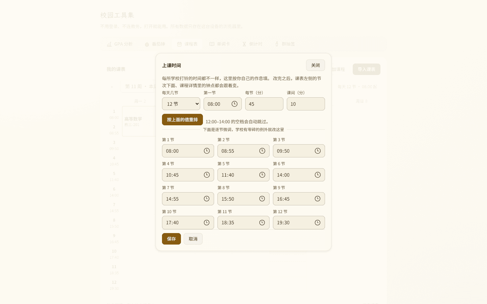
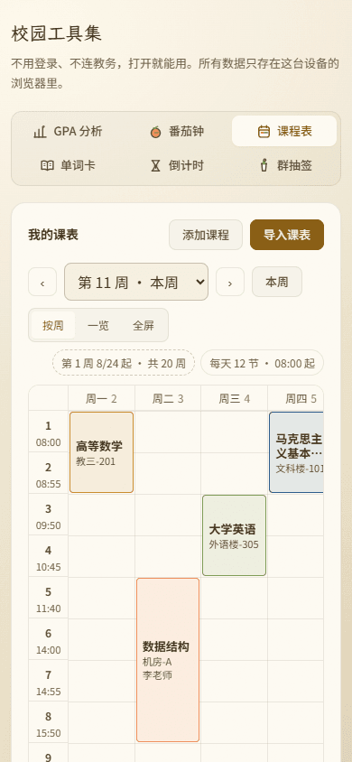

# 审核报告 · 课表 B2 作息与密度

> **审核通过前不得推送**（本地 commit 可以，防丢失）。
> 填写要求见 `campus/docs/05_审核闸门与分支策略.md`。

---

| 项 | 内容 |
| --- | --- |
| 报告日期 | 2026-11-06 |
| 开发者 | 橙子 |
| 审核人 | @baomi888 |
| 分支 | `school-tools` |
| 板块版本 | 0.6.0 → **0.6.1** |
| 关联条目 | 需求 4.1 / 4.2 / 4.3；补充项 A03 / A07；决策 D4（`docs/07` 第 0.1 节） |

---

## 1. 做了什么

课表优化的**第二批：作息可设 + 格子填满**。这一批第一次动了数据（快照多一个 `periods`），
所以连带迁移逻辑与存储契约文档。

1. **「上课时间」弹窗**（4.1）：周次条右端多一枚 chip「每天 12 节 · 08:00 起」。里面三件事：
   每天几节（8–14）、一键重排（第一节几点 / 每节多少分钟 / 课间多少分钟）、逐节微调。
2. **节次时间常显**（4.1）：原来只有全屏视图在节次下面标时间，页面里看不到。现在两处都有。
3. **课名 12 → 13px，课块内容按高度分级**（4.2）：1 节只课名、2 节加教室、3 节以上才放老师。
4. **课块竖向居中 + 加宽行高 + 补横向分节线**（4.3）：「框框太空旷」的三处成因一起收。

顺带三件必须一起做的事：

- **`periods` 写进存储契约**（A07）：`docs/02` 新增 2.6 节；缺字段的旧存档读出即补默认值。
- **节次上限 12 → 14**：跟着 `count` 放宽，否则第 13 节会被 `parseSections` 静默吞掉。
- **节次超限报错而不是静默**：加课填超了会说「每天只排了 N 节，第 M 节放不下」，
  导入时也会说「其中 N 门有第 13 节以后的课，去『上课时间』加节数才看得见」。

---

## 2. 为什么做

### 2.1 每所学校的打铃时间不一样，写死等于没有

旧版 12 节时间写死在 `PERIOD_TIMES` 常量里（08:00 / 08:55 / 10:00…），全屏视图拿来显示，
详情弹窗拿它算 `08:00–09:40`。对不上自己学校的作息时，这两处显示的都是**错的**时间，
而且用户没有任何办法改。现在作息进快照、三处共用同一份：

| 用到作息的地方 | 之前 | 现在 |
| --- | --- | --- |
| 周视图左侧节次栏 | 不显示 | 节次号 + 开始时间（两处视图都有） |
| 课程详情「时间」一行 | 常量算出的 `08:00–09:40` | 当前作息算出的区间 |
| 全屏视图 | 常量 | 当前作息 |

存储上只存**开始时间**，不存结束时间 —— 结束时间由下一节推、最后一节按 `duration` 算。
两个都存，早晚出现「第 1 节 08:00–09:40、第 2 节 09:30 开始」这种自相矛盾的存档。

### 2.2 「一键重排」和「逐节微调」缺一不可

- 只给一键重排：学校周四早操推迟十分钟这种零碎例外，用户无从下手。
- 只给逐节微调：第一次用要手填 12 个时间，多数人填到第 4 节就放弃了。

所以两样都给，且一键重排是**显式按钮**（「按上面的值重排」），不会因为改了「每节多少分钟」
就把用户辛苦调好的逐节时间冲掉。

### 2.3 「框框太空旷」不是一个原因

拆开看是三处：

1. **字小**：课名 12px、教室 10px，在 110px 宽的列里字只占三分之一。
2. **内容不随高度长**：只要超过 1 节就三行全塞，4 节的块里三行字挤在顶上、下半截空着。
3. **没有横向分节线**：日期列里一条横线都没有，节次和时间像浮在空中，格子边界靠猜。

对应三条改法：13px、按 span 分级 + 竖向居中、repeating 渐变画分节线（行高变了只改
`background-size`，比画 7×12 个 div 便宜）。课块垫了一层不透明的卡片底色，
否则 12% 的课程色是透明的，分节线会从块里穿过去 —— 4 节的块里像被划了一道。

### 2.4 13px 在手机上会折成四行

「马克思主义基本原理」9 个字，手机上每列只有 73px，13px 一行放 5 个字 → 两行能放下；
但若列再窄或课名更长，会折到三行四行，两节的块高 90px 装不下，`overflow: hidden` 会把
最后一行裁掉半个字。所以课名**最多两行 + 省略号**，教室/老师各一行省略，完整信息点开详情看。

---

## 3. 改动文件

| 文件 | 改动 |
| --- | --- |
| `frontend/src/campus/types.ts` | 新增 `PeriodPlan`（`count` / `starts` / `duration`）；`ScheduleSnapshot` 增加 `periods` |
| `frontend/src/campus/logic/schedule.ts` | 删掉 `PERIODS` / `PERIOD_TIMES` 常量，改为 `MIN/MAX/DEFAULT_PERIOD_COUNT` + `generateStarts` / `resizeStarts` / `normalizePeriodPlan` / `sectionTimeRange` / `toMinutes` / `fromMinutes` / `addMinutes`；`parseSections` 上限放宽到 14；`migrateLegacySchedule` 补默认作息 |
| `frontend/src/campus/tools/schedule/ScheduleDialogs.tsx` | 新增 `PeriodDialog`：4 个生成参数 + 逐节微调网格 + 吸底的保存条 |
| `frontend/src/campus/tools/schedule/WeekGrid.tsx` | 删掉 `PERIODS` / `PERIOD_TIMES` / `showTime`，改由 `plan` 驱动；节次下常显时间；课块按 `span` 分级显示；新增横向分节线图层；课块底色改为「课程色 + 不透明卡片底」 |
| `frontend/src/campus/tools/schedule/CourseEditor.tsx` | `sectionTimeText` 移出（改用 `sectionTimeRange(sections, plan)`）；`CourseForm` / `CourseDialog` 增加 `maxSection` / `timeText`，节次一栏标注上限 |
| `frontend/src/campus/tools/schedule/ScheduleTool.tsx` | 读取时 `normalizePeriodPlan`；新增作息 chip 与 `periodOpen`；`buildCourse` 增加节次超限校验；导入提示超限门数；`savePeriod` 处理「节数调小后有课看不见」 |
| `frontend/src/campus/styles/campus.css` | 课表段：左侧栏 40 → 44px、`.campus-week-slot-time` 常显 11px、`.campus-week-lines`、课块 13px / 两行截断 / 竖向居中 / `z-index`、`.campus-wk-chips`、`.campus-term-chip.is-plain`、`.campus-period-gen` / `.campus-period-grid` / `.campus-period-actions` |
| `frontend/src/campus/index.ts` | 对外导出随常量改名同步（`PERIODS` → `MIN/MAX/DEFAULT_PERIOD_COUNT` + 作息函数） |
| `campus/docs/02_数据与本地存储契约.md` | 新增 2.6 节「课表快照 · `campus.schedule.courses.v2`」，写清 `periods` 的四条约定 |
| `campus/docs/07_…`、`campus/CHANGELOG.md`、`campus/VERSION` | 批次进度、变更记录、版本号 0.6.1 |

板块外文件：无。

---

## 4. 验证方式

| 项 | 方法 | 结果 |
| --- | --- | --- |
| 类型 | `npx tsc --noEmit` | exit 0 |
| 规范 | `npx eslint src/campus --max-warnings=0` | 0 error / 0 warning |
| 构建 | 停 dev → `rm -rf .next` → `npm run build` | **通过**，15/15 页静态预渲染 |
| 旧存档迁移（A07） | 把 `periods` 从 localStorage 里删掉再打开 | 12 行齐、时间齐 `08:00…19:30`；落盘后 `count=12`、`duration=45`、`starts[0]=08:00` |
| 改节数 | 弹窗里选「10 节」→ 重排 → 保存 | 周视图 **12 → 10 行**；chip 变「每天 10 节 · 08:00 起」；课块位置不变 |
| 节次超限 | 10 节状态下加一门 `13,14` 的课 | 拦下并提示「每天只排了 10 节，第 13 节放不下 —— 先去『上课时间』把节数加上去」 |
| 课块分级 | 量三块课的内容与高度 | 1 节（44px）：只有课名；2 节（90px）：课名 + 教室，无老师；4 节（182px）：课名 + 教室 + 老师 |
| 字号 | `getComputedStyle` 取课名 | 13px（并排两列时 12px）；节次时间 11px |
| 分节线 | 放大 3 倍截 `.campus-week` 左上角 | 线与左侧节次行逐行对齐；课块内部无线条穿过（垫了不透明底） |
| 对比度（四组：浅/深 × 桌面/手机） | canvas 归一化颜色后按 WCAG 算 | 课名 **12.43 / 12.03**；教室老师 **8.0 / 7.83**；节次号 **8.0 / 7.83**；节次时间 **5.87 / 4.78**；chip **5.87 / 4.78** —— 全部 ≥ 4.5:1 |
| 版面 | 量面板高度（添加面板收起） | **704px**（每天 10 节）；12 节时为 704 + 2×46 = 796px；卡片 1 张 |
| 手机排布 | 390×844 触屏模拟 | 4 个生成参数两列、逐节微调两列（12 节 6 行）；保存/取消**吸底常驻**，不用滚到底 |

**未覆盖 / 已知**：手机周视图仍 `min-width: 560px`，要左右滑 —— 这是 6.1，B4 处理；
全屏行高仍固定 52px，`count` 变大时手机一屏放不下，同样归 B4。

---

## 5. 风险与未做的事

1. **旧用户第一次打开会看到「默认作息」而不是自己学校的作息**。这是有意的：旧数据里根本没有
   作息（写死在代码里），补出来的 12 节 / 08:00 起至少和原来显示的一致，且现在**可以改**了。
   入口是新加的那枚 chip，没有弹窗打扰。
2. **节数调小会让一些课「消失」**。不删数据，只在提示行说明「有 N 门课排在第 X 节以后，现在看不见，
   节数加回去就回来」。没有做二次确认，因为这是可逆的展示状态，不是删除。
3. **`duration` 只服务于「结束时间」**。它不参与排布，也不影响课块高度（高度由节次数量决定）。
   所以用户把每节改成 50 分钟，块不会变高 —— 课表是「节」为单位，不是分钟。
4. **同格冲突提示（A04）仍未做**，留到 B3 之后的批次。
5. **B4 会再动这块**：一屏看全要重算行高与列宽，本批的 46px 行高、44px 左栏、13px 字号
   都是「页面内视图」的口径，全屏会另给一套。

---

## 6. 截图

### 看图速览

<table>
  <tr>
    <td align="center"><b>上课时间弹窗 · 桌面 1440</b>  <a href="../previews/shots/b2sched/desk-period.png">点开原图</a></td>
    <td align="center"><b>周视图密度 · 手机 390</b>  <a href="../previews/shots/b2sched/phone-week.png">点开原图</a></td>
  </tr>
</table>

`campus/previews/shots/b2sched/`（桌面 1440×900、手机 390×844 触屏模拟，均为最终代码）：

| 文件 | 内容 |
| --- | --- |
| `desk-week.png` | 周视图：左栏节次 + 时间、横向分节线、13px 课名、两颗 chip |
| `desk-period.png` | 上课时间弹窗：4 个生成参数（4 列）+ 12 节逐节微调（3 列 4 行） |
| `desk-period-10.png` | 改成 10 节后按「重排」：时间从 08:00 到 17:40，12:00–14:00 空档跳过 |
| `desk-week10.png` | 保存后周视图 10 行，chip 变「每天 10 节 · 08:00 起」 |
| `desk-overflow.png` | 节次超限的报错：10 节状态下加第 13 节的课被拦下 |
| `zoom-grid.png` | 放大 3 倍：分节线与节次行对齐、课块内无线条穿过 |
| `phone-week.png` | 手机周视图：时间完整、课名两行截断不裁字 |
| `phone-period.png` | 手机弹窗：两列、保存吸底 |
| `desk-week-dark.png` / `desk-period-dark.png` | 深色主题 |
| `phone-period-dark.png` / `phone-period-dark-open.png` | 深色主题 · 手机 |

---

## 7. 审核结论（由负责人填写）

- [x] **通过** —— 可以合并并推送
- [ ] **有条件通过** —— 条件：
- [ ] **打回** —— 不通过条目（对照 `docs/03` 编号）：

审核意见：通过。（负责人 2026-11-06 确认；本地留存，等「上传」指令后再推）

审核日期：2026-11-06

---

## 8. 上传记录（审核通过后填写）

| 项 | 内容 |
| --- | --- |
| 开发者授意上传 | 否（尚未） |
| **上传前优化**（`docs/05` 闸门 4） | 改了什么：____ ／ 复核：tsc、eslint、build、双端实测是否重跑 |
| 推送时间 | |
| 推送分支 | `school-tools` |
| 推送提交 | |
