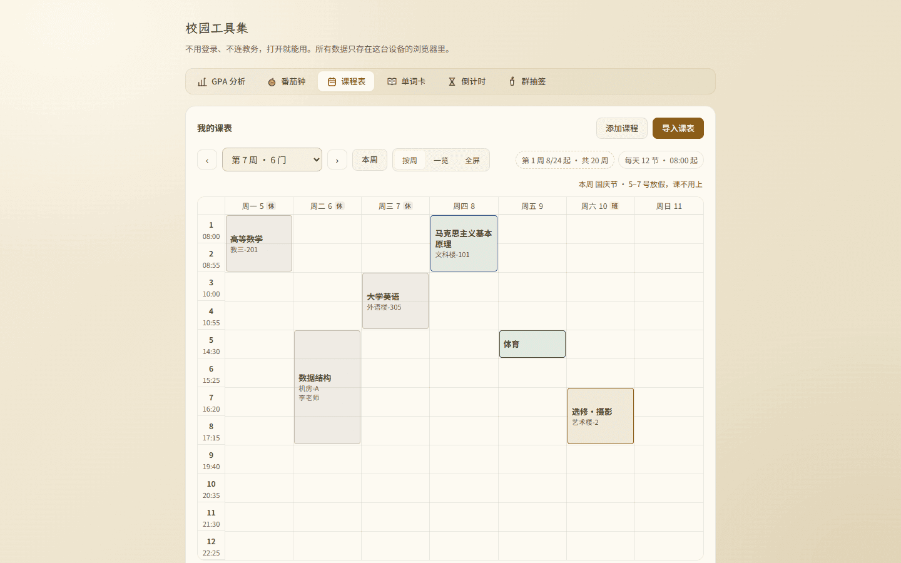

# 审核报告 · 课表 B3 日历联动

> **审核通过前不得推送**（本地 commit 可以，防丢失）。
> 填写要求见 `campus/docs/05_审核闸门与分支策略.md`。

---

| 项 | 内容 |
| --- | --- |
| 报告日期 | 2026-11-06 |
| 开发者 | 橙子 |
| 审核人 | @baomi888 |
| 分支 | `school-tools` |
| 板块版本 | 0.6.1 → **0.6.2** |
| 关联条目 | 需求 4.4 / 4.5 / 4.6 / 4.7；补充项 A05 / A06；决策 D1（`docs/07` 第 0.1 节） |

---

## 1. 做了什么

课表优化的**第三批：跟日历对上**。这一批是 18 条需求里唯一依赖外部数据的一批 ——
放假与调休不是算出来的，是国务院发布的事实。

1. **节假日常量表** `logic/holidays.ts`：内置 2026、2027 两年安排。放假日与调休上班日分开存，
   加载时展开成逐日索引，查询 O(1)。
2. **列头「休 / 班」徽标**（4.6）：放假那天标「休」（灰），调休上班日标「班」（橙）。
3. **放假那天的课块变暗**（4.5）：底色和边框由课程色换成灰，课名加删除线。调休上班日不变暗。
4. **今天要上的课块加深描边**（4.4）：原有「今天整列淡底」之上，给今天那列的课块加 2px 主题色描边。
5. **节日名提示**（4.7）：页面内在课表右上角，全屏时挪到顶栏标题旁。

顺带三件：

- **变暗方案换了实现**：先按「整块 opacity 45%」做的，实测课名只剩 2.51:1，改成语义更准的
  「彩色变灰」，实测 8:1（详见第 2.3 节）。
- **日期列头去掉 `opacity: .75`**：这是 B2 遗留的，实测 4.17:1，比 4.5 少一点。
- **没设学期时的说明**（D2 降级）：四条联动全部静默跳过，但页面会说清原因并给「设一下」的入口。

---

## 2. 为什么这么做

### 2.1 为什么写死常量表，而不是请求接口

板块铁律是「免登录、纯前端、无后端接口」。节假日只有两条路：

| 方案 | 优点 | 代价 |
| --- | --- | --- |
| **A 内置常量表（本批采用）** | 离线可用、零请求、不会静默失效 | **每年要发一次版** |
| B 运行时请求第三方接口 | 自动更新，零维护 | 校园网墙掉或离线时课表变成「没有假期」；引入隐私与稳定性问题 |

课表是「打开就要准」的东西，不能指望网络。代价是每年发版 —— 已写进 `ROADMAP.md`
的「例行事项（按年）」，标明时间点、改哪个文件、不做的后果。

### 2.2 为什么不按周末判断

用户原话是「放假的节假日自动变暗」，没提周末。这里**故意不把周六周日算作「不用上课」**：
周末上课是真实存在的（补课、选修、成人教育），一律标成休息会给这些人一个错信息。
只认国务院发布的放假与调休，其余日子一律「平常」。

### 2.3 为什么「变暗」不用 `opacity`

按 `docs/07` 第 8 节的口径，4.5 原来是「不透明度降到 45% + 删除线」。实现后实测：

| 方案 | 课名对比度（浅 / 深） | 问题 |
| --- | --- | --- |
| 整块 `opacity: .45` | **2.51 / 3.6** | 比 4.5 差一半，想确认「那天本来是哪门课」读不出来 |
| **彩色变灰（本批采用）** | **8 / 7.83** | 变暗的语义靠颜色和删除线表达，不牺牲可读性 |

变暗是为了表达「这天不用上课」，不是为了让人看不见。
实际效果：有颜色的块 = 要上课，灰掉划掉的块 = 不用上课，一眼就分得开。
这条与审核通过的口径有出入，**请负责人确认可以接受**（第 5 节第 1 条）。

### 2.4 为什么提示要写「哪几天」

国庆跨两周。第 6 周（9/28–10/4）只有周四到周日放假，周一到周三照常上课。
只说「本周国庆节放假」会让人以为整周都不用去。所以算出一周内放假的日期：
连号收成区间（`1–4 号`），断号照实列（`1、3、5 号`）。

---

## 3. 改动文件

| 文件 | 内容 |
| --- | --- |
| `frontend/src/campus/logic/holidays.ts` | **新增**。两年常量表、逐日索引、`dayInfoOf` / `holidayLabelsOf` / `dateKey` / `isYearCovered`，文件头写明数据来源与更新方式 |
| `frontend/src/campus/tools/schedule/WeekGrid.tsx` | 新增 `dayInfos` 入参；列头徽标；`is-off` / `is-today-block` 类名；放假块换灰底灰框 |
| `frontend/src/campus/tools/schedule/ScheduleTool.tsx` | 计算 `dayInfos` / `holidayNames` / `offDays` / 覆盖年份；假日提示行；没学期的说明；全屏标题旁节日名；`toDateString` 改为复用 `dateKey`（去掉一处重复实现） |
| `frontend/src/campus/styles/campus.css` | `.campus-week-mark`（休/班）、`.campus-week-block.is-off`、`.is-today-block`、`.campus-week-holiday`、`.campus-fullscreen-holiday`；日期列头去 `opacity` |
| `campus/docs/02_数据与本地存储契约.md` | 新增「节假日不进快照」：常量表 vs 用户数据的边界 |
| `campus/ROADMAP.md` | 新增「例行事项（按年）」：每年 12 月更新节假日表 |
| `campus/docs/07_…` | 批次表 B3 → 已完成 |
| `campus/VERSION` / `campus/CHANGELOG.md` | 0.6.2 |

板块外文件：无。存储结构：**未变**（节假日不落盘）。

---

## 4. 验证方式

| 项 | 方法 | 结果 |
| --- | --- | --- |
| 类型 | `npx tsc --noEmit` | exit 0 |
| 规范 | `npx eslint src/campus --max-warnings=0` | 0 error / 0 warning |
| 构建 | 停 dev → `rm -rf .next` → `npm run build` | **通过**，15/15 页静态预渲染 |
| 第 7 周（10/5–10/11，国庆后 3 天 + 10/10 调休） | 真页面翻 4 周到该周，读 DOM | 周一/二/三标「休」，周六标「班」，周四 10/8、周五 10/9、周日 10/11 无标；高等数学 / 数据结构 / 大学英语变灰划线，马克思 / 体育 / 选修·摄影保持彩色；提示「国庆节 · 5–7 号放假，课不用上」 |
| 第 6 周（9/28–10/4，跨节） | 同上，翻 5 周 | 周四–周日标「休」，提示「1–4 号放假」；周一到周三的课保持彩色 |
| 今天那周（11/2–11/8） | 直接打开（默认停在本周） | 7 列全部无徽标、无提示行；`today` 列 = 4（周五），仅体育块带 2px 描边 |
| 翻周后描边是否残留 | 翻到第 7 周再读 | `today` 列变 −1，所有块 `isTodayBlock = false` |
| 全屏 | 点「全屏」 | 标题「第 7 周 · 10月5日 起」+ 徽章「国庆节 · 5–7 号放假」 |
| 没设学期（D2 降级） | 快照里 `term: null` | 列头无日期、无徽标；提示「还没设学期，所以不标今天和节假日 —— 设一下」 |
| **对比度（浅 / 深，桌面与手机四组一致）** | canvas 归一化颜色后按 WCAG 算 | 休徽标 **5.87 / 4.78**、班徽标 **5.7 / 6.93**、假期提示 **5.7 / 6.93**、变灰课名 **8 / 7.83**、日期列头 **8 / 7.83**（改前 4.17）、正常课名 **12.43 / 12.03** —— 全部 ≥ 4.5:1 |
| 不只靠颜色（A06） | 人工核对 | 休/班是**字**不是纯色点；变暗课名有**删除线**；今天块有**描边** |

---

## 5. 风险与未做的事

1. **与已定口径的偏离（要负责人确认）**：4.5 原口径是「不透明度 45%」，本批改成「彩色变灰」
   并保留删除线，原因是 45% 时课名只有 2.51:1。视觉效果同样是「明显变淡」，请确认可接受。
2. **每年要发一次版**。国务院办公厅通常在上一年 11–12 月发布次年安排。已写进
   `ROADMAP.md` 的例行事项。若某年没跟上，次年的课表只是不标休/班，不会崩。
3. **2028 年及以后没有数据**。表外年份降级为「不判断」，课表右上方会显示
   「20XX 年的放假安排还没收录（数据到 2027 年）」，不会默默当作没有假期。
4. **不识别寒暑假**。寒暑假不是法定节假日，也不是「一周内某几天」的事，本批没做。
   如果学生希望在假期那几周显示「假期中」，要单开一批（需要用户自己填起止日期，
   没有权威数据源可查）。
5. **学校自己的校历可能与国务院不同**。部分高校不放满 9 天春节、或有自己的补课日。
   本批只按国家安排，用户无法覆盖 —— 这是「自动」的代价。
6. **跨零点不自动刷新**。`today` 是按渲染时的 `new Date()` 算的，页面开着过夜不会自己跳到新的一天。
   这个限制 B1 起就存在（`todayIndex`），不是本批引入。
7. **跨年周（如 12/29–1/4）只按周一那年判断数据是否覆盖**。极端情况下会出现「周日那格没标」。
   两年表都在时不会遇到；2028 年边界才需要处理。
8. **未做：自定义节假日、导出导入包含学期/作息**。导出目前只导课程。

---

## 6. 截图

### 看图速览

<table>
  <tr>
    <td align="center"><b>国庆周「休 / 班」· 桌面 1440</b>  <a href="../previews/shots/b3sched/desk-holiday.png">点开原图</a></td>
    <td align="center"><b>同上 · 手机深色</b>  <a href="../previews/shots/b3sched/phone-holiday-dark.png">点开原图</a></td>
  </tr>
</table>

`campus/previews/shots/b3sched/`（桌面 1440×900、手机 390×844 触屏模拟，均为最终代码）：

| 文件 | 内容 |
| --- | --- |
| `desk-holiday.png` | 第 7 周：三列「休」+ 一列「班」，三块变灰划线，其余保持彩色，右上角节日提示 |
| `desk-holiday-prev.png` | 第 6 周：跨节假期，周四起才放假，提示「1–4 号放假」 |
| `desk-normal.png` | 今天那周：无徽标无提示，只体育块带描边 |
| `desk-holiday-full.png` | 全屏：标题旁「国庆节 · 5–7 号放假」 |
| `desk-noterm.png` | 没设学期：无日期无徽标 + 说明行 |
| `phone-holiday.png` | 手机第 7 周：徽标与提示一行放得下，灰块清晰 |
| `desk-holiday-dark.png` / `phone-holiday-dark.png` | 深色主题（A05） |

---

## 7. 审核结论（由负责人填写）

- [x] **通过** —— 可以合并并推送
- [ ] **有条件通过** —— 条件：
- [ ] **打回** —— 不通过条目（对照 `docs/03` 编号）：

审核意见：通过。（负责人 2026-11-06 确认；第 5 节第 1 条「变暗由 opacity 改为彩色变灰」随本批一并认可。本地留存，等「上传」指令后再推）

审核日期：2026-11-06

---

## 8. 上传记录（审核通过后填写）

| 项 | 内容 |
| --- | --- |
| 开发者授意上传 | 否（尚未） |
| **上传前优化**（`docs/05` 闸门 4） | 改了什么：____ ／ 复核：tsc、eslint、build、双端实测是否重跑 |
| 推送时间 | |
| 推送分支 | `school-tools` |
| 推送提交 | |
