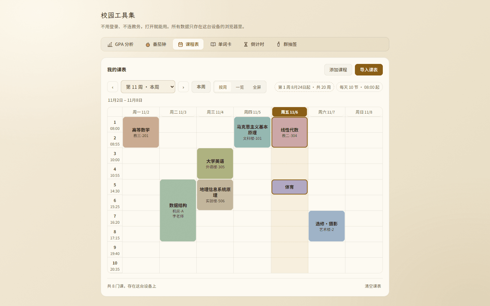

# 审核报告 · 课表 B5 莫兰迪配色

> **审核通过前不得推送**（本地 commit 可以，防丢失）。
> 填写要求见 `campus/docs/05_审核闸门与分支策略.md`。

---

| 项 | 内容 |
| --- | --- |
| 报告日期 | 2026-11-06 |
| 开发者 | 橙子 |
| 审核人 | @baomi888 |
| 分支 | `school-tools` |
| 板块版本 | 从 `0.6.4` → `0.6.5` |
| 关联条目 | 内测反馈「课表配色想要莫兰迪色系 + 参考图那种色块效果」 |
| 前置批次 | B1 0.6.0 / B2 0.6.1 / B3 0.6.2 / B3.1 0.6.3 / B4（未发版，与本次同批） |

---

## 1. 做了什么

课块从「纸色底 + 一圈彩色描边」换成了**实心莫兰迪色块**：8 个低饱和色，圆角 8px，课名和教室居中；
今天那一列的表头变成一个实心胶囊。已经存过的课表不用重新录，打开就是新配色。

## 2. 为什么做

参考图（小律课程表）能一眼看完，很大一部分功劳在配色：色块本身就是信息，
不用读字也能靠颜色把「上午两节数学、下午四节专业」串起来。原来的画法是 12% 淡底 + 同色描边，
远看整张表还是纸色，只有一圈圈细边，这正是 4.3「框框太空旷」的另一个来源。

于是这一批把两组东西一起换掉：
1. **色板**：旧色板（金 / 橙 / 深绿 / 藏蓝）是给描边用的高饱和色，做底色会把一屏染成色卡；
2. **画法**：淡底描边 → 实心块，圆角 4px → 8px，左对齐 → 居中。

## 3. 改动文件

| 文件 | 改动 |
| --- | --- |
| `campus/logic/schedule.ts` | `COURSE_COLORS` 换莫兰迪 8 色；新增 `LEGACY_COURSE_COLORS` 迁移表与 `normalizeCourseColor()` |
| `campus/tools/schedule/ScheduleTool.tsx` | 读档时对 `courses[].color` 过一遍 `normalizeCourseColor`（v2 存档不走迁移函数，这里是唯一入口） |
| `campus/tools/schedule/WeekGrid.tsx` | 课块底色由「12% 渐变 + 同色描边」改为实心课程色；描边改透明（保住 `calc(% - 2px)` 的块宽） |
| `campus/styles/campus.css` | 课块圆角/居中/字色变量；`--course-off`、`--course-ink`、`--course-sub`；今天胶囊；深色压暗一档；放假块字色改走块级变量 |

**板块外文件**：无。未动 `tokens.css`、`CornIcon.tsx`。

## 4. 验证方式

| 验证项 | 命令 / 操作 | 结果 |
| --- | --- | --- |
| 类型检查 | `npx tsc --noEmit` | 通过 |
| 构建 | `npm run build`（15/15 页） | 通过 |
| 代码规范 | `npx eslint src/campus` | 通过 |
| 迁移实测 | 存档里**故意写旧色值**（`#C8892A` 等 8 个），刷新后读块底色 | 8 块分别变成 `#C9A990 #ACB07E #A3BCA4 #93B7B0 #9DB1C6 #AFA6C2 #CBA5A6 #C2B49A`，无一留旧值 |
| 画法实测 | CDP 读 computed style | `border-radius: 8px`、`align-items: center`、`text-align: center`、课名 13px、块底色**不透明** |
| 放假块 | 翻到第 7 周（10/5–10/11） | 底色 `#D6D0C6`、字 `#5A5348`、`text-decoration: line-through`；深色下底色 `#3E372C`、字 `#C9C0B0` |
| 今天胶囊 | 第 11 周（11/2–11/8） | 浅色 `#875B10` 底 + `#FDFAF2` 字；深色 `#E0A03A` 底 + `#292217` 字 |
| 双端 | 390×844 / 1440×900，浅色 + 深色，普通 + 全屏 | 见第 6 节 |

### 对比度（A03 / A05，正文线 4.5:1）

| 课块色 | 课名 `#241F18` | 教室 `#3B332A` |
| --- | --- | --- |
| `#C9A990` 赭 | 7.45 | 5.65 |
| `#ACB07E` 橄榄 | 7.22 | 5.47 |
| `#A3BCA4` 鼠尾草 | 8.01 | 6.08 |
| `#93B7B0` 灰青 | 7.51 | 5.69 |
| `#9DB1C6` 灰蓝 | 7.43 | 5.63 |
| `#AFA6C2` 灰紫 | 7.05 | 5.35 |
| `#CBA5A6` 脏粉 | 7.38 | 5.60 |
| `#C2B49A` 米灰 | 8.01 | 6.08 |

其余：放假块字 4.95（浅）/ 6.52（深）；今天胶囊 5.70（浅）/ 6.93（深）；
深色主题整块 `brightness(.88)` 后最差的一格（灰紫）仍有 5.60。

## 5. 风险与未做的事

- **已知限制**
  1. 8 色里有几组在色相上靠得近（赭 `#C9A990` / 米灰 `#C2B49A`、橄榄 `#ACB07E` / 鼠尾草 `#A3BCA4`）。
     莫兰迪本身就是"低饱和 + 灰调"，色相空间被压窄，8 个色不可能像高饱和色板那样两两分得很开。
     现在的顺序按色相拉开，保证**相邻 id 的两门课**一定不同色；隔着两三门课看混属可接受范围。
  2. 迁移是"按下标一一对应"而不是"挑近色"：旧板的橙 `#EF8A56` 变成鼠尾草绿、红 `#A03E28` 变成米灰。
     颜色整体变了是必然的（换色板），但如果负责人认为应按色相接近来配，改 `LEGACY_COURSE_COLORS` 的表即可，不影响其它逻辑。
  3. 深色主题下色块统一压暗 12%，不再是"逐色微调"，极少数块（灰紫）会略偏灰。
- **本次没做（但参考图里有，属下一批）**
  1. 顶部独立日期条（七个圆角格 + 大日期标题「11月5日」）：现在日期还在表头里，没有独立成行；
  2. 「午饭 / 晚饭」分隔条：需要给作息加"午休在第几节后"，属于 `periods` 结构扩展；
  3. 底部悬浮工具栏（添加 / 今日 / 日程 / 设置）：我们工具页是顶部标签栏，不属于课表这一块。
- **可能的回归点**
  1. 课块描边改透明后，块宽没变（`calc(% - 2px)` 依赖 1px border，已保留），但**两门课并排**时块间距仍是 2px，视觉上比原来更贴；
  2. `normalizeCourseColor` 会在每次读档时跑，用户手改导入 JSON 填的自定义色只要合法就不会被覆盖（正则带 `i`，大小写都收）。

## 6. 截图

### 看图速览

<table>
  <tr>
    <td align="center"><b>8 色实心块 · 桌面浅色</b>  <a href="../previews/shots/b5sched/desk-week11.png">点开原图</a></td>
    <td align="center"><b>深色 · 放假块变灰</b>  <a href="../previews/shots/b5sched/phone-week7-dark.png">点开原图</a></td>
  </tr>
</table>

`campus/previews/shots/b5sched/`：

| 文件 | 内容 |
| --- | --- |
| `desk-week11.png` | 桌面浅色，8 色全出现，今天胶囊在周五 |
| `desk-week11-dark.png` | 桌面深色，色块压暗一档 |
| `phone-week11.png` | 手机 390 浅色 |
| `phone-week7.png` | 手机第 7 周国庆：周一至周三放假块（灰底 + 删除线） |
| `phone-week7-dark.png` | 同上，深色 |
| `phone-full.png` | 手机全屏 7 列窄格下的实心块 |

---

## 7. 审核结论（由负责人填写）

- [x] **通过** —— 可以合并并推送
- [ ] **有条件通过** —— 条件：
- [ ] **打回** —— 不通过条目（对照 `docs/03` 编号）：

审核意见：负责人 2026-11-06 确认「已经审核通过了，可以推送」；闸门 4 上传前优化已完成并复核通过（逐条对账见整合版报告第 10 节）。

审核日期：2026-11-06

---

## 8. 上传记录（审核通过后填写）

| 项 | 内容 |
| --- | --- |
| 开发者授意上传 | 否（尚未收到「上传」） |
| **上传前优化**（`docs/05` 闸门 4） | 待做 |
| 推送时间 | — |
| 推送分支 | `school-tools` |
| 推送提交 | — |
