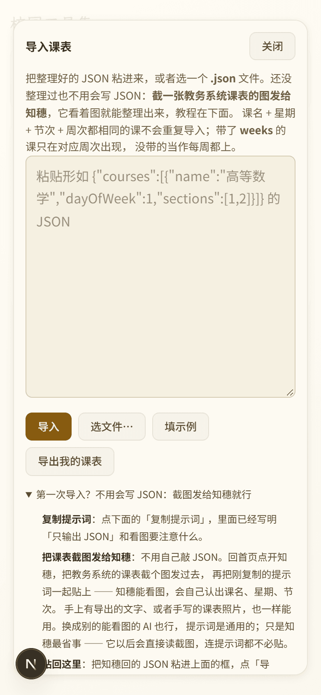
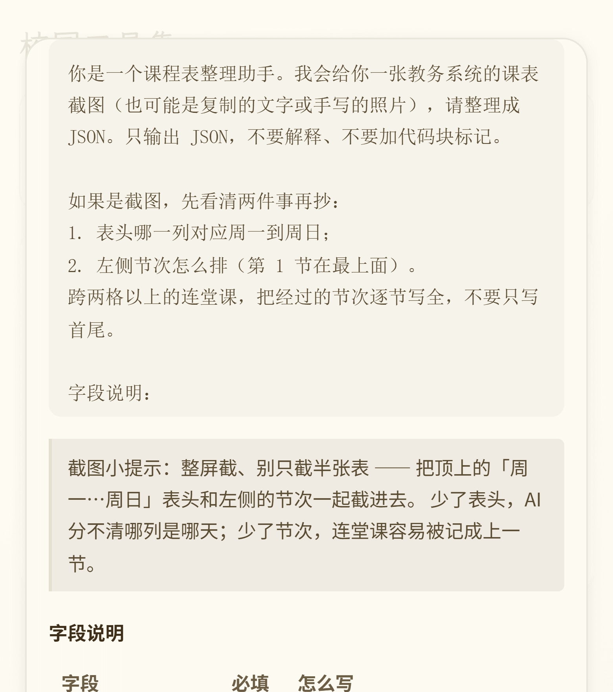

# 审核报告 · 课表 B7.1 教程改「截图优先」

> **审核通过前不得推送**（本地 commit 可以，防丢失）。
> 填写要求见 `campus/docs/05_审核闸门与分支策略.md`。

---

| 项 | 内容 |
| --- | --- |
| 报告日期 | 2026-11-06 |
| 开发者 | 橙子 |
| 审核人 | @baomi888 |
| 分支 | `school-tools` |
| 板块版本 | 从 `0.6.8` → `0.6.9` |
| 关联条目 | `docs/07` 1.1 / 1.2（教程入口与「用知穗整理」的口径修正） |
| 前置批次 | B1–B6.1（0.6.0–0.6.7）/ B7（0.6.8） |

---

## 1. 做了什么

导入教程的入口从「先有 JSON，再粘进来」改成 **「截一张教务系统课表的图，发给知穗」**。

三处文案 + 一处提示词：

1. **三步法第 2 步**改写：不写「丢给知穗」这种默认你已经有文字的表述，而是明说
   「不用自己敲 JSON，把课表截图发过去」；补上「知穗能看图」「换成别的能看图的 AI 也行」
   「只是知穗最省事 —— 以后会直接读截图，连提示词都不必贴」。
2. **`AI_PROMPT` 首句**改成「我会给你一张教务系统的课表截图（也可能是复制的文字或手写的照片）」，
   并新加一段看图承重点（见第 2 节）。
3. **新增一段截图小提示**：整屏截、别只截半张表，把表头和左侧节次一起截进去。
4. **空状态与弹窗开头**改成先说截图，把 JSON 退到第二位。

## 2. 为什么这么改

负责人原话：

> 生成 JSON 可以不用自己输入，直接截屏教务系统课表，让知穗或者是其他有视觉模型的 AI 进行识别，
> 知穗后期会加上视觉模型的，所以最好就说让知穗来

上一版（B7 / 0.6.8）的三步法是「复制提示词 → 丢给知穗 → 粘回来」，第 2 步的措辞是
「把教务系统导出的课表一起发过去 —— 截图、复制出来的文字都行」。问题在于：

- **入口仍然假设用户手上有一份能读的文本。** 绝大多数学生只有教务系统那张周课表，
  没有导出按钮，也不会自己敲 JSON；
- **「截图…都行」是括号里的补充**，读起来像次要路径，实际它才是主路径；
- 提示词整段是给「文本」写的：没有一句告诉模型「这是图、先看表头和节次」。
  视觉模型在这类周课表上最容易犯的错是**错行** —— 把第 3-4 节的课记成第 4-5 节，
  整块往下挪一格。导进来的课表看着正常，只是节次全错，用户很难发现。

所以这轮不是「加一句话」，是把入口换成截图，同时把看图最容易错的地方在提示词里钉死。

## 3. 改动文件

| 文件 | 改动 |
| --- | --- |
| `frontend/src/campus/tools/schedule/ScheduleDialogs.tsx` | `AI_PROMPT` 首句改为「可能发截图」+ 新增「先看清表头哪列是周一、节次怎么排、连堂逐节写全」段 + 「看不清就留空，不要猜」；三步法第 2 步改写；新增「截图小提示」段（放在提示词块之后）；弹窗开头说明补一句「截一张图发给知穗」 |
| `frontend/src/campus/tools/schedule/ScheduleTool.tsx` | 空状态第一句由「把整理好的 JSON 粘进来最快」改为「导入一份整理好的课表最快」，避免和下面那句重复说 JSON；下面那句改为先讲截图、再指向「导入课表」里的提示词 |

**板块外文件**：无。

## 4. 验证方式

| 验证项 | 命令 / 操作 | 结果 |
| --- | --- | --- |
| 类型检查 | `npx tsc --noEmit` | 通过 |
| 代码规范 | `npx eslint src/campus` | 通过（0 warning） |
| 构建 | `npm run build` | 通过（15/15 页） |
| 手机默认展开 | 390×844 打开导入弹窗 | `
.open === true`，`summary` = 「第一次导入？不用会写 JSON：截图发给知穗就行」，`li` 3 条 |
| 桌面默认收起 | 1440×900 | `
.open === false`，点开正常 |
| 横向溢出 | 390 / 360 两档 `scrollWidth - clientWidth` | **0 / 0** |
| 弹窗可滚 | 390 下 `.campus-modal-card` | `scrollHeight 1907 / clientHeight 794`，教程块高 1328，内部可滚，不撑破页面 |
| 提示词内容 | 读 `.campus-prompt` 文本 | 含「截图」「表头」「留空」「代码块标记」四处关键措辞（长度 587） |
| 复制按钮 | 点「复制提示词」 | 反馈「提示词已复制。」（无安全上下文时降级为「请手动选中」） |
| 文案一致性 | 空状态 / 弹窗开头 / 三步法 / 提示词末句 | 四处口径一致：都是「截图发给知穗」，没有一处还在说「必须先有 JSON」 |

## 5. 风险与未做的事

- **能力依赖**：文案里写「知穗能看图」，依赖主站对话已支持图片输入。若某个入口暂时还不支持，
  用户会照着做但失败 —— **这是本批唯一的外部依赖，请负责人确认口径可以这么写。**
  建议保留的兜底是那句「换成别的能看图的 AI 也行，提示词是通用的」，用户不会被卡死。
- **识别质量不在这批范围内**：错行、少抄一门课，取决于模型的视觉能力，前端无法校验。
  已做的只是把「先看表头、连堂逐节写全、看不清留空」写进提示词，外加一句截图小提示。
  后续如果要更强，得在导入后加「课块数量 / 节次范围」的自检提示（未做）。
- **教程块变长了**：手机上 1328px，比 0.6.8 长约 200px。它在折叠块里、弹窗内滚动，
  不影响页面高度；桌面默认收起，看不到。
- **未做**：`AI_PROMPT` 里没有写「如果是图片请直接输出，不要先复述课表」这类抑制前缀的指令，
  实测各模型表现不一；等真接了视觉再按实际表现补。

## 6. 截图 / 录屏

### 看图速览

<table>
  <tr>
    <td align="center"><b>导入弹窗 · 已改成「截图发给知穗」</b>  <a href="../previews/shots/b71sched/phone-390-import.png">点开原图</a></td>
    <td align="center"><b>提示词放大 · 首句写明可发截图</b>  <a href="../previews/shots/b71sched/phone-390-prompt-zoom.png">点开原图</a></td>
  </tr>
</table>

`campus/previews/shots/b71sched/`（7 张，压缩后 0.8MB）

| 文件 | 说明 |
| --- | --- |
| `phone-390-empty.png` | 空状态：先讲「导入整理好的课表」，下面指向「截图发给知穗」 |
| `phone-390-import.png` | 390 导入弹窗：开头说明已改口径，教程默认展开，三步齐全 |
| `phone-360-steps.png` | 360 窄屏下的三步法与「截图小提示」，无贴边或挤压 |
| `phone-390-prompt-zoom.png` | 提示词块放大：首句「我会给你一张教务系统的课表截图…」，其后是「截图小提示」 |
| `phone-360-import.png` | 360 导入弹窗整体 |
| `desk-1440-import.png` | 桌面：教程默认收起 |
| `desk-1440-import-open.png` | 桌面展开后的排版 |

---

## 7. 审核结论（由负责人填写）

- [ ] **通过** —— 可以合并并推送
- [ ] **有条件通过** —— 条件：
- [ ] **打回** —— 不通过条目（对照 `docs/03` 编号）：

审核意见：

审核日期：

---

## 8. 上传记录（审核通过后填写）

| 项 | 内容 |
| --- | --- |
| 开发者授意上传 | 否（截至本报告写完，未收到「上传」二字） |
| **上传前优化**（`docs/05` 闸门 4） | 待做 |
| 推送时间 | |
| 推送分支 | `school-tools` |
| 推送提交 | |
