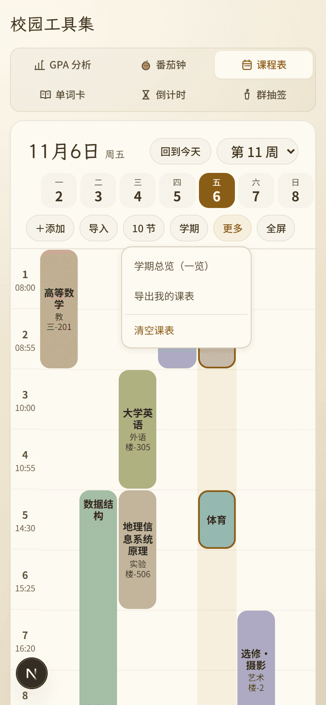
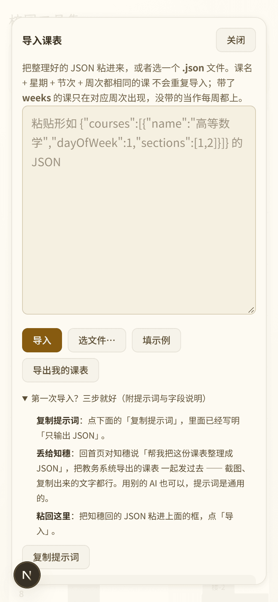

# 审核报告 · 课表 B7 导入教程与「更多」收口

| 项 | 内容 |
| --- | --- |
| 报告日期 | 2026-11-06 |
| 开发者 | 橙子 |
| 审核人 | @baomi888 |
| 分支 | `school-tools` |
| 板块版本 | `0.6.7` → `0.6.8` |
| 关联条目 | 需求 1.1 1.2 1.3 1.4 + A08；2.1 待勾选清单第 3、6 条；A01–A09 复核；D1–D4 口径 |

---

## 1. 做了什么

站在用户视角三句话：

1. **第一次导入不再卡在「提示词不知道往哪放」**：导入弹窗里从一句灰字变成「三步就好」——复制提示词 → 丢给知穗（或任意 AI）→ 把回来的 JSON 粘回来，下面配字段表和四种最常见的错法。
2. **从聊天窗口整段复制也能导**：粘进来带着 ` ```json ` 围栏不再报「不是合法 JSON」，会自动剥掉。
3. **工具条安静了**：「一览」和「清空课表」从主按钮组收进「更多」，主组只剩「按周 / 全屏」；「导出我的课表」也放进「更多」，换手机时不用先点「导入」。

## 2. 为什么做

负责人 2026-11-06 的原话：「第四个建议补充的需求，A01、A02、A03、A05、A07、A08、A09 都实现……以下按你的推荐做」，并逐条确认了 D1–D4。

把这批拆开核对后，实际缺口只有三处，其余是「已做，补证据」：

| 条目 | 状态 | 依据 |
| --- | --- | --- |
| A01 编辑已有课程 | 已做（B1） | 点课块开 `CourseDialog`，里面有「编辑 / 删除」 |
| A02 空状态 | 已做（B1） | `.campus-empty-state` +「导入课表」主按钮 +「手动添加」 |
| A03 每天几节可设 | 已做（B2） | `PeriodDialog`「每天几节」10/12/14 + 逐节时间 |
| A05 深色主题验证 | **本轮补证据** | 见 §4 深色实测，未发现需改代码的问题 |
| A07 数据迁移 | 已做（B2） | 读档处 `normalizePeriodPlan` 补默认作息；`docs/02` §2.6 已写 |
| A08 导出/导入闭环 | **本轮补** | 「更多 → 导出我的课表」+ 教程末尾一句换设备说明 |
| A09 手机全屏退出 | 已做（B4） | 明显的「退出全屏」按钮 + Esc + 锁 body 滚动 |
| 2.1 第 1、2、4、5、7 条 | 已做（B1 / B6） | 示例课已删、常驻提示已随「点块即详情」消失、学期说明并进 chip、表单收成按钮、按钮组精简 |
| 2.1 第 3、6 条 | **本轮做** | 「一览」「清空课表」进「更多」 |
| A04 撞课提示 | **没做** | 本轮清单里没列，单独排期 |
| A06 不只靠颜色 | 已做（B3） | 放假块加删除线、今天课块加描边 |
| 1.1–1.4 教程 | **本轮做** | 三步法 / 字段表 / 四种错法 / 迁移提示 |

## 3. 改动文件

| 文件 | 改动 |
| --- | --- |
| `frontend/src/campus/tools/schedule/MoreMenu.tsx` | **新增**。「更多」菜单：学期总览 / 导出 / 清空；点外关闭、Esc 关闭、选完即收 |
| `frontend/src/campus/tools/schedule/ScheduleDialogs.tsx` | 提示词重写（字段说明 + 单行 JSON 示例 + 单双周写法）；折叠块改成三步教程 + 字段表 + 四种错法 + 换设备提示；新增受控 `tutorialOpen` |
| `frontend/src/campus/tools/schedule/ScheduleTool.tsx` | 桌面与手机都接入 `MoreMenu`；「一览」从两处按钮组移出；页脚去掉「清空课表」；新增 `downloadSchedule()`；`ImportDialog` 传 `tutorialOpen={phone}` |
| `frontend/src/campus/logic/schedule.ts` | 新增 `stripCodeFence()`，`parseScheduleImport` 先剥围栏再解析 |
| `frontend/src/campus/logic/holidays.ts` | 仅注释：补官方文号、发布日与核对日期。**数据一行未改**（核对结果本来就对，见 §4） |
| `frontend/src/campus/styles/campus.css` | 新增 `.campus-more*`、`.campus-steps`、`.campus-field-table`、`.campus-faq`、`.campus-details-note`；`.campus-phone-tools` 去掉 `overflow-x: auto`（原因见 §5） |
| `campus/VERSION` / `campus/CHANGELOG.md` / `campus/docs/07` / `campus/reviews/README.md` | 版本 0.6.8、变更日志、批次表、索引 |

**板块外文件**：无。未触碰 `tokens.css`、`CornIcon.tsx`、任何公共组件。

## 4. 验证方式

| 验证项 | 命令 / 操作 | 结果 |
| --- | --- | --- |
| 类型检查 | `npx tsc --noEmit` | 通过（无输出） |
| 代码规范 | `npx eslint src/campus` | 通过（无输出） |
| 构建 | `npm run build` | 通过 |
| 手机 390 工具条 | 数胶囊 | 6 颗：＋添加 / 导入 / 10 节 / 学期 / 更多 / 全屏（「一览」已不在） |
| 更多菜单 | 点「更多」 | 三项：学期总览（一览）/ 导出我的课表 / 清空课表；面板 156×122px，完整在视口内 |
| 菜单关闭 | Esc / 点空白 / 选中某项 | 三种都关（`Esc 后可见: false`、`点空白后可见: false`） |
| 360px 布局 | 量胶囊行 | 一行 6 颗，行高 34px，最右 317 < 360，**没有换行** |
| 一览视图 | 点「学期总览」 | 20 行 × 7 列正常渲染；此时「更多」按钮 `is-on` 常亮，能看出不在周视图 |
| 导出 | 点「更多 → 导出我的课表」 | 触发下载，提示「已导出「我的课表.json」。换设备时用「导入课表」选这个文件。」 |
| 教程默认态 | 手机 / 桌面各开一次导入弹窗 | 手机 `open: true`、桌面 `open: false`（1.1 口径） |
| 字段表列宽 | 360px 下量 `th` | 98 / 42 / 158px，三列对齐，`[1,2]`、`"1,2"` 不被劈断 |
| 围栏容错 | 粘 ` ```json {…} ``` ` 后导入 | `导入 1 门课。`，课程出现在表里 |
| 深色实测（A05） | 深色 + 第 7 周国庆 | 日期条「一5休 二6休 三7休 六10班」清晰；4 个放假课块变灰 + 删除线；节日名「国庆节 · 10月5-7日放假」金色可读 |
| 全屏点开详情（D3） | 全屏视图点任意课块 | 弹出课程详情（`WeekGrid onOpen` → `CourseDialog`，弹窗挂在全屏层之后，层级正常） |
| 旧数据（A07） | 造 `{v:2, courses:[…]}` 无 `periods` 的存档 | 正常打开，补默认 10 节 08:00 起；`docs/02` §2.6 已记录该约定 |

### D1 节假日内置表核对（逐条对 gov.cn 原文）

| 年份 | 代码里的表 | 官方通知 | 结论 |
| --- | --- | --- | --- |
| 2026 | 元旦 1/1–1/3（1/4 上班）；春节 2/15–2/23 共 9 天（2/14、2/28 上班）；清明 4/4–4/6；劳动 5/1–5/5（5/9 上班）；端午 6/19–6/21；中秋 9/25–9/27；国庆 10/1–10/7（9/20、10/10 上班） | 国办 2025-11-04 通知，逐条一致 | **一字不差** |
| 2027 | 元旦 1/1–1/3；春节 2/5–2/13 共 9 天（1/31、2/14 上班）；清明 4/3–4/5；劳动 5/1–5/5（5/8 上班）；端午 6/9 共 1 天；中秋 9/15 共 1 天；国庆 10/1–10/7（9/26、10/9 上班） | 国办发明电〔2026〕10 号，2026-11-05 发布，逐条一致 | **一字不差** |

> 结论：D1 的「用网上正确的日历填」**已经满足**，本轮只把文号和核对日期写进注释，方便下一年照格式更新。
> 界面提示仍是「节假日按国务院办公厅 2026、2027 年安排」。

## 5. 风险与未做的事

- **已知限制 1 · 「更多」降低了发现性**：一览和清空现在要多点一次。这是您确认过的取舍（2.1 第 3、6 条），但第一次用的人可能找不到「学期总览」。缓解：一览打开时「更多」按钮常亮，菜单首项写「回到按周」。
- **已知限制 2 · 手机工具条不能再横向滚**：为了不让 `overflow-x: auto` 把弹出菜单裁掉（它会把 y 方向一起裁），这条规则必须去掉。代价是将来再加胶囊只能换行。当前 360px 一行 6 颗还有 43px 余量。
- **已知限制 3 · 教程变长**：手机端默认展开后，弹窗要往下滚才能看到字段表。已把「导入」按钮放在教程**上方**，主路径不受影响。
- **本次没做（但相关）**：A04 撞课提示（加课时的黄色提醒）；B7 之外的 360px 课名裁字问题依旧。
- **可能的回归点**：① 一览视图原按钮组的 `aria-pressed` 已移除，改用菜单项文案表达状态；② 页脚不再有按钮，`.campus-card-foot` 现在只剩一行文字；③ 概览表格宽屏下多出约 40px（少了「一览」一格），未影响排版。

## 6. 截图 / 录屏

### 看图速览

<table>
  <tr>
    <td align="center"><b>「更多」菜单 · 手机 390</b><br><br><a href="../previews/shots/b7sched/phone-390-more.png">点开原图</a></td>
    <td align="center"><b>导入教程三步法 · 手机 390</b><br><br><a href="../previews/shots/b7sched/phone-390-import.png">点开原图</a></td>
  </tr>
</table>

`campus/previews/shots/b7sched/`（共 12 张）

| 文件 | 说明 |
| --- | --- |
| `phone-390-more.png` | 手机：更多菜单展开（三项完整可见） |
| `phone-360-more.png` | 360px：六颗胶囊仍在一行，菜单不出屏 |
| `phone-390-dark-more.png` | 深色下的更多菜单 |
| `phone-390-all.png` / `desk-1440-all.png` | 一览视图（手机 / 桌面） |
| `desk-1440-more.png` | 桌面工具条：按周 / 全屏 / 更多 + 学期与作息 chip |
| `phone-390-import.png` | 手机导入弹窗：教程默认展开，三步可见 |
| `phone-390-import-fields.png` | 手机：字段表与四种错法 |
| `phone-360-import-fields.png` | 360px：字段表三列对齐、代码不被劈断 |
| `desk-1440-import.png` / `desk-1440-import-open.png` | 桌面导入弹窗（收起 / 展开） |
| `phone-390-dark-holiday.png` | A05 深色实测：休/班徽标、放假块变灰加删除线、节日名 |

---

## 7. 审核结论（由负责人填写）

- [x] **通过** —— 可以合并并推送
- [ ] **有条件通过** —— 条件：
- [ ] **打回** —— 不通过条目（对照 `docs/03` 编号）：

审核意见：负责人 2026-11-06 确认「已经审核通过了，可以推送」；闸门 4 上传前优化已完成并复核通过（逐条对账见整合版报告第 10 节）。

审核日期：2026-11-06

---

## 8. 上传记录（审核通过后填写）

| 项 | 内容 |
| --- | --- |
| 开发者授意上传 | 否（尚未说「上传」） |
| **上传前优化**（`docs/05` 闸门 4） | 待做 |
| 推送时间 | |
| 推送分支 | `school-tools` |
| 推送提交 | |
