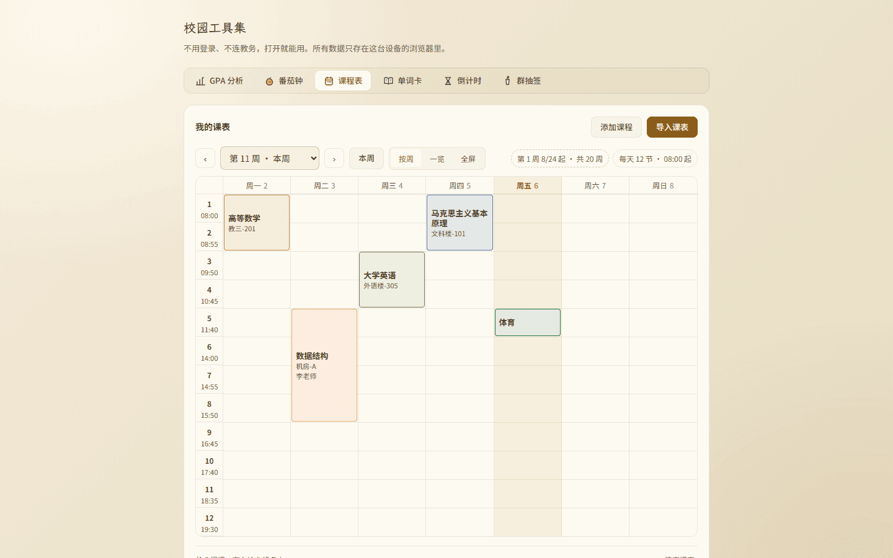
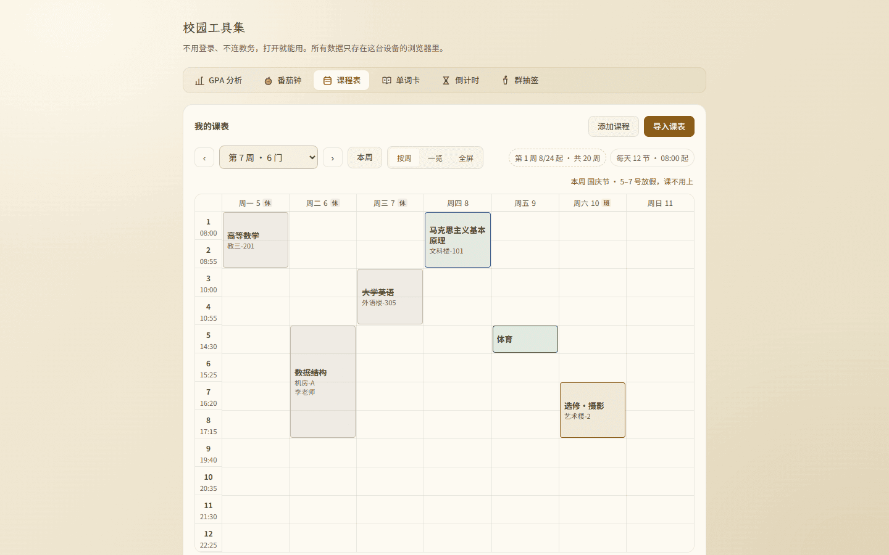
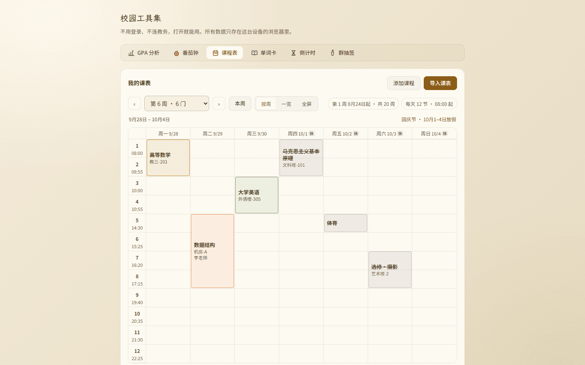
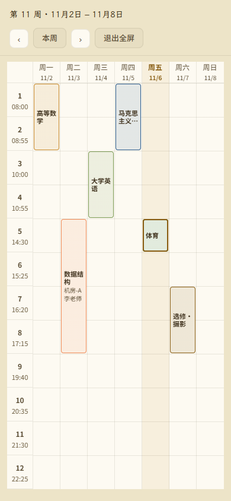
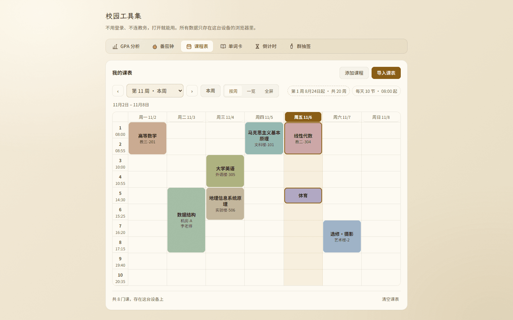
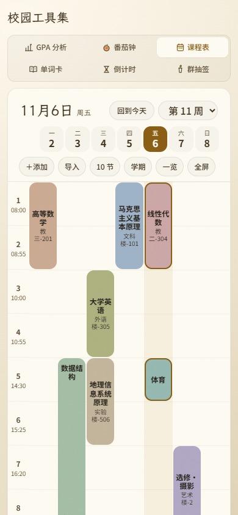
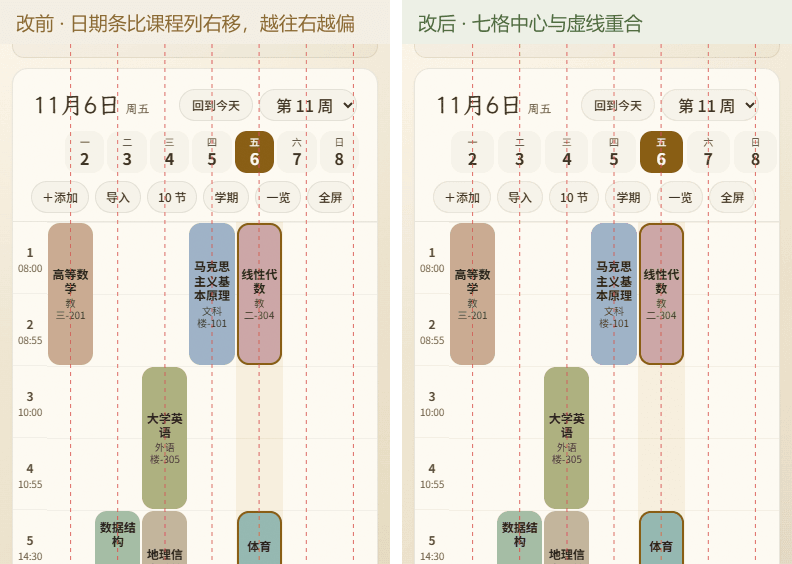
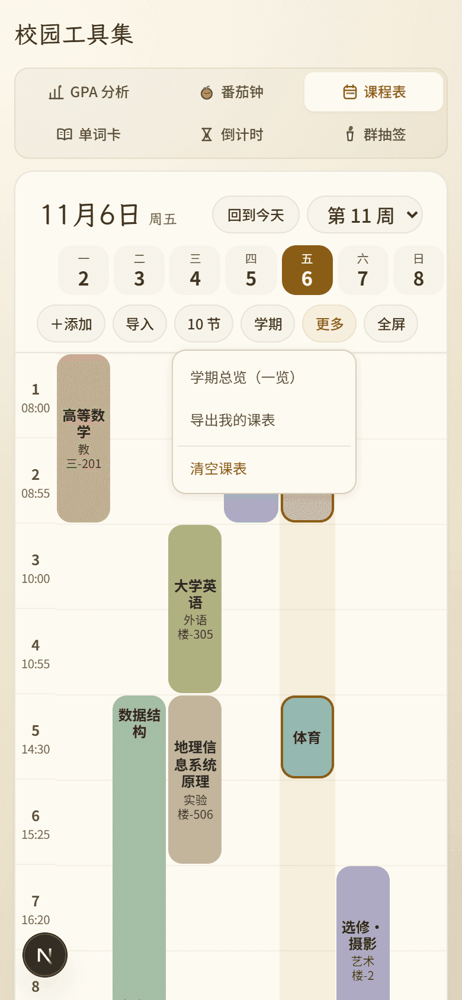
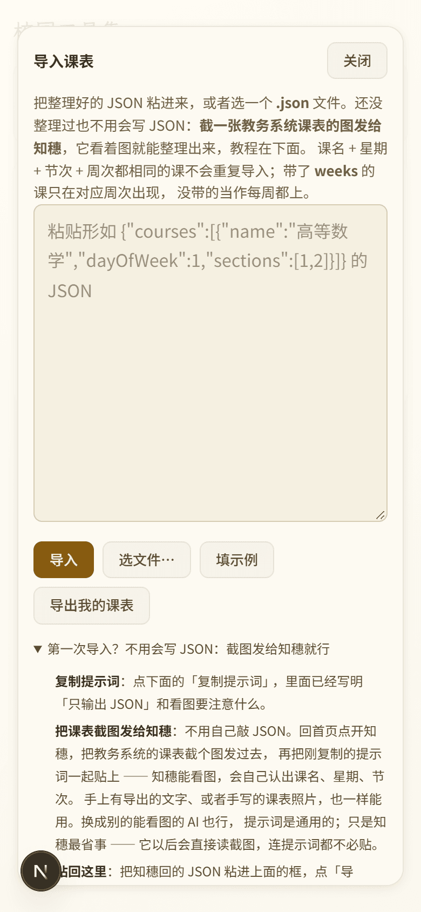

# 审核报告 · 课表 B1–B6.1 整批整合审核（0.6.0 – 0.6.7）

> **审核通过前不得推送**（本地 commit 可以，防丢失）。
> 填写要求见 `campus/docs/05_审核闸门与分支策略.md`。

---

| 项 | 内容 |
| --- | --- |
| 报告日期 | 2026-11-06 |
| 开发者 | 橙子 |
| 审核人 | @baomi888 |
| 分支 | `school-tools`（**本地 8 个提交，尚未推送**；远端上次推送为 `35d541f`，见 README 记录） |
| 板块版本 | 0.5.9 → **0.6.0 → 0.6.1 → 0.6.2 → 0.6.3 → 0.6.4 → 0.6.5 → 0.6.6 → 0.6.7**（八个版本，同一批待审） |
| 待审报告 | 本份整合版 + 8 份分项报告（附录 A） |
| 关联条目 | `docs/07` 的 18 条需求与 A01–A09；内测反馈 5 条（日期缺月份 / 配色要莫兰迪 / 手机太拥挤 / 想达到参考图 / 日期和课程没对齐） |
| 改动规模 | 代码 9 个文件 **+3037 / −526**；截图 69 张（`campus/previews/shots/b1–b61sched/`） |

---

## 0. 给审核人的三分钟版

这一批是**课表从头改一遍**，8 个版本连在一起才是一个完整的东西：结构、作息、日历、全屏、
配色、手机版式、对齐。单看任何一批都缺一块，所以合成一份。

**你提过的 5 条，现在的样子：**

| # | 你说的 | 现在的结果 | 版本 |
| --- | --- | --- | --- |
| 1 | 「日期好像不明确，缺少月份」 | 列头写 `周一 9/28`，上方常显 `9月28日 – 10月4日`，放假提示写 `10月1–4日` | 0.6.3 |
| 2 | 「想达到参考图的效果，颜色可不可以是莫兰迪色系」 | 8 色莫兰迪**实心色块**，圆角 8px、内容居中；老存档自动换色，不用重录 | 0.6.5 |
| 3 | 「手机端看起来那么拥挤」 | 表格上方从 57% 屏压到 35%，行高 46 → 72px，课块变成竖长条，课名能读 9 个字 | 0.6.6 |
| 4 | 「想做到和参考图一样的效果」 | 顶部「大日期 + 七格日期条」+ 六个胶囊，日期条替代表头（省 28px） | 0.6.6 |
| 5 | 「日期和课程好像没有对齐」 | 两处像素错位都修掉，七列中心偏差 `+14.1 … −14.1` → **全 0** | 0.6.7 |

**必须先知道的四件事：**

1. **八个版本全在本地**，一个都没推。你说「上传」之后才推 `school-tools`（远端上次推送是 `35d541f`）。
2. **`tsc` / `eslint` / `npm run build` 三关全过**（15/15 页静态预渲染，13 条路由全 `○ Static`）。
3. **桌面版式基本没动**：1440×900 列宽 109 / 行高 49 / 表头 7 列，与 0.5.9 一致；
   唯一的桌面变化是颜色（0.6.5 是你要求的）和课块内容变实心。
4. **有一批没做**：1.1–1.4 的导入教程 + A08（导出导入说明）、A04（加课撞课提示）。
   教程那条原本排 B5，被两次内测追加挤成 **B7**，本次没碰（第 6 节说明理由）。

> **为什么合成一份**：`reviews/README.md` 的规则是「一份功能交付 = 一份报告」，
> 8 份分项报告都保留、仍可逐条回溯（附录 A）；这一份是给负责人**一次看完八批**的合集，
> 签章只回答一个问题：**这八批能不能一起放行**。

---

## 1. 需求覆盖对照

`docs/07` 的 18 条 + 9 条补充项，逐条对账：

| 编号 | 需求 | 状态 | 落在 |
| --- | --- | --- | --- |
| 1.1 | 导入教程放哪、什么形态 | ⬜ **未做** | B7 |
| 1.2 | 「用知穗整理 JSON」写清入口 | ⬜ 未做 | B7 |
| 1.3 | JSON 字段说明 | ⬜ 未做 | B7 |
| 1.4 | 常见错法三条 | ⬜ 未做 | B7 |
| 2.1 | 页面太杂乱，要简化 | ✅ | 0.6.0 |
| 2.2 | 加课收成一个按钮 | ✅ | 0.6.0 |
| 3.1 | 加课表单排版不整齐 | ✅ | 0.6.0 |
| 4.1 | 每节课时间可设、可持久化 | ✅ | 0.6.1 |
| 4.2 | 课名字号要变大 | ✅ 页面内 12–13px、全屏 11–13px | 0.6.1 / 0.6.6 |
| 4.3 | 格子太空旷 | ✅ 三处成因一起收（字号 / 分级 / 分节线）+ 实心色块 | 0.6.1 / 0.6.5 |
| 4.4 | 今天那列轻微高亮 | ✅ 整列淡底 + 今天课块描边 | 0.6.2 |
| 4.5 | 放假日课块变暗 | ✅ **口径有调整**（见第 5 节第 1 条） | 0.6.2 |
| 4.6 | 列头「休 / 班」徽标 | ✅ | 0.6.2 |
| 4.7 | 节日名提示 | ✅ 全屏时挪到顶栏标题旁 | 0.6.2 |
| 5.1 | 学期设置排版太空 | ✅ 弹窗两列 + 分隔线 | 0.6.0 |
| 6.1 | 全屏一屏看完全周 | ✅ 360/390/844/1440 横纵滚全 0 | 0.6.4 |
| 6.2 | 横屏能看整周 | ✅ 844×390 每节 25px，只留课名 | 0.6.4 |
| 7.1 | 照参考图（小律课程表） | ✅ 配色 + 版式两批兑现 | 0.6.5 / 0.6.6 |
| A01 | 编辑已有课程 | ✅ 点课块 → 详情 → 编辑 | 0.6.0 |
| A02 | 空状态设计 | ✅ | 0.6.0 |
| A03 | 每天几节可设 | ✅ 8–14 节 | 0.6.1 |
| A04 | 同格撞课提示 | ⬜ **未做**（同时段两门课**已经会左右分栏**，缺的是加课时的黄字提示） | 待排 |
| A05 | 深色主题验证 | ✅ 每批都跑了深色实测 | 全部 |
| A06 | 不只靠颜色区分 | ✅ 「休 / 班」有字、今天课块有描边、放假块有删除线 | 0.6.2 |
| A07 | `periods` 数据迁移 | ✅ 写进 `docs/02` 2.6 节，旧存档读出补默认值 | 0.6.1 |
| A08 | 导出 / 导入闭环说明 | ⬜ 未做（属教程） | B7 |
| A09 | 手机全屏的退出方式 | ✅ Esc + 明显按钮 + 锁滚动 | 0.6.4 |

**21 / 27 已落地**（本表记的是 0.6.0–0.6.7 八批的状态），剩下 6 条：B7 教程 5 条（1.1–1.4 + A08）、A04 撞课提示 1 条。

> **补记（2026-11-06，B7 / 0.6.8）**：1.1、1.2、1.3、1.4 与 A08 已完成，覆盖数变为 **26 / 27**；
> 上表这 5 行的「未做」已过时，以 `2026-11-06_课表B7教程与收口.md` 为准。仍未做的只剩 **A04 撞课提示**。
另有 3 条虽然做了，但口径与 `docs/07` 原文不同，需要你点头（第 5 节）。

---

## 2. 八批各改了什么

### 2.1 · B1 结构与交互（0.6.0）

**只动结构与交互，不碰数据模型。**

- 首访不再塞三门示例课 → 空状态（「还没有课表」+ 导入 / 手动添加 + JSON 从哪来）；
- 「添加一门课」从第二张常驻卡片收成头部按钮，点了**页内展开**（不弹窗、不推挤表格）；
- 表单改 Grid：桌面 6 格两行、手机 2 列四行，右边缘对齐；
- 学期弹窗收紧为两列 + 分隔线；
- **点课块从「删」改「看」**：详情里能编辑（同一套字段）或删除 —— 改个教室不用删了重加。

实测：面板高 986px（原 1105）、卡片 1 张（原 2 张）、表单两行边缘都落在 328 / 1112。

### 2.2 · B2 作息与密度（0.6.1）

**第一次动数据**：快照多一个 `periods`，连带迁移与契约文档。

- 「上课时间」弹窗：每天几节（8–14）、一键重排（第一节几点 / 每节多少分钟 / 课间多少分钟）、逐节微调；
- 节次时间**常显**在节次号下面（原来只有全屏有）；
- 课名 12 → 13px，课块内容按高度分级：1 节只课名、2 节加教室、3 节以上才放老师；
- 课块竖向居中 + 补横向分节线（repeating 渐变，行高变了只改一个 `background-size`）。

存**开始时间**不存结束时间：两个都存，早晚出现「第 1 节 08:00–09:40、第 2 节 09:30 开始」的自相矛盾存档。

### 2.3 · B3 日历联动（0.6.2）

**唯一依赖外部数据的一批。** 内置 2026–2027 节假日常量表（`logic/holidays.ts`），
零请求、离线可用，代价是每年 12 月要更新一次（已写进 `ROADMAP` 的「例行事项（按年）」）。

- 列头「休 / 班」徽标（灰 / 橙），**有字不只靠颜色**；
- 放假日课块变灰 + 课名删除线，调休上班日不变暗；
- 今天课块加深描边（在原有整列淡底之上）；
- 节日名 + 「哪几天放假」：连号收成区间，断号照实列。

**变暗的实现换了**：按 `docs/07` 的 45% 不透明度做出来，课名只剩 **2.51:1**，读不出「那天本来是哪门课」；
改成「彩色变灰」后 **8:1**。这条与原口径有出入，已在 0.6.2 报告里提请确认，随该批一并通过。

### 2.4 · B3.1 日期补月份（0.6.3）

- 列头 `5` → `10/5`（跨月那周不再是「29 30 1 2」）；
- 表格上方常显整周区间（原来只在有假期时出现）；
- 放假提示带月份；全屏标题给完整区间；学期 chip 改中文日期。

顺带修掉 B3 的隐藏 bug：`dayRangeText` 原来收日号数组，跨月的「30、1、2」既读不出月份、
**连号判断也断了**（本该「放假三天」被写成「不连续的三个日子」）。改成收 `Date[]`，按「前一天 + 1 天」比。

### 2.5 · B4 全屏一屏看全整周（0.6.4）

- 「排不下」其实是写死了宽度：`.campus-week{min-width:560px}` + 全屏 `min-width:720px`，去掉即自适应；
- 行高按容器均分（进全屏量一次，下限 18 / 上限 96，窗口变化重算）；
- 窄列改两行表头（「周几 + 徽标」/「日期」），矮行只留课名；
- Esc 退出 + 锁 body 滚动；横屏顶栏压缩。

| 场景 | 容器 | 横滚 | 纵滚 | 列宽 | 行高 | 可见列 |
| --- | --- | --- | --- | --- | --- | --- |
| 390×844 竖屏 | 390×750 | 0 | 0 | 46×7 | 57 | 7/7 |
| 844×390 横屏 | 844×343 | 0 | 0 | 112×7 | 25 | 7/7 |
| 360×640 小屏 | 360×546 | 0 | 0 | 42×7 | 40 | 7/7 |
| 1440×900 桌面 | 1440×841 | 0 | 0 | 196×7 | 65 | 7/7 |

### 2.6 · B5 莫兰迪配色（0.6.5）

- `COURSE_COLORS` 换成 8 个莫兰迪色（明度 70–78、饱和 15–25%，按色相拉开）；
- 画法从「12% 淡底 + 同色描边」改成**实心色块**，圆角 4 → 8px，内容居中；
- 今天那列表头变实心胶囊；
- 旧存档自动换色：`normalizeCourseColor()` 按旧 8 色的下标映射，**v2 存档不走迁移函数**，所以在读档处单独过一遍。

课名对比度 7.05–8.01:1，教室 5.35–6.08:1，放假块 4.95 / 6.52，今天胶囊 5.70 / 6.93 —— 都过 AA。
深色主题整块 `brightness(.88)`，最差一格（灰紫）仍有 5.60。

### 2.7 · B6 手机版式重排（0.6.6）

拥挤不是观感问题，是七层控件压掉了 57% 屏幕：页头 96 + 工具标签 104 + 卡片头 56 + 周次条 44 +
视图切换 40 + 两颗 chip 36 + 区间行 22 → 表格只剩 354px 装 12 节，单节被压到 46px（格子接近正方形）。

照参考图重排：

| 项 | 改前 | 改后 |
| --- | --- | --- |
| 表格顶部（390×844） | 约 480px | **298px** |
| 表格上方占屏 | 57% | **35%** |
| 单节行高 | 46px | **72px** |
| 课块（连上两节） | 45×90（2.0） | **45×142（3.2）** |
| 单元格线 | 七竖七横 | 只有很淡的横线 |

日期条同时是表头（`bareHead`，省 28px）；长块「课名贴顶、教室贴底」；教室允许折两行。

### 2.8 · B6.1 日期对齐 + 翻周标题（0.6.7）

内测「日期和课程好像没有对齐」。量出来是两处错位，方向相反、中途交叉：

1. **起点差 18px**：表格用 `margin: 6px -18px` 抵到卡片外沿，日期条还在卡片内容盒里；
2. **算法不同**：日期条 `gap: 3px` 从轨道里扣宽（47.1 → 39.4），课程列是不带 gap 的七等分（仍 47.1）。

改法：日期条补同一个 `-18px`；`gap` 改 `0`，缝隙交给每格 `margin: 0 2px`（margin 不参与轨道计算）。

| 列 | 日期格中心 | 课程列中心 | 改前偏差 | 改后 |
| --- | --- | --- | --- | --- |
| 一 | 84.7 | 70.6 | **+14.1** | 0 |
| 四 | 212.0 | 212.0 | 0（碰巧） | 0 |
| 日 | 339.3 | 353.4 | **−14.1** | 0 |

顺带：翻到别周时大标题不再写「今天」（原来第 7 周顶着「11月6日 周五」，日期条却是 10/5–10/11），
改显「第 N 周」+ 区间行。

---

## 3. 改动文件

代码 9 个文件（+3037 / −526），全部在 `frontend/src/campus/` 内：

| 文件 | 涉及批次 | 改动 |
| --- | --- | --- |
| `types.ts` | B2 | 新增 `PeriodPlan`；`ScheduleSnapshot` 增加 `periods` |
| `logic/schedule.ts` | B2 B5 | 删掉写死的时间常量，改作息函数族；节次上限 12 → 14；`COURSE_COLORS` 换莫兰迪 + `LEGACY_COURSE_COLORS` + `normalizeCourseColor()` |
| `logic/holidays.ts` | B3 | **新增**：2026–2027 常量表、逐日索引、`dayInfoOf` / `holidayLabelsOf` / `isWeekend` / `isYearCovered` |
| `tools/schedule/ScheduleTool.tsx` | 全部 | 页面结构、手机版式、全屏测量、作息 chip、节假日计算、日期文案、读档迁移 |
| `tools/schedule/WeekGrid.tsx` | B1–B6 | 点课块改详情；`plan` 驱动；分级显示；分节线图层；`compact` / `dense` / `bareHead`；实心色块 |
| `tools/schedule/CourseEditor.tsx` | B1 B2 | **新增**：加课/改课共用表单 + 详情弹窗 |
| `tools/schedule/ScheduleDialogs.tsx` | B1 B2 | 导入成功即关闭；学期弹窗两列；**新增** `PeriodDialog` |
| `styles/campus.css` | 全部 | 课表段整体重写（按批次分节注释）；B6 新增日期条 / 胶囊 / 手机版式；B6.1 对齐修正 |
| `index.ts` | B2 | 对外导出随常量改名同步 |

治理与文档：`VERSION`、`CHANGELOG.md`（0.6.0–0.6.7 八条）、`docs/02`（`periods` 契约 + 节假日边界）、
`docs/07`（批次进度表）、`ROADMAP.md`（按年例行事项）、`reviews/`（9 份文档）、69 张截图。

**板块外文件：无。** 未动 `tokens.css`、`CornIcon.tsx`，未加任何后端接口或登录态。

---

## 4. 验证汇总

| 验证项 | 命令 / 操作 | 结果 |
| --- | --- | --- |
| 类型检查 | `cd frontend && npx tsc --noEmit` | **通过，exit 0**（八批各跑一次，最后一次 0.6.7 复跑） |
| 代码规范 | `npx eslint src/campus` | **通过，0 error / 0 warning** |
| 构建 | `npm run build` | **通过**：15/15 页静态预渲染，13 条路由全 `○ Static`（0.6.7 复跑） |
| 桌面未回归 | CDP 1440×900 | 列宽 109 / 行高 49 / 表头 7 列 / 无日期条，与 0.5.9 一致 |
| 全屏四档 | 390×844 / 844×390 / 360×640 / 1440×900 | 横滚 0、纵滚 0、7 列全可见 |
| 手机页面内 | 390 / 360 | 横滚 0；表格顶 298；行高 72；课块 45×142 |
| 日期条对齐 | 逐列 `getBoundingClientRect` | 七列中心偏差 **全 0**（390 与 360 两档） |
| 作息持久化 | 改节数 → 刷新 → 读快照 | `periods.count` / `starts` / `duration` 全部保留 |
| 旧数据兼容 | 手写旧存档（无 `periods`、旧 8 色、`day` 偏移一天） | 补默认作息、自动换色、`day` 只回拨一次 |
| 节假日 | 第 6/7 周（国庆跨两周） | 第 6 周只标周四–周日；第 7 周一–三休、周六班 |
| 深色主题 | 每批 `?theme=dark` 重跑关键场景 | 通过；对比度逐层 alpha 合成后全部 ≥ 4.5:1 |
| 对比度 | canvas 归一化取色 + 半透明底逐层合成 | 课名 7.05–8.01、日期条 7.53 / 6.94、今天胶囊 5.70 / 6.93、放假块 4.95 / 6.52 |

复现脚本全部留在 `.workbuddy/tmp/`（`sched_b1.mjs` … `sched_b61`、`sched_align.mjs`、
`sched_b6_contrast.mjs`）。**截图脚本一律用 `localhost:PORT`**：用 `127.0.0.1` 会被
Next dev 的跨域拦截挡住 dev 资源，页面虽然出 HTML 但 React 不水合，点哪儿都不动。

---

## 5. 三个需要你点头的取舍

1. **4.5「变暗」不是 45% 不透明度，是「彩色变灰」。**
   原口径会让课名掉到 2.51:1（读不出是哪门课）；改后 8:1，靠灰色 + 删除线表达「不用上课」。
   0.6.2 报告里已提请确认，随该批通过 —— 这里再列一次，因为它与 `docs/07` 的原文不一致。
2. **手机页面内不再「一屏 12 节」。** 一屏约 7 节，要往下滑一屏多（总高 1159 / 视口 844）。
   这是照参考图做的取舍；「一屏看全整周」由**全屏**承担（四档横纵滚都是 0）。
   如果你要求页面内也必须一屏，那就得回到 46px 行高，B6 的效果会全部作废。
3. **翻到别周时大标题改显「第 N 周」。** B6 原本固定写「今天」（翻周时字不跳），
   但第 7 周顶着「11月6日」和日期条对不上，所以 0.6.7 改成「第 N 周」。

---

## 6. 风险与未做的事

**已知限制**

- **360px 上「马克思主义基本原理」仍裁一个字**（列宽 43、一行 2 字、连堂块 4 行 = 8 字 < 9 字）。
  再压只能降到 11px，会跌破「页面内 ≥12px」的验收线，所以没做。
- **莫兰迪 8 色里有几组色相靠得近**（赭 / 米灰、橄榄 / 鼠尾草）。低饱和本身就把色相空间压窄了；
  现在按色相排序，保证相邻 id 一定不同色。
- **日期条七格是只读的**（点日期不切单日视图）。参考图里点了会切，我们没有单日视图，
  与其点了不响应，不如不做成按钮。
- **节假日靠内置常量表**：2026–2027 已覆盖，2028 起必须更新，否则课表会显示「这一年不标假期」
  （代码里会明确提示「数据未覆盖」，不会静默当成没假期）。

**本次没做（但相关）**

- **B7 教程（1.1–1.4 + A08）**：导入弹窗里已有 `
` 雏形和 `AI_PROMPT`，
  但没写三步图文、字段表、常见错法。原排 B5，被两次内测追加挤后改号 B7。
- **A04 加课撞课提示**：同时段两门课已经会左右分栏（旧版就有），缺的是加课那一刻的黄字提醒。
- **参考图里的「午休 / 晚饭」分隔条**：需要给 `periods` 加「午休在第几节后」，是数据结构改动，另批再做。
- `tests/test_focus_sync.py` 13 个接口用例（番茄钟的，本机无 pytest），与课表无关。

**可能的回归点（建议重点看）**

1. **`periods` 迁移**：旧存档没有这个字段，读出即补默认 12 节 / 08:00 起。若你本地有很早的存档，值得刷新看一眼。
2. **点课块语义变了**：从「删」变「看」，删除移进详情弹窗。肌肉记忆会误触，但不会误删。
3. **手机端卡片头隐藏**：「我的课表 + 添加 / 导入」收进工具条前两格，功能没丢。
4. **`bareHead`**：只在「手机 + 设了学期」时生效，课块 `top` 基准同步改 0；桌面与全屏不走这个分支。
5. **全屏 `min-width` 去掉后**，桌面全屏的列宽从固定 196 变成按屏宽均分，宽屏上列会更宽（不是变窄）。

---

## 7. 审核时值得亲手点的 6 个点

1. **桌面**：点任一课块 → 出详情（不是删除）→ 编辑改个教室 → 保存 → 课块内容跟着变。
2. **桌面**：「上课时间」→ 每天改 10 节 → 一键重排 → 刷新页面 → 时间还在。
3. **桌面**：翻到第 7 周（国庆）→ 列头有「休 / 班」、放假课块变灰带删除线、右上角写「国庆节 · 10月5–7日放假」。
4. **手机**：一屏看到「大日期 + 七格日期条 + 六个胶囊」；日期条每格**正对**下面那一列。
5. **手机**：点「全屏」→ 竖屏一屏 7 列无横滑；横过来 → 每节更矮但仍 7 列；Esc / 退出按钮能回去。
6. **手机**：翻到别的周 → 标题变「第 N 周」、出现区间行；点「回到今天」→ 回到本周且今天那格是实心。

---

## 8. 截图

### 看图速览 · 十个批次一屏看完

> 每格是当批最有代表性的一张（缩略图限宽 220），**点「原图」可放大看字**。
> 0.6.8 / 0.6.9 是整合版写完后的追加批次，按 README 说明随本批一起审，所以一并放进图集。

<table>
  <tr>
    <td align="center"><b>0.6.0 · B1 结构与交互</b>  删示例课 · 空状态 <a href="../previews/shots/b1sched/desk-empty.png">原图</a></td>
    <td align="center"><b>0.6.1 · B2 作息与密度</b>  节次时间 · 分节线 <a href="../previews/shots/b2sched/desk-week.png">原图</a></td>
    <td align="center"><b>0.6.2 · B3 日历联动</b>  休 / 班 · 放假变灰 <a href="../previews/shots/b3sched/desk-holiday.png">原图</a></td>
  </tr>
  <tr>
    <td align="center"><b>0.6.3 · B3.1 日期补月份</b>  「9月28日 – 10月4日」 <a href="../previews/shots/b31sched/desk-week6.png">原图</a></td>
    <td align="center"><b>0.6.4 · B4 全屏一屏</b>  竖屏一屏 7 列无横滑 <a href="../previews/shots/b4sched/phone-full-portrait.png">原图</a></td>
    <td align="center"><b>0.6.5 · B5 莫兰迪配色</b>  8 色实心块 · 今天胶囊 <a href="../previews/shots/b5sched/desk-week11.png">原图</a></td>
  </tr>
  <tr>
    <td align="center"><b>0.6.6 · B6 手机版式重排</b>  表格上方 480 → 298px <a href="../previews/shots/b6sched/phone-390.png">原图</a></td>
    <td align="center"><b>0.6.7 · B6.1 日期对齐</b>  逐列偏差全归零 <a href="../previews/shots/b61sched/compare-before-after.png">原图</a></td>
    <td align="center"><b>0.6.8 · B7 教程与收口</b>  「更多」菜单 · 教程三步 <a href="../previews/shots/b7sched/phone-390-more.png">原图</a></td>
  </tr>
  <tr>
    <td align="center"><b>0.6.9 · B7.1 截图优先</b>  「把课表截图发给知穗」 <a href="../previews/shots/b71sched/phone-390-import.png">原图</a></td>
    <td colspan="2" align="left">以上 10 张是各批代表图；<b>每批的完整截图清单</b>见对应分项报告第 6 节，或下表目录。 浅色 / 深色、390 / 360 / 1440 各档实测图都在 `campus/previews/shots/` 下，未做裁剪。</td>
  </tr>
</table>

| 目录 | 批次 | 张数 | 看点 |
| --- | --- | --- | --- |
| `shots/b1sched/` | 0.6.0 | 11 | 空状态、页内展开表单、详情 / 编辑、学期弹窗、桌面全貌 |
| `shots/b2sched/` | 0.6.1 | 12 | 作息弹窗、节次时间常显、课块分级、分节线 |
| `shots/b31sched/` | 0.6.3 | 10 | 列头 `10/5`、区间行、跨月周 |
| `shots/b3sched/` | 0.6.2 | 8 | 休 / 班徽标、放假块变灰、节日提示、深色 |
| `shots/b4sched/` | 0.6.4 | 5 | 四档全屏（竖 / 横 / 小屏 / 桌面） |
| `shots/b5sched/` | 0.6.5 | 6 | 8 色实心块、今天胶囊、深色、迁移前后 |
| `shots/b6sched/` | 0.6.6 | 7 | 手机版式改前改后、360 小屏、深色、全屏 |
| `shots/b61sched/` | 0.6.7 | 10 | **改前 / 改后并排（叠列中心虚线）**、日期条 3 倍放大、跨月周标题 |

---

## 9. 审核结论（由负责人填写）

- [x] **通过** —— 八批一起合并并推送
- [ ] **有条件通过** —— 条件：
- [ ] **打回** —— 不通过条目（对照 `docs/03` 编号）：

审核意见：负责人 2026-11-06 确认「已经审核通过了，可以推送」；闸门 4 上传前优化已完成并复核通过（逐条对账见整合版报告第 10 节）。

审核日期：2026-11-06

---

## 10. 上传记录（审核通过后填写）

| 项 | 内容 |
| --- | --- |
| 负责人审核结论 | ✅ **通过**（2026-11-06，第 9 节已签章；负责人确认「已经审核通过了，可以推送」） |
| 开发者授意上传 | ✅ **已收到**（2026-11-06 21:59：「把今天有关课程表修改的内容优化后上传」）—— 闸门 3 两个条件均已满足 |
| 推送时间 | 2026-11-06（精确时间与最终 sha 见推送后回填） |
| 推送分支 | `school-tools` |
| 推送提交 | `ef570ca..HEAD` 共 21 个提交（课表 0.6.0–0.6.9、12 份报告、核验材料、3 笔上传前优化、8 份签章） |
| 远端起点 | `ef570ca`（经 GitHub API 读取的真实远端头）。本地跟踪引用 `origin/school-tools` 仍停在 `af2873a`，推送后需重建 sha 对齐 |
| 推送通道 | `github.com:443` 报 `schannel: server closed abruptly`；`api.github.com` 返回 200，改走 Git Data API（`push_api.py`），推完用 `recon.py` 重建远端 sha 再 `git reset --soft` 对齐 |

### 上传前优化逐条对账（`docs/05` 闸门 4）

| # | 项目 | 结论 |
| --- | --- | --- |
| 1 | 调试残留 | **无此项**。全 `src/campus` 扫描 `console.*` / `debugger` / `TODO` / `FIXME` / 注释掉的旧实现，零命中；仅 6 处既有 `eslint-disable`（hooks 规则，非调试残留） |
| 2 | 重复逻辑 | **无新增重复**。上一轮优化已抽出 `logic/download.ts` 公共下载、`schedule.ts` 公共常量与 `formatSections()`；本轮扫描课表目录，无 ≥3 次重复段 |
| 3 | 死代码 | **做了**：删除 `campus.css` 的 `.campus-pending` / `-title` / `-text` / ` a` 共 4 段（`f018cc3` 建分区时「未迁移工具占位提示」的遗留，五工具迁移完后全仓库零引用）。全 campus 扫描未使用导出 **0** 个；组件里直接调 `localStorage` **0** 处（板块铁律） |
| 4 | 类型与规范 | **通过**：`npx tsc --noEmit` = 0、`npx eslint src/campus --max-warnings=0` = 0；无新增 `any` / `@ts-ignore` |
| 5 | 魔法数字 | **无此项**。沿用上一轮收进常量的 `DAYS_IN_WEEK` / `MIN·MAX_TERM_WEEKS` / `HEAD_HEIGHT*` / `REVOKE_DELAY_MS` 等，本轮未引入新字面量 |
| 6 | 副作用清理 | **无此项**。`MoreMenu` 3 个 `addEventListener` 对 3 个 `removeEventListener`；断点 `mq` 与全局 `keydown` 均有清理；`download.ts` 的 `setTimeout` 是一次性 `revokeObjectURL`，无需卸载清理 |
| 7 | 双端与深浅色 | **通过**：本轮无新增 UI 文案/控件；另做 390×844 / 1440×900 × 浅/深四档 DOM 复核（数据见 `.workbuddy/tmp/preupload-check.json`），`passed=true`：手机 7 格日期条、桌面 0（B6 版式预期）、横滚全 0、「更多」「导入」与课程块齐全、`html.dark` 主题变量浅 `#d6d0c6` / 深 `#3e372c` 确有差异 |
| 8 | 文案一致性 | **做了**：`VERSION` 0.6.9 / `CHANGELOG` 0.6.9 / 本报告一致；B7.1 报告「压缩后 0.8MB」改为实测 0.74MB；核验报告第 8 节「未收到上传二字」改为已收到；代码注释里两处「键盘 / 桌面端」非用户可见文案，无电脑专属说法漏进手机 |
| 9 | 截图时效 | **做了**：本轮优化只删零引用样式 + 截图重编码，**画面内容未变**，故沿用各批最终代码截图、不重拍；四档复核另以 DOM 量测佐证界面未退化 |
| 10 | 体积 | **做了**：44 张今天新增截图统一调色板 PNG 重编码，`13.13MB → 5.00MB`（-62%）；今天 101 张总量 `16.35MB → 8.22MB`，**无单张 > 500KB**。`git status` 无临时脚本 / 草稿 / 本地配置（压缩与复核脚本均在被忽略的 `.workbuddy/tmp/`）；仅两份用户素材未跟踪，不提交 |
| 11 | 提交粒度 | **做了**：拆 3 个提交 —— ① 删死样式 ② 截图压缩 ③ 上传记录，各一件事，message 写明做了什么与为什么 |

**优化动了代码（删 CSS），已按闸门 1 重跑**：`tsc` 0 / `eslint` 0 / `npm run build` **15/15 静态页通过** / 四档 DOM 复核 `passed=true`。
截图压缩属二进制重编码、删样式属零引用清理，二者都不改变渲染结果，故不触发重拍。

---

## 附录 A · 分项报告索引

| 版本 | 分项报告 | 用途 |
| --- | --- | --- |
| 0.6.0 | `2026-11-06_课表B1结构与交互.md` | 结构重排前后、点课块改详情、表单对齐实测 |
| 0.6.1 | `2026-11-06_课表B2作息与密度.md` | `periods` 契约与迁移、「框框太空旷」三处成因 |
| 0.6.2 | `2026-11-06_课表B3日历联动.md` | 为什么用常量表、变暗口径为什么改、放假日期怎么算 |
| 0.6.3 | `2026-11-06_课表B31日期补月份.md` | 列头为何不写中文全称、`dayRangeText` 跨月 bug |
| 0.6.4 | `2026-11-06_课表B4全屏一屏.md` | `min-width` 根因、行高均分算法、三档字号分工 |
| 0.6.5 | `2026-11-06_课表B5莫兰迪配色.md` | 8 色取值与对比度矩阵、旧色迁移表 |
| 0.6.6 | `2026-11-06_课表B6手机版式重排.md` | 逐层控件高度账、版式取舍、已知限制 |
| 0.6.7 | `2026-11-06_课表B61日期对齐.md` | 逐列偏差实测、改前改后对比数据 |

八份分项报告按规则保留（归档不删），本文件是它们的合集与签章入口；
两者内容冲突时**以本文件为准**（本文件写在各批之后，含最后一次复跑的构建与回归数据）。

## 附录 B · 提交对照

| 提交 | 内容 |
| --- | --- |
| `950c6e6` | 课表 B1–B3.1 代码（0.6.0–0.6.3） |
| `0fba026` | B1–B3.1 审核报告与截图 |
| `9a74164` | B5 莫兰迪配色 + B4 全屏一屏 |
| `3e18a99` | B4 / B5 审核报告与截图 |
| `8a13265` | B6 手机端版式重排 |
| `788ae7b` | B6 审核报告与截图 |
| `72451d1` | B6.1 日期对齐 + 翻周标题 |
| `eaa6431` | B6.1 报告补对比图 |

以上 8 个提交全部只在本地；远端上次推送是 `35d541f`（0.5.8 + 0.5.9），本次未做 fetch，未核对远端头。
