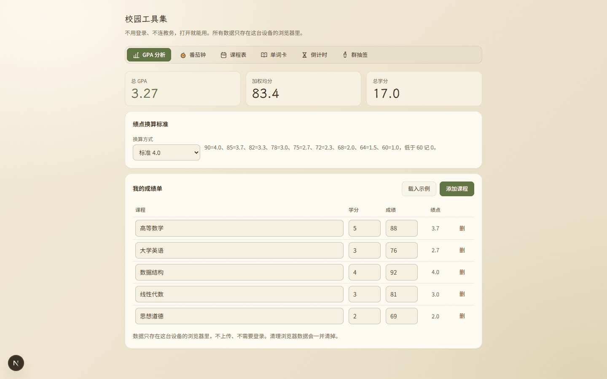
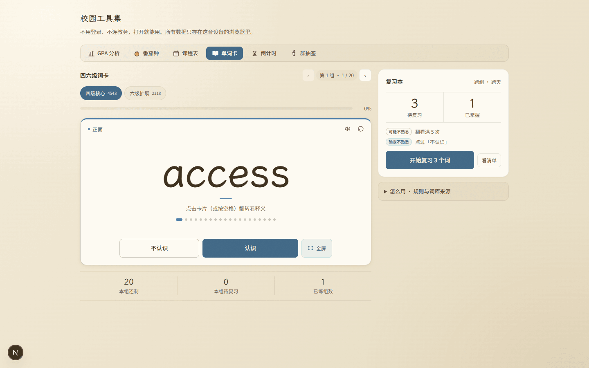
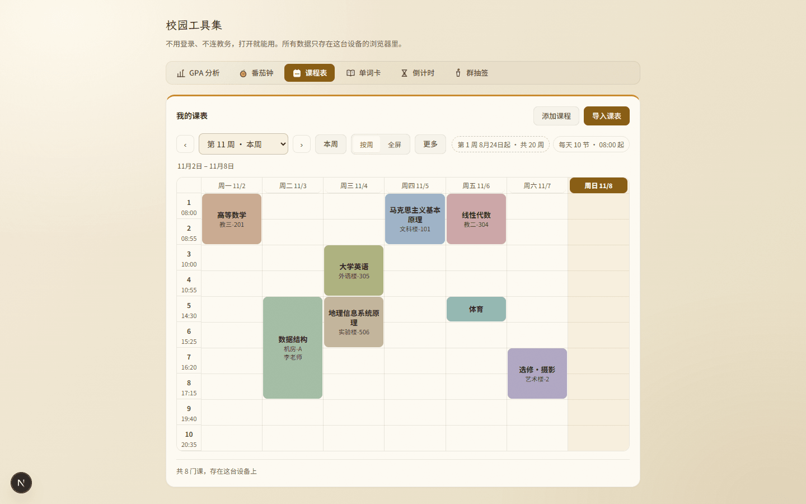
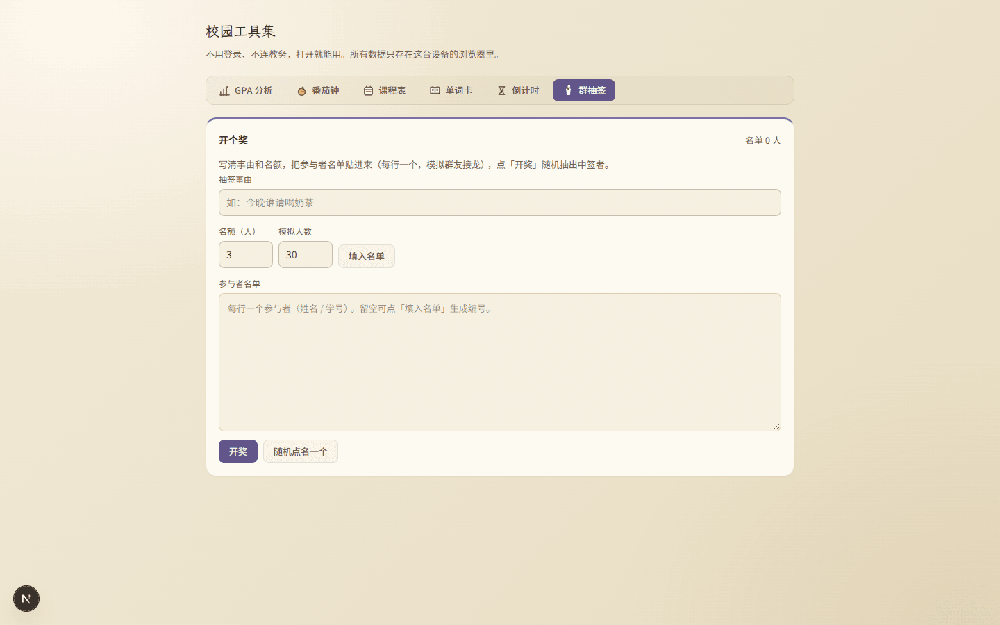
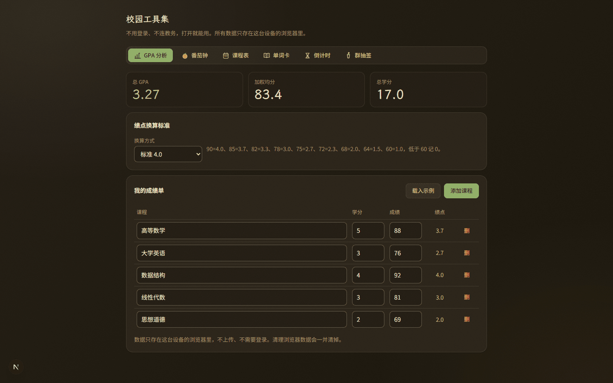
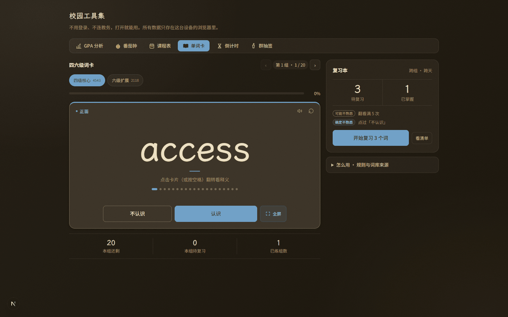
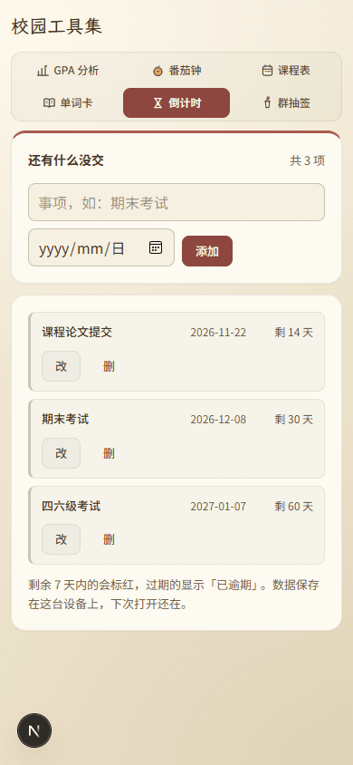
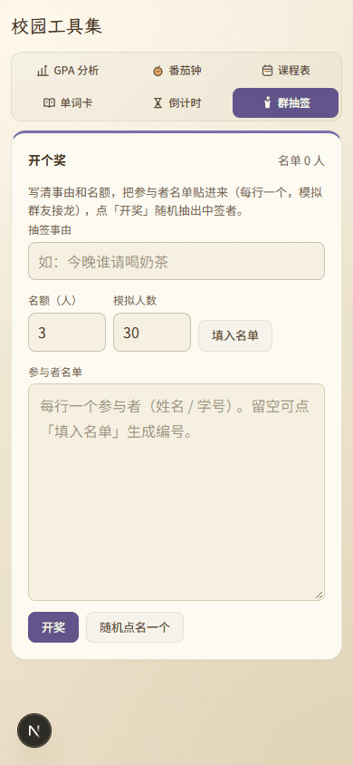
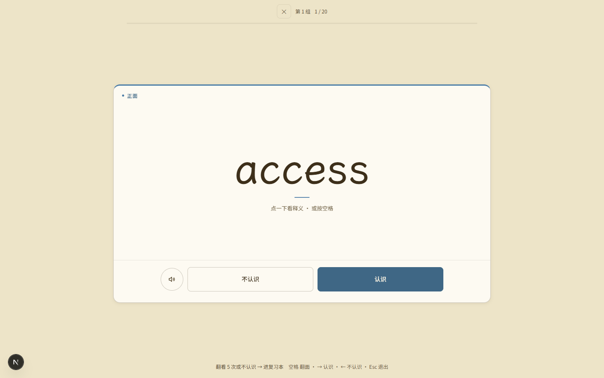
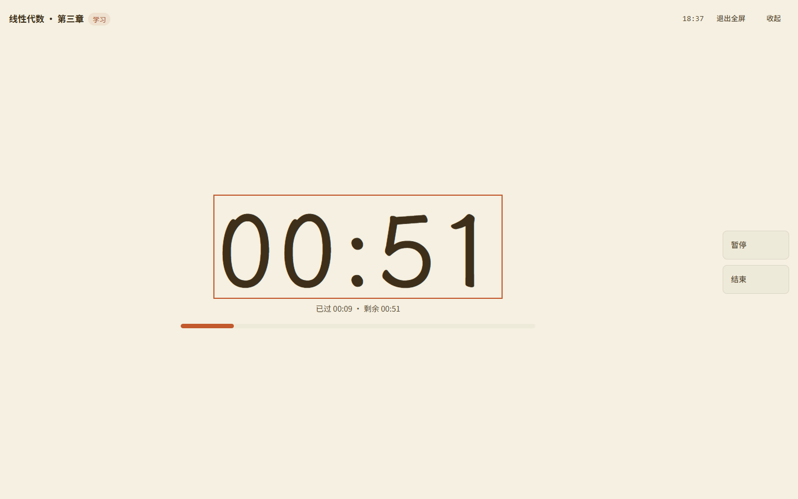

# 审核报告 · 六个工具各用一支身份色（方案 C 全套落地）

| 项 | 内容 |
| --- | --- |
| 报告日期 | 2026-11-08 |
| 开发者 | 橙子 |
| 审核人 | @baomi888 |
| 分支 | `school-tools` |
| 板块版本 | `0.6.9` → **`0.7.0`**（已落地：`VERSION` 与 `CHANGELOG` 均已更新并随批推送；与同日单词卡三批、番茄钟那批合并进同一版） |
| 关联条目 | 负责人原话「其他也改成这样的配色」；前序「方案C_工具身份色_切换换色」+「番茄钟换成这种配色」「其他暂时不改动」 |

> 上一批只把番茄钟那一支（赤陶）接上了身份色，负责人随即说「其他也改成这样的配色」。
> 这次把方案 C 剩下的五支一次接完：GPA 草绿、课表金、单词卡蓝、倒计时赭红、抽签紫。
> **只有 `campus.css` 一个文件被改动**，组件、数据结构、存储、路由零改动。

---

## 1. 做了什么

六个工具各自有了自己的颜色。点进 GPA 是草绿，番茄钟是赤陶，课表是金，单词卡是蓝，倒计时是赭红，抽签是紫：导航那格、卡片顶边、页内主按钮、进度条、点阵、选中的芯片全部跟着这一支走。切到另一个工具，颜色整套换掉，不会有「标签是蓝的、按钮还是金的」这种半套配色。

## 2. 为什么做

- 六个工具共用一套金 accent，六页看起来像同一页的六个部分，不是六个工具 —— 这是负责人最早提「区分度太低了，视觉冲击力不够」的原始动因。
- 当时给了三条路线，负责人选了 A+C（克制加强 + 工具身份色），但后续几批都在处理单词卡，身份色只落了番茄钟一支。
- 这批就是补齐剩下的五支，并且把「一个工具一支色」的机制统一成一条，而不是再复制五遍番茄钟的写法。

## 3. 改动文件

| 文件 | 改动 |
| --- | --- |
| `frontend/src/campus/styles/campus.css` | ① `.campus-shell` / `.dark .campus-shell` 各新增 12 个 `--t-*` 色值（六工具 × accent/ink）；② 新增「工具身份色」一段：六条 `[data-tool] / #campus-panel-*` 映射、标签满色底、面板内 `--accent` 一族重映射、深色实底反转、三张主场卡的 3px 顶边；③ `.campus-tab.is-active` 从「纸底 + 金字」改成读 `--tool-tab-*`（带兜底）；④ 删掉番茄钟段里那套 `--pomo-accent*` 局部映射（已并入统一段） |

**板块外文件**：无。`tokens.css`、`CornIcon.tsx`、路由薄壳都没碰。

### 3.1 机制：一处映射，两处消费

导航那格和面板根节点不是同一棵子树，但必须拿到同一支颜色。所以映射写在一条选择器里，两处共享：

```css
.campus-tab[data-tool="words"],
#campus-panel-words {
  --tool-accent: var(--t-words);
  --tool-accent-ink: var(--t-words-ink);
}
```

面板里再把这族变量接到 `--accent` 上，页内所有强调色（进度条、主按钮、分段选中、聚焦环、词卡顶边、点阵）就一起换掉了 —— 不必逐条改选择器。六个工具共用同一套组件，逐条改一定会漏一处，而漏出来的那种「半套配色」最难查。

### 3.2 仍然必须每页重声明 `--campus-btn-solid`

`.campus-shell` 上写的是 `--campus-btn-solid: var(--accent-ink)`。CSS 自定义属性的 `var()` 替换发生在**声明它的那个元素**上，`.campus-shell` 这一层就已经算成字面量 `#875B10` 了，子元素之后改 `--accent-ink` 不会让它回头重算。所以六个面板里都必须再声明一次，否则「进度条已经变蓝、主按钮还是金」——番茄钟那批就是这么翻出来的，这次把它固化成了通用规则。

### 3.3 三个 alpha 档用 `color-mix` 生成

金色那套是手写的 `rgba(200,137,42,.10/.12/.15)`。六支色若照抄，就是 18 个手写数值、改一次色要改 18 处，所以改成：

```css
--accent-soft: color-mix(in srgb, var(--tool-accent) 10%, transparent);
--accent-line: color-mix(in srgb, var(--tool-accent) 20%, transparent);
```

比例与金色那套一致（10% / 12% / 20%），观感不跳。项目里已有 `color-mix` 先例（番茄钟的实底 hover）。

## 4. 取色与对比度

浅色 = 方案 C 原稿色值，深色 = 同色相只提明度（不改色相，六个工具在深色下仍认得出谁是谁）。

| 工具 | 浅色 accent | 浅色 ink（文字/实底） | ink 压纸白 | 深色 accent | 深色 ink | 深 accent 压深字 |
| --- | --- | --- | --- | --- | --- | --- |
| GPA | `#6F8A4E` | `#5C7340` | 5.06:1 | `#8FAE64` | `#B3CE8E` | 5.98:1 |
| 番茄钟 | `#C25A2E` | `#A84B24` | 5.45:1 | `#E07B4E` | `#F0A077` | 5.06:1 |
| 课表 | `#C8892A` | `#875B10` | 5.70:1 | `#E0A03A` | `#E8B54E` | 6.58:1 |
| 单词卡 | `#4E7EA8` | `#3F6785` | 5.77:1 | `#6E9FC6` | `#9CC3DE` | 5.29:1 |
| 倒计时 | `#A8574E` | `#8B443B` | 6.74:1 | `#D08070` | `#E5A79A` | 4.98:1 |
| 抽签 | `#7A6BA8` | `#5E5189` | 6.68:1 | `#A292CE` | `#C6B9E6` | 5.36:1 |

- **为什么文字与实底不用原色**：原色压纸白普遍只有 2.6–4.2:1（赤陶 4.2、绿 3.3、紫 4.0），14px 的标签压不住 AA 的 4.5 线。所以原色只管装饰（进度条、顶边、图形），文字与实底统一走深一档的 ink。
- **深色为什么要提亮**：原色压在深棕纸面 `#292217` 上只剩 2.4–3.0:1，糊成一片褐。accent 提到 5.2–6.9:1（它还要当标签底色、压深字 `--solid`），ink 再亮一档到 7.5–9.1:1。
- 六支 ink 在浅色面板纸 `#F5F0E1` 上也都在 4.6:1 以上。

## 5. 验证方式

| 验证项 | 命令 / 操作 | 结果 |
| --- | --- | --- |
| 类型检查 | `npx tsc --noEmit` | 通过（exit 0，无输出） |
| 代码规范 | `npx eslint src/campus` | 通过（exit 0，无输出） |
| 构建 | `npm run build` | 通过，`✓ Compiled successfully in 14.6s`，路由含 `/tools` |
| 视觉实测 | `.workbuddy/tmp/tool-colors-verify.mjs`（Playwright + 真实浏览器） | **72 条断言全过** |
| 双端 | 1440×900 / 1024×900 / 768×900 / 390×844 | 六页均无横向滚动 |

### 5.1 断言分布（72 条）

- **浅色 30 条**：六个工具逐个切过去 —— 面板 `--accent`、`--accent-ink`、`--campus-btn-solid`、选中标签底色与字色、页内主按钮实底（`schedule` 也有主按钮，故 6×5 全中）。
- **深色 24 条**：同样六个工具 —— `--accent`、`--accent-ink`、标签底（亮色）+ 字（`--solid`）、页内主按钮。
- **顶边 6 条**：课表 / 倒计时 / 抽签首卡 3px、词组卡 3px 蓝、番茄钟专注卡 3px 赤陶、GPA 明确「不加粗顶边」（仍为 1px 通边）。
- **不串色 2 条**：六支 accent 互不相同；每次切 tab 只有一个面板挂载（`document.querySelectorAll('[id^="campus-panel-"]')` 长度为 1）——变量靠面板存活，这条是「不外泄」的直接证据。
- **没误伤版式 2 条**：单词面板版心仍 1080、其余五个仍 880；四个工具的卡片圆角仍 16px。
- **多宽度 8 条**：1440 / 1024 / 768 / 390 × （无横向滚动、选中标签仍是对应色且不因窄屏掉色）。

其中「GPA 不加粗顶边」这条最容易被误读为失败：`.campus-card` 本来就带 1px 通边，所以断言写的是「顶边仍是 1px，不是 3px」。

## 6. 风险与未做的事

- **课表看起来「没变」**：方案 C 给课表的身份色就是板块金 `#C8892A`，与原来的通用 accent 同色，所以这一页前后几乎一样。这不是漏改，是方案 C 的设定 —— 若希望课表也与板块金区分开，需要新给一支色（比如更深一档的赭金），这属于改方案，需负责人点头。
- **GPA 没有 3px 顶边**：它的「主场」是顶上那排读数（主值 `.is-accent` 已变绿），下面两张卡（换算标准 / 成绩单）分量相当，给任意一张加边等于在两张同等重要的卡之间瞎选一张。若希望统一，建议给读数条加边，而不是卡片。
- **标签满色偏重**：方案 C 的导航就是「当前工具满色填充」。整行六格只有一格实心，锚点很强，但比其余五格重。想收一档可以降成「淡色底 + 该色文字」，改一条规则即可 —— 上一份报告已提过，仍未定。
- **没跟上颜色的东西（刻意）**：课表课块的莫兰迪色（`--course-*`，标的是课程本身）、番茄钟统计饼图的分类色板（`--pie` 系列，标的是学习/作业/其他）——它们是数据分类色，不是工具身份色，染成同一支会让类别失去区分度。
- **深色下实底按钮偏浅**：深色用亮色压深字（与番茄钟那批同一套镜像逻辑），按钮会比浅色主题更「粉/淡」。六支一起看是协调的，但单看某一个可能觉得轻。
- **浏览器依赖**：`color-mix()` 与 `:has()` 都需要近两年的浏览器。前者不支持会让三档淡底失效（变透明，不影响可读性）；后者不支持只是番茄钟与词卡顶边不出现。项目里已有 `:has()` 先例。
- **本次没做**：工具页头（`校园工具集` 标题区）仍是中性墨色，没有跟着当前工具变色 —— 页头属于板块级，不属于任何工具。

## 7. 截图

<table>
  <tr>
    <td align="center"><b>桌面 1440 · GPA（草绿）</b><br>
      <br>
      <a href="../previews/shots/tool-colors/1440-gpa-light.png">点开原图</a></td>
    <td align="center"><b>桌面 1440 · 单词卡（蓝）</b><br>
      <br>
      <a href="../previews/shots/tool-colors/1440-words-light.png">点开原图</a></td>
  </tr>
  <tr>
    <td align="center"><b>桌面 1440 · 课表（金，与板块同色）</b><br>
      <br>
      <a href="../previews/shots/tool-colors/1440-schedule-light.png">点开原图</a></td>
    <td align="center"><b>桌面 1440 · 群抽签（紫）</b><br>
      <br>
      <a href="../previews/shots/tool-colors/1440-draw-light.png">点开原图</a></td>
  </tr>
  <tr>
    <td align="center"><b>桌面 1440 · GPA 深色</b><br>
      <br>
      <a href="../previews/shots/tool-colors/1440-gpa-dark.png">点开原图</a></td>
    <td align="center"><b>桌面 1440 · 单词卡深色</b><br>
      <br>
      <a href="../previews/shots/tool-colors/1440-words-dark.png">点开原图</a></td>
  </tr>
  <tr>
    <td align="center"><b>手机 390 · 倒计时（赭红）</b><br>
      <br>
      <a href="../previews/shots/tool-colors/390-deadline.png">点开原图</a></td>
    <td align="center"><b>手机 390 · 群抽签</b><br>
      <br>
      <a href="../previews/shots/tool-colors/390-draw.png">点开原图</a></td>
  </tr>
  <tr>
    <td align="center"><b>全屏刷词（蓝）</b><br>
      <br>
      <a href="../previews/shots/tool-colors/1440-words-deck.png">点开原图</a></td>
    <td align="center"><b>专注全屏（赤陶，进度条 9/60）</b><br>
      <br>
      <a href="../previews/shots/tool-colors/1440-pomodoro-stage.png">点开原图</a></td>
  </tr>
</table>

完整清单（20 张，调色板 PNG 重编码后共 3.0MB）：

| 文件 | 内容 |
| --- | --- |
| `1440-<工具>-light.png` ×6 | 桌面浅色，逐个工具的默认态（GPA 已载入示例） |
| `1440-<工具>-dark.png` ×6 | 桌面深色，同上 |
| `390-<工具>.png` ×6 | 手机浅色，2×3 标签网格 |
| `1440-words-deck.png` | 单词卡全屏刷词（牌面顶边、认识按钮、词头短线均为蓝） |
| `1440-pomodoro-stage.png` | 番茄钟专注全屏（时钟框、进度条为赤陶） |

> 截图时间 18:36–18:37，晚于最后一次代码改动（`campus.css` 18:35）；`tsc` / `eslint` / `build`（18:41）在截图之后重跑。

---

## 8. 审核结论（由负责人填写）

- [x] **通过** —— 可以合并并推送
- [ ] **有条件通过** —— 条件：
- [ ] **打回** —— 不通过条目（对照 `docs/03` 编号）：

审核意见：负责人 2026-11-09 确认通过（开发者转述「他通过了」）；闸门 4 上传前优化已于 2026-11-08 完成并复核，逐条见整合版报告 §8。

审核日期：2026-11-09

---

## 9. 上传记录（审核通过后填写）

| 项 | 内容 |
| --- | --- |
| 开发者授意上传 | ✅ 2026-11-09 12:05 橙子说「上传吧」 |
| **上传前优化**（`docs/05` 闸门 4） | ✅ 已做（2026-11-08 22:55–23:19），11 条逐项对账见整合版报告 §8 |
| 推送时间 | 2026-11-09 12:11（北京时间） |
| 推送分支 | `school-tools`（`44c58dc → 6bc8c0b`） |
| 推送提交 | `1abf099` feat · `ae6631c` style · `02ed8ef` docs · `6bc8c0b` docs（4 个提交、2 次推送；本次为第 3 次，回填签章） |
