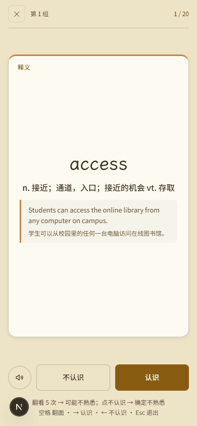
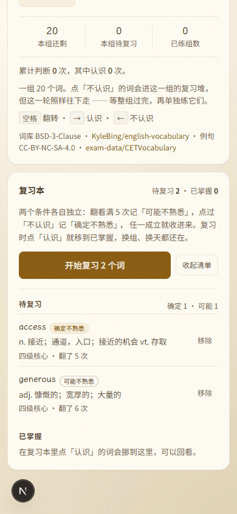
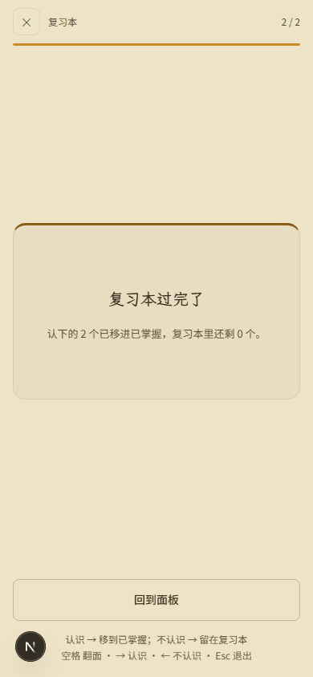
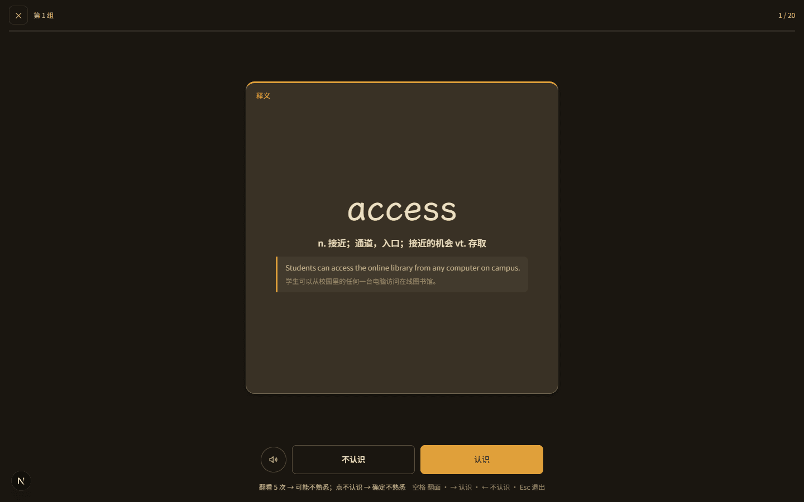

# 审核报告 · 单词卡：全屏刷词 + 复习本

| 项 | 内容 |
| --- | --- |
| 报告日期 | 2026-11-08 |
| 开发者 | 橙子 |
| 审核人 | @baomi888 |
| 分支 | `school-tools` |
| 板块版本 | 从 `0.6.9` → `0.7.0`（**审核通过后**才改 `VERSION` 与 `CHANGELOG`） |
| 关联条目 | 用户需求：「像百词斩那样全屏刷单词」+「安排一个复习本，全部结束后还能再复习」 |

---

## 1. 做了什么

单词卡多了一个「全屏刷词」模式：一张一张过，翻面看释义，左右判认识不认识，键盘和手指都能用。

同时多了一个**复习本**：反复翻看或点过「不认识」的词会被单独攒起来，跨组、跨级别、跨天都在；
复习完点「认识」就移到「已掌握」，可以回看但不再进复习轮。

## 2. 为什么做

原来点「不认识」只是把词塞进**本组**的复习堆，这一组练完就散了——换个组、隔一天再想找回这些词已经找不到。
用户要的是「全部结束后还能再复习」，所以必须有一份脱离「当前这一组」的长期清单。

收词规则经负责人当面确认（2026-11-08），是**两个独立条件**，任一成立就进本，但轻重分两档：

| 条件 | 含义 | 标记 |
| --- | --- | --- |
| 翻看 ≥ 5 次 | 看这么多遍还没记住 | 可能不熟悉 |
| 点过「不认识」 | 用户自己承认记不住 | 确定不熟悉 |

两条都中按「确定不熟悉」算——后者是用户的原话，比推断更硬。
因为「翻看次数」必须跨会话累计（一次刷词里同一个词根本翻不到 5 次，翻一次就判了），
所以单独存了一份计数表，而不是塞进原来的 `campus.words.progress.v1`。

## 3. 改动文件

| 文件 | 改动 |
| --- | --- |
| `frontend/src/campus/types.ts` | 新增 `ReviewMark` / `ReviewEntry` / `WordsMemory` |
| `frontend/src/campus/storage/keys.ts` | 新增 `campus.words.review.v1` |
| `frontend/src/campus/logic/wordsReview.ts` | **新增**。收词规则、两档标记、升级、掌握、移回、容量上限，全是纯函数 |
| `frontend/src/campus/logic/speech.ts` | **新增**。浏览器自带语音朗读，无外部接口 |
| `frontend/src/campus/logic/useSpeech.ts` | **新增**。`useSyncExternalStore` 探测朗读能力，避免 effect 里 setState |
| `frontend/src/campus/tools/words/FlashDeck.tsx` | **新增**。全屏刷词层（受控组件） |
| `frontend/src/campus/tools/words/ReviewBook.tsx` | **新增**。复习本卡片（折叠、两档标记、已掌握分区） |
| `frontend/src/campus/tools/words/WordsTool.tsx` | 接入记忆档案读写、翻面计数、判定收词、全屏入口、复习本轮次 |
| `frontend/src/campus/styles/campus.css` | 新增全屏层与复习本样式，全部限定在 `#campus-panel-words` 下 |

**板块外文件**：无。`tokens.css`、其他五个工具、路由薄壳、`ToolNav` 均未改动。

### 3.1 规则为什么单独成文件

「什么样的词该进复习本」只有一处实现（`logic/wordsReview.ts`），组件只调用不判断。
这样改阈值、加第三档、调容量上限都只动一个文件，也不会出现「面板里判一遍、全屏层再判一遍」的两套账。

## 4. 验证方式

| 验证项 | 命令 / 操作 | 结果 |
| --- | --- | --- |
| 类型检查 | `npx tsc --noEmit` | 通过（exit 0） |
| 代码规范 | `npx eslint src/campus` | 通过（exit 0） |
| 构建 | `npm run build` | 通过（15/15 页面） |
| 收词·可能不熟悉 | 种子把首个词的翻看次数置 4，再翻一次 | `mark=unsure`、`items` 1 条、watch 清空、提示「翻看了 5 次，收进复习本 · 可能不熟悉」 |
| 收词·确定不熟悉 | 同一个词点「不认识」 | 仍 1 条，`mark` 升级为 `sure`，提示「改成『确定不熟悉』」——**不新增重复条目** |
| 清单两档标记 | 再塞一条 `unsure` 条目后展开清单 | `sure=1`、`unsure=1`，分区小结「确定 1 · 可能 1」 |
| 复习闭环 | 2 个词都点「认识」 | `pending=0`、`mastered=2`，面板计数条同步为「待复习 0 · 已掌握 2」 |
| 全屏层不溢出 | 390×844 量 `scrollHeight` 与各段高度 | 844 / 844，进度 3、舞台 661、按钮 70、提示 56，提示底部 844（贴边不越界） |
| 全屏层锁滚 | 打开后读 `body.className` | `campus-modal-open` 已挂上，背后页面不滚 |
| 深色主题 | `html.dark` 后实拍 | 词卡 `color-mix` 后比背景亮一档，金顶条与主按钮对比正常 |
| 横向滚动 | 390 宽读 `scrollWidth - clientWidth` | 0 |

复现：

```bash
cd frontend && npx next dev -p 3000
# http://localhost:3000/tools → 单词卡 → 点「全屏刷词」
# 收词验证：DevTools 里把 campus.words.review.v1 的 watch 某词 f 置 4，翻一次即收词
```

## 5. 风险与未做的事

- **容量上限**：计数表 800 条（按最后翻看时间淘汰最旧）、待复习 500 条、已掌握 800 条。
  超限丢弃的是最旧记录，不会报错也不会撑爆 localStorage。
- **朗读依赖浏览器**：隐私模式或老浏览器没有 `speechSynthesis` 时不显示朗读按钮（不是报错）。
- **复习池是快照**：进入复习本那一刻拍下待复习清单，中途在别处删词不会打断这一轮；
  退出再进才会重新取。
- **可能不熟悉会进本**：按负责人定的口径，光翻看 5 次就收进复习本，不进「本组复习堆」。
  如果实际用起来觉得太吵，把 `REVIEW_FLIP_THRESHOLD` 调高或改成只在「确定」时入本即可，一处改完。
- **本次没做**：错词按间隔重复排期（次日/三日）、复习本按级别筛选、手动星标（负责人选的是两条件制，没有星标）、
  全屏层的翻面动画。

## 6. 截图 / 录屏

截图放 `campus/previews/shots/words-deck/`，时间晚于最后一次代码改动；已做调色板 PNG 重编码（12 张 1.3MB → 429KB）。

<table>
  <tr>
    <td align="center"><b>手机 390 · 全屏刷词（释义）</b><br>
      <br>
      <a href="../previews/shots/words-deck/deck-390-back.png">点开原图</a></td>
    <td align="center"><b>手机 390 · 复习本清单</b><br>
      <br>
      <a href="../previews/shots/words-deck/reviewbook-390.png">点开原图</a></td>
  </tr>
  <tr>
    <td align="center"><b>复习完成（已移入已掌握）</b><br>
      <br>
      <a href="../previews/shots/words-deck/review-deck-390-done.png">点开原图</a></td>
    <td align="center"><b>桌面 1440 · 深色</b><br>
      <br>
      <a href="../previews/shots/words-deck/deck-1440-dark.png">点开原图</a></td>
  </tr>
</table>

完整清单：

| 文件 | 说明 |
| --- | --- |
| `deck-390-front.png` | 全屏层正面：大词 + 「点一下看释义」 |
| `deck-390-back.png` | 全屏层释义：16px 释义 + 例句块 |
| `deck-390-dark.png` | 手机深色全屏 |
| `deck-1440-back.png` | 桌面全屏（卡片限高 560，居中） |
| `deck-1440-dark.png` | 桌面深色全屏 |
| `review-deck-390.png` | 复习本刷词：顶栏标「复习本」、进度 1/2 |
| `review-deck-390-done.png` | 复习完成：「认下的 2 个已移进已掌握」 |
| `reviewbook-390.png` | 复习本清单：两档标记徽章、待复习/已掌握分区 |
| `reviewbook-390-mastered.png` | 已掌握分区有内容时的样子 |
| `panel-390.png` | 面板：新增「全屏刷词」入口 |
| `panel-390-collected.png` | 收词提示条 |
| `panel-390-after-review.png` | 复习后计数条「待复习 0 · 已掌握 2」 |

## 7. 审核结论（由负责人填写）

- [ ] **通过** —— 可以合并并推送
- [ ] **有条件通过** —— 条件：
- [ ] **打回** —— 不通过条目（对照 `docs/03` 编号）：

审核意见：

审核日期：

---

## 8. 上传记录（审核通过后填写）

| 项 | 内容 |
| --- | --- |
| 开发者授意上传 | 待定 |
| **上传前优化**（`docs/05` 闸门 4） | 待上传前复核 |
| 推送时间 | |
| 推送分支 | `school-tools` |
| 推送提交 | |
