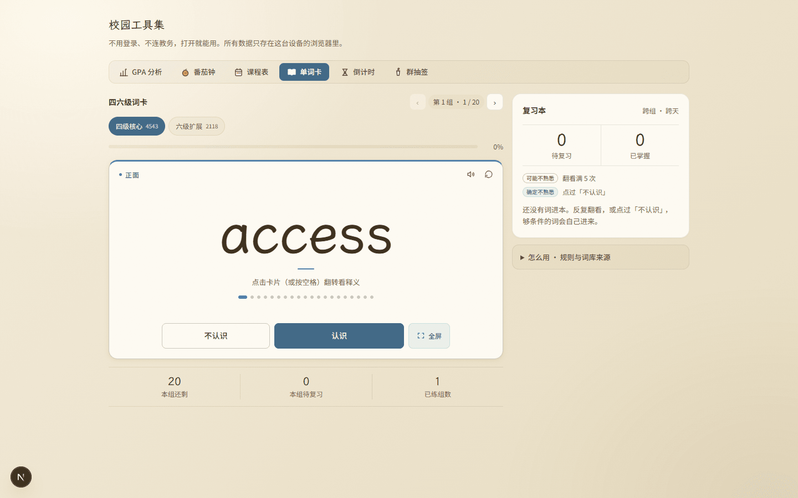
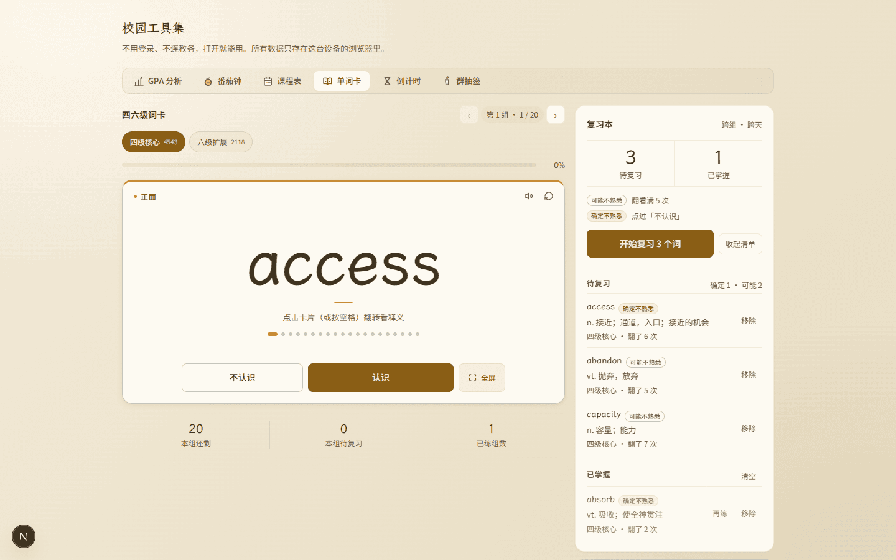
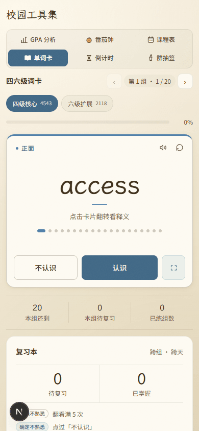
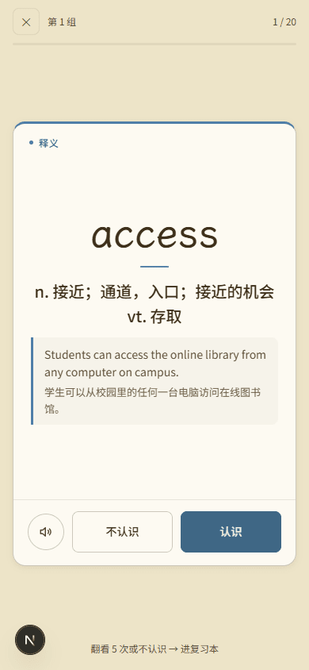
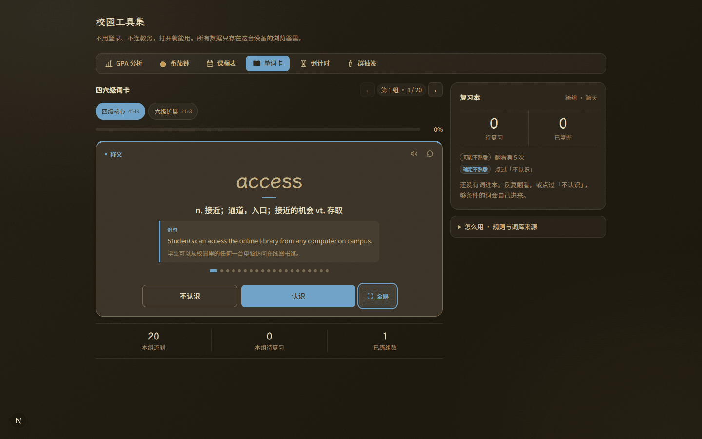

# 审核报告 · 单词卡：版心放宽到 1080 + 左栏去卡片化 + 牌面点阵 + 全屏层收口

| 项 | 内容 |
| --- | --- |
| 报告日期 | 2026-11-08 |
| 开发者 | 橙子 |
| 审核人 | @baomi888 |
| 分支 | `school-tools` |
| 板块版本 | `0.6.9` → **`0.7.0`**（已落地：`VERSION` 与 `CHANGELOG` 均已更新并随批推送） |
| 关联条目 | 负责人原话「继续优化页面设计，不好看」；承接同日三批（视觉层级 / 全屏与复习本 / 版式适配） |

> 前一批把版式拆成了双栏，但**只在 880 的旧版心里**拆：左栏 534、右栏 320，
> 1440 的屏幕上左右各空 280，整页还是一块被捏在中间的小东西。
> 这一批是把上一批没敢动的两件事做了：**版心**和**卡里套卡**；顺带把牌面里那截
> 「说不清用途的留白」换成了有信息的点阵。
> 改动仍然只在 `tools/words/` 三个组件与 `campus.css` 的 `#campus-panel-words` 段落里。

---

## 1. 做了什么

打开单词卡，整页比之前宽了一档（880 → 1080），左边那张词卡不再长在另一张纸卡里，
而是直接浮在页面上；词卡里多了一条 20 个点的进度轨道，按钮行右边并进了一颗「全屏」；
标题行右边多了「‹ 第 1 组 · 1/20 ›」，原来单独占一行的「第 1 / 228 组」被撤掉；
全屏刷词那张牌里，牌面与按钮之间加了一道细线，牌高从 560 收到 520；
右栏复习本顶上多了两个衬线大数字，没词可复时不再摆一颗灰掉的禁用按钮；
平板竖屏（768 这类）左栏收到 560 居中，不再是一条 736 宽、2.2:1 的「信封卡」。

## 2. 为什么做

负责人一句原话：「继续优化页面设计，不好看」。拆开看是六个具体问题：

| 现象 | 当时的实际样子 | 这次怎么改 |
| --- | --- | --- |
| 一页内容被捏在中间 | 六个工具共用 `--campus-max: 880px`；双栏加起来 880，1440 下左右各空 280 | 单词面板挂载时版心放到 1080（`:has()` 按内容挑容器，其他五个工具照旧 880），左栏 534 → 712 |
| 卡里套卡 | 页面底 → 面板纸卡（1px 描边 + 16 圆角）→ 词卡（又 1px + 16 圆角 + 投影），三层底色只差几个百分点 | 左栏去掉纸底：`.campus-words-main` 透明、无边框、无内边距，白牌直接浮在页面上，整页只剩一个「抬起来」的东西 |
| 牌面下半截是空白 | 词卡 330/400 高，中间「词 + 一行提示」居中，下面到按钮之间空出 80~130px，没有任何交代 | 卡高收到 300（手机）/ 360（桌面），补一条 20 点位置轨道（翻过的点是淡金、当前拉成小胶囊、未到的是描边色），空白被「内容 → 呼吸 → 轨道 → 操作」四段分掉 |
| 牌底三层、标题两行 | 判定按钮一行 + 「全屏刷词」小横条一行 + 卡片下沿；标题下面「第 1 组 · 1/20」与「第 1 / 228 组」两行灰字说同一件事 | 全屏入口并进按钮行最右（桌面带「全屏」二字，手机只留方格箭头）；组导航并进标题行，箭头夹着状态胶囊 |
| 全屏牌下半截悬空 | 牌 900×560，按钮行直接浮在纸上，没有分隔；背面单词 101px 压着右栏 | 按钮行加 `border-top` 细线、牌高 560 → 520，背面单词收到 81px，词头加一道金短线 |
| 复习本不像个面板 | 顶上只有一行 12px 灰字「待复习 0 · 已掌握 0」；没词时摆一颗通栏的灰色禁用按钮 | 顶上换成一对衬线读数（30px）夹在两条细线之间；没词时改成一句话，金色「开始复习 N 个词」只在该出现时出现 |

## 3. 改动文件

| 文件 | 改动 |
| --- | --- |
| `frontend/src/campus/tools/words/WordsTool.tsx` | 组导航并进标题行（删掉 `.campus-words-nav` 整行）；新增牌面金短线、20 点轨道；全屏入口并入 `.campus-flip-controls`，按钮行与入口同一行 |
| `frontend/src/campus/tools/words/ReviewBook.tsx` | 顶部改成 `campus-rb-meters` 两格读数；空态不再渲染禁用按钮，改为一句 `campus-rb-hint`（「看清单」只要有任何记录就保留） |
| `frontend/src/campus/tools/words/FlashDeck.tsx` | 词头拆成 `campus-deck-lead`（词 + 金短线），背面两列的 flex 项随之从词换成词头 |
| `frontend/src/campus/styles/campus.css` | 全部在 `#campus-panel-words` 段内；新增 `.campus-shell:has(#campus-panel-words) { --campus-max: 1080px }`、`.campus-flip-controls/-rule/-dots/-dot`、`.campus-rb-meters/-meter/-hint`、`.campus-deck-lead/-rule`；删除失效规则 `.campus-words-nav`、`.campus-words-btn:disabled` |

**板块外文件**：无。
但有两处**跨作用域**需要报备（都属于「只对单词面板生效」，没改公共类的定义）：

1. `.campus-shell:has(#campus-panel-words)` 改的是六个工具共用的 `--campus-max`。
   写法上它挂在 `.campus-shell` 这个共用类上，但选择器要求「里面有单词面板」才成立，
   单词面板一卸载就回 880。**实测五个面板切走后 `max-width` 均为 880px**（见 §4）。
   不支持 `:has()` 的浏览器退化成 880，即现状，不会崩。
2. `.campus-flip-word` / `.campus-flip-actions` 等类名是单词卡独有的（其余五工具不用），
   仍然沿用 ID 下钻写法，没有裸写共用类。

## 4. 验证方式

| 验证项 | 命令 / 操作 | 结果 |
| --- | --- | --- |
| 类型检查 | `npx tsc --noEmit` | 通过（无输出） |
| 代码规范 | `npx eslint src/campus` | 通过（exit 0） |
| 构建 | `npm run build` | 通过（15/15 静态页） |
| 版式实测 | `node .workbuddy/tmp/words-layout.mjs` | **22 条断言全过**（下附清单） |
| 多宽度实测 | `node .workbuddy/tmp/widths.mjs`（1920 / 1440 / 1280 / 1100 / 980 / 900 / 768 / 430） | 八档均 `scrollX = 0`；≥1100 版心稳定 1080 |
| 复习本有数据的形态 | 手工塞 3 条待复习 + 1 条已掌握后截图 | 见 §6 第二张 |

**22 条断言**（手机 390 / 桌面 1440，浅深两套）：

```
手机首次进入出现引导条（3 步 + 知道了）
手机不显示键盘提示（desktop-only 全部 none）
引导展开时「认识」仍在首屏内
判定按钮长在牌面内（不认识 / 认识）        ← 牌面 366 宽 × 250 高（引导态）
全屏刷词入口也在牌面内                    ← 入口 46 × 46，在 `.campus-flip` 内
牌面高度被内容用起来（≥250）
点知道了 → 引导收起并写盘
手机全屏层无键盘提示且按钮不出屏            ← 牌 358×560，按钮底 696 < 屏高 844
手机全屏层按钮长在牌内、贴住牌底            ← 距牌底 1px
手机全屏层无横向滚动
全屏完成态：按钮在牌内（重练这组 / 回到面板）
完成态换成 重练/下一组
复习本改成图例（2 条、无大段说明）
桌面为双栏（复习本在主卡右侧）              ← 列宽 712px 320px，两者同顶
桌面显示键盘提示
桌面词卡加高（≥360）                      ← 实测 360
桌面无横向滚动
桌面全屏卡加宽（≥860）且提示不越界          ← 牌 900×520，背面单词 81px
桌面全屏按钮在牌内且牌面字放大（≥72px）
桌面引导条每步单行（高度 ≤ 30）
其他五个面板卡片圆角未变（16px）
切走后单词面板已卸载、版心回到 880          ← 五个面板逐一实测 880px
```

> 上一版这条「其他五个面板」是**假通过**：点 tab 之后在同一次 `evaluate` 里立刻读
> `.campus-card`，读到的还是单词面板（React 还没换面板），当时它也是 16px 所以看起来对。
> 这次改成每个面板单独点、等一拍再读，并额外断言「单词面板已卸载 + 版心回 880」。

**多宽度实测**（浅色、默认态）：

| 视口 | 版心 | 双栏 | 词卡 | 单词字号 |
| --- | --- | --- | --- | --- |
| 1920 | 1080 | 712 + 320 | 712 × 360 | 104px |
| 1440 | 1080 | 712 + 320 | 712 × 360 | 101px |
| 1280 | 1080 | 712 + 320 | 712 × 360 | 90px |
| 1100 | 1080 | 712 + 320 | 712 × 360 | 77px |
| 980 | 980 | 612 + 320 | 612 × 360 | 69px |
| 900 | 900 | 532 + 320 | 532 × 360 | 64px |
| 768 | 768（左栏收到 560 居中） | 单栏 | 560 × 340 | 54px |
| 430 | 430 | 单栏 | 406 × 300 | 56px |

## 5. 风险与未做的事

- **`:has()` 兼容性**：Chrome 105+ / Safari 15.4+ / Firefox 121+ 支持。不支持的浏览器
  就是现在这个 880 版心，功能不受影响，只是没那么宽。
- **组总数不再常驻**：「共 228 组」从界面上撤了（和「第 1 组 · 1/20」重复），
  改成状态胶囊的 `title` 提示 + 箭头到了边界自动禁用。如果负责人认为这个数要一直看得见，
  我再加回去（一行 12px 灰字）。
- **牌面点阵是装饰性的**：`aria-hidden`，读屏读不到；真正的进度仍由进度条的
  `role="progressbar"` + 百分比承担。
- **右栏比左栏短**：默认态（复习本为空）右栏到 330 就结束，左栏到 560。这是「主舞台 + 侧栏」
  的正常形态，没为了对齐硬撑高度；复习本一旦有词，右栏会自然长过左栏。
- **本次没做**：词库音标（数据里没有，不造）、复习本列表常驻预览（只在展开时出现）。
- **可能的回归点**：`.campus-flip.is-flipped .campus-flip-word` 在桌面把词收到 34~44px，
  若以后词库里出现超长词（如 `counterrevolutionary`），需要再看一眼换行。
  已经用 `word-break` 兜底，但没实测这么长的词。

## 6. 截图

> 截图时间：2026-11-08 17:05–17:09，晚于最后一次代码改动（17:03）；`tsc` / `eslint` / `build` 在其后重跑。
> 目录：`campus/previews/shots/words-layout/`（调色板 PNG 重编码，17 张共 1.5MB）。

<table>
  <tr>
    <td align="center"><b>桌面 1440 · 默认态</b><br>
      <br>
      <a href="../previews/shots/words-layout/1440-panel.png">点开原图</a></td>
    <td align="center"><b>桌面 1440 · 复习本有词</b><br>
      <br>
      <a href="../previews/shots/words-layout/1440-reviewbook.png">点开原图</a></td>
  </tr>
</table>

<table>
  <tr>
    <td align="center"><b>手机 390 · 牌面</b><br>
      <br>
      <a href="../previews/shots/words-layout/390-front.png">点开原图</a></td>
    <td align="center"><b>手机 390 · 全屏</b><br>
      <br>
      <a href="../previews/shots/words-layout/390-deck.png">点开原图</a></td>
    <td align="center"><b>桌面 1440 · 深色</b><br>
      <br>
      <a href="../previews/shots/words-layout/1440-dark.png">点开原图</a></td>
  </tr>
</table>

**完整截图清单**

| 文件 | 内容 |
| --- | --- |
| `1440-panel.png` | 桌面默认态：标题行 + 状态胶囊 + 级别 + 进度 + 词卡 + 读数 + 复习本 |
| `1440-back.png` | 桌面翻面：词缩到 44px、释义与例句 |
| `1440-guide.png` | 桌面首次引导（三条横排 + 右侧按钮） |
| `1440-dark.png` | 桌面深色默认态 |
| `1440-reviewbook.png` | 桌面复习本有 3 条待复习 + 1 条已掌握 |
| `1440-deck-front.png` / `1440-deck.png` | 桌面全屏正面 / 背面（牌 900×520，按钮行有细线分隔） |
| `1440-deck-dark.png` | 桌面全屏深色 |
| `390-front.png` / `390-back.png` | 手机牌面正反 |
| `390-guide.png` | 手机首次引导（「认识」仍在首屏内） |
| `390-done.png` | 手机完成态 |
| `390-deck.png` / `390-deck-done.png` | 手机全屏 / 全屏完成态 |
| `390-dark.png` | 手机深色 |
| `390-reviewbook.png` / `390-reviewbook-open.png` | 手机复习本收起 / 展开 |

---

## 7. 审核结论（由负责人填写）

- [x] **通过** —— 可以合并并推送
- [ ] **有条件通过** —— 条件：
- [ ] **打回** —— 不通过条目（对照 `docs/03` 编号）：

审核意见：负责人 2026-11-09 确认通过（开发者转述「他通过了」）；闸门 4 上传前优化已于 2026-11-08 完成并复核，逐条见整合版报告 §8。

审核日期：2026-11-09

---

## 8. 上传记录（审核通过后填写）

| 项 | 内容 |
| --- | --- |
| 开发者授意上传 | ✅ 2026-11-09 12:05 橙子说「上传吧」 |
| **上传前优化**（`docs/05` 闸门 4） | ✅ 已做（2026-11-08 22:55–23:19），11 条逐项对账见整合版报告 §8 |
| 推送时间 | 2026-11-09 12:11（北京时间） |
| 推送分支 | `school-tools`（`44c58dc → 6bc8c0b`） |
| 推送提交 | `1abf099` feat · `ae6631c` style · `02ed8ef` docs · `6bc8c0b` docs（4 个提交、2 次推送；本次为第 3 次，回填签章） |
