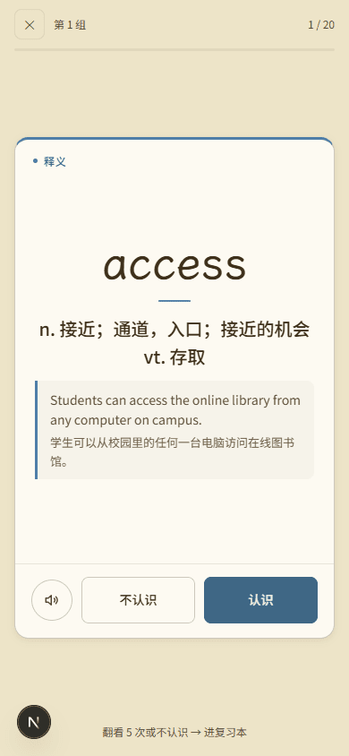
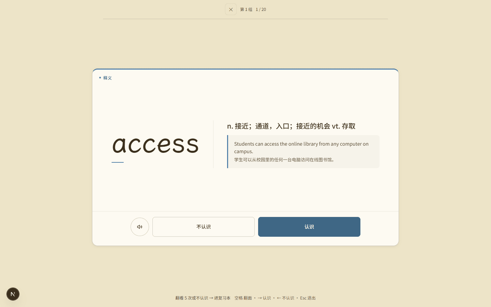
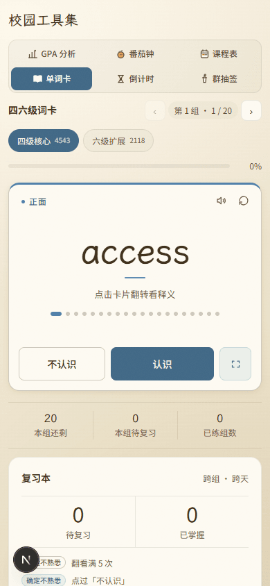
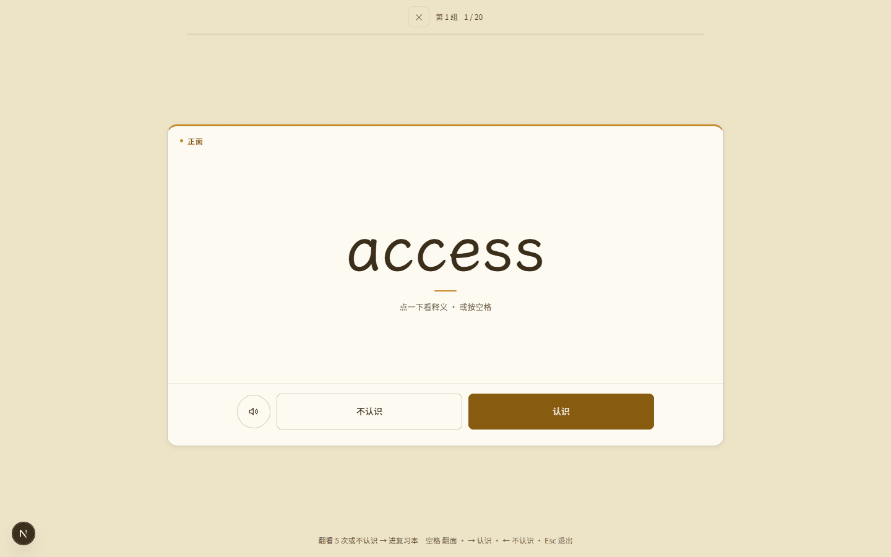
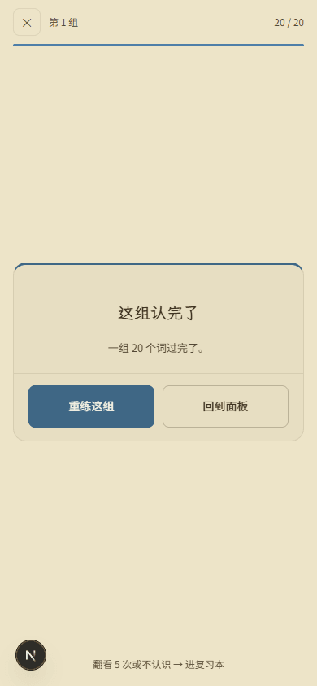
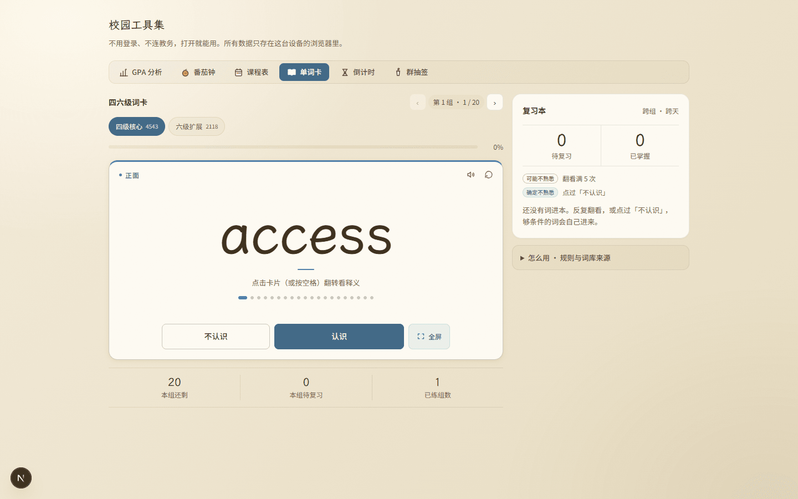
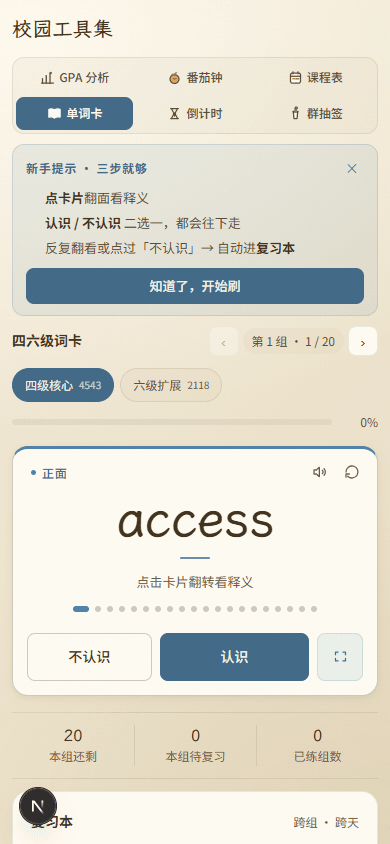
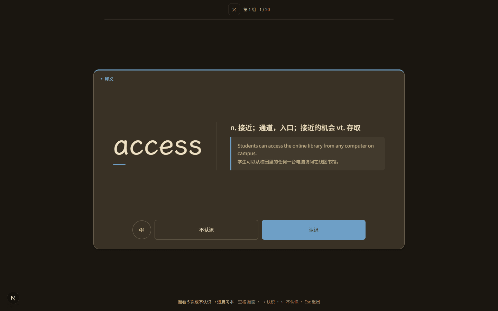

# 审核报告 · 单词卡：电脑双栏 + 牌面内按钮 + 首次引导 + 全屏层同款

| 项 | 内容 |
| --- | --- |
| 报告日期 | 2026-11-08 |
| 开发者 | 橙子 |
| 审核人 | @baomi888 |
| 分支 | `school-tools` |
| 板块版本 | 从 `0.6.9` → `0.6.10`（**未改，等审核通过后再动**） |
| 关联条目 | 内测反馈「电脑端太空旷／手机词框太空／字太密」「全屏模式也要这样修改」；承接同日的「单词卡视觉层级」「单词卡全屏与复习本」两批 |

> 本批与同日两批的关系：前两批解决「卡片立不起来、复习能跨天」，本批解决**版式**——
> 电脑端把一列拉成两栏、手机端把按钮收进牌面、把常驻说明收成「首次引导 + 折叠块」，
> 并把同一套版式规则**搬到全屏刷词层**（按钮进牌、电脑端加宽、背面改左词右义）。
> 三批改动都在 `tools/words/` 与 `campus.css` 的 `#campus-panel-words` 段落内，其余五个工具零改动。

---

## 1. 做了什么

单词卡这一页按屏幕换了版式：**电脑上是「左边刷词、右边复习本」两栏**，手机上是单栏且
「不认识 / 认识」长在词卡里；页面底部那四行常驻说明（规则、键盘、词库来源）不再天天挂着——
第一次进来用三步引导讲一遍，之后收进右栏「怎么用」折叠块。

**全屏刷词层用同一套版式**：判定按钮与朗读从卡外的底栏搬进牌里，贴着牌的底沿；
手机牌 358×560，电脑牌 900×560、单词 101px；电脑上翻面后是「左词右义」两列，
中间一道细竖线——原来竖排居中，释义只占中间 340，左右各三百多像素全是纸。

## 2. 为什么做

负责人三条原话，逐条对应：

| 反馈原话 | 当时的实际样子 | 这次怎么改 |
| --- | --- | --- |
| 「电脑端太空旷，要做适配电脑的」 | 1440 下整页只有一张 880 宽的卡；词卡 880×268，里面只有一个词居中，左右各留一大片 | 双栏：左 534 主卡 + 右 300 复习本（sticky）；词卡加高到 360，单词字号放到 64 |
| 「手机端的单词框太空了，可以把下面三个按钮发进框里」 | 词卡 226px 高、中间一个词，卡外另挂「不认识/认识」一排 + 「全屏刷词/朗读/翻转/重练」一排 | 判定按钮、全屏入口、朗读/重练全部收进牌面；卡高 330，牌面自己把高度用满 |
| 「这个页面太多字了太密密麻麻」 | 卡片底部 4 段同色同号灰字连成一团（累计判断 / 规则 / 键盘 / 词库来源），复习本里还有一段三句话的说明 | 常驻说明清零：一次性引导 3 步 + 右栏「怎么用」折叠块；复习本的长说明改成两行图例 |
| 「电脑端的按键不要写到手机端」 | 键盘提示虽然挂 `campus-desktop-only`，但那条件只看 `hover/pointer`，无头浏览器与分屏窄窗口仍是「精细指针」，390 宽的截图里照样印着「空格 翻转 · → 认识」 | 单词卡内额外加一道 720px 宽度门槛；并实测手机全屏层也无残留 |
| 「全屏模式也要这样修改」 | 全屏层还是旧结构：一张 560×560 的空纸，判定按钮浮在卡外的底栏上，电脑端卡宽 720、单词 86px，背面竖排居中 | 按钮搬进牌里（牌 = 容器 + 可点牌面 + 按钮行）；手机牌 358×560、按钮距牌底 1px；电脑牌 900×560、单词 101px、背面改左词右义两列 |

## 3. 改动文件

| 文件 | 改动 |
| --- | --- |
| `frontend/src/campus/tools/words/WordsTool.tsx` | 外层加 `.campus-words-layout` 双栏容器与 `.campus-words-side` 右栏；词卡由「整块 `<button>`」改成容器 + 牌面 + 按钮组（button 里不能再套 button）；新增首次引导条与「怎么用」折叠块；删掉牌面外的判定行、次操作行、四段常驻说明 |
| `frontend/src/campus/tools/words/ReviewBook.tsx` | 开头那段三句话说明换成两行图例（徽章与清单同款）；空态文案各减一句 |
| `frontend/src/campus/tools/words/FlashDeck.tsx` | 卡片由「整块 `<button>`」拆成 容器 `.campus-deck-card` + 可点牌面 `.campus-deck-face` + `.campus-deck-actions`（按钮在牌内）；牌面加 `is-flipped` 供电脑端切两列；单词与释义包进 `.campus-deck-main` |
| `frontend/src/campus/styles/campus.css` | 新增「单词卡 · 版式」一段：双栏、引导条、折叠块、图例、宽度门槛；词卡/牌面/按钮组重写；全屏层重写（按钮进牌、牌高/牌宽、电脑两列、深色例句对比度）；删掉 4 段随结构一起失效的样式（`.campus-words-judge`、`.campus-words-tools`、`.campus-words-keys kbd`、`btn:only-child` 的旧挂点） |
| `frontend/src/campus/storage/keys.ts` | 新增 `campus.words.intro.v1`（引导是否看过） |

**板块外文件**：无。`tokens.css`、`ToolNav.tsx`、`CampusToolsHub.tsx` 一行未动。

### 一处需要说明的「规范偏离」

`campus.css` 顶部规则 1 要求「只用全局令牌、不自造色板」——本批**没有新增任何色值**，
引导条用的是现成的 `--accent-soft / --accent-line / --accent-ink`，按钮用 `--campus-btn-solid` 那一套。

但有一条**作用域偏离**要报备：键盘提示的隐藏条件我加在了单词卡内部
（`#campus-panel-words .campus-desktop-only`，720px 以下一律不显示），
而全局那条 `.campus-desktop-only`（`hover:hover and pointer:fine`）**没动**。
理由：那条规则对真机是对的，问题在于「精细指针 ≠ 宽屏」，而改全局会影响课表、番茄钟等面板的既有提示。
如果后面要统一收口，建议单独开一条技术债，把宽度条件并进全局规则，本批不顺手改。

> **2026-11-08 23:00 更新（上传前优化）**：这条技术债已在同日晚的优化里做掉 ——
> 全局 `.campus-desktop-only` 的媒体查询改成
> `(hover: hover) and (pointer: fine) and (min-width: 720px)`，单词卡那段局部补丁删除。
> 回归结果见 `2026-11-08_今日整批整合审核.md` §8.3（新增 15 条断言，其中 4 条专测
> 390 / 700 / 720 / 1440 四档）。本节的「作用域偏离」至此不再成立。

## 4. 验证方式

| 验证项 | 命令 / 操作 | 结果 |
| --- | --- | --- |
| 类型检查 | `npx tsc --noEmit` | 通过（exit 0，无输出） |
| 代码规范 | `npx eslint src/campus` | 通过（exit 0，无输出） |
| 构建 | `npm run build` | 通过，15/15 页面（含 `/tools`） |
| 功能实测 | Playwright MCP（`--browser msedge --headless`）跑 `.workbuddy/tmp/words-layout.mjs`，21 个断言全过、14 张截图 | `passed=true`，见下表 |
| 旧数据兼容 | 脚本先清空 `campus.words.*` 再重新种进度；复习本为空、引导键不存在的「全新用户」路径 | 通过 |

### 实测断言（脚本输出，非人工目测）

| 断言 | 实测值 |
| --- | --- |
| 首次进入出现引导条（3 步 + 知道了） | `guide=true, steps=3, hasOk=true` |
| 手机不显示键盘提示 | 面板内所有 `.campus-desktop-only` 的 `display` 全为 `none`；`.campus-words-help-list li` 为 `none` |
| 手机全屏层无键盘提示且按钮不出屏 | `keysDisplay=none, actionsBottom=694, inner=844` |
| **手机全屏层按钮在牌内、贴住牌底** | `actsInside=true, cardH=560, cardW=358, faceH=486, gapToCardBottom=1, scrollX=0` |
| **全屏完成态：按钮在牌内** | `isDone=true, btns=[重练这组, 回到面板], cardH=220` |
| 引导展开时「认识」仍在首屏内 | `visible=true` |
| 判定按钮长在牌面内 | `actsInside=true, btns=[不认识, 认识]` |
| 全屏刷词入口也在牌面内 | `deckInside=true` |
| 点「知道了」→ 收起并写盘 | `guide=false, campus.words.intro.v1` 已写入 |
| 完成态换成 重练/下一组 | `btns=[重练这组, 下一组], tag=本组完成` |
| 复习本改为图例、无大段说明 | `items=2, 大段 note 数=0` |
| 桌面双栏 | `cols=512px 320px, mainRight=808, rbLeft=824, sameTop=true` |
| 桌面显示键盘提示 | `display=list-item`（即未隐藏） |
| 桌面词卡加高 | `cardH=400` |
| **桌面全屏卡加宽 + 按钮在牌内 + 字放大** | `cardW=900, cardH=560, actsInside=true, btnW=300, wordPx=101, footBottom ≤ inner` |
| 两档均无横向滚动 | `scrollX=0`（390 与 1440） |
| 其他五个面板未牵连 | GPA/番茄钟/课程表/倒计时/群抽签的 `.campus-card` 圆角均为 `16px` |

## 5. 风险与未做的事

- **已知限制**
  - 双栏只在宽度 ≥ 880 时成立。板块版心是 880，所以 1440 屏左右仍各留 280 ——
    再宽就要动 `.campus-shell` 的 `--campus-max`，那是全板块共用的，属于另一批改动，本批不碰。
    **这条是本批唯一没解决的「电脑端空旷」来源**：只放宽单词卡会让切工具时导航条跟着变宽（视觉跳动），
    要么六件工具一起放宽，要么维持现状，需要负责人定。
  - 全屏牌在电脑上固定 900×560，牌面内容（词 + 释义 + 例句）仍偏上偏中，牌内上下各有约 110px 留白。
    这是牌式设计的呼吸区，不再是大白纸；若希望更满，可以把牌高压到 480，代价是大屏上牌变小。
  - 词卡高度用的是 `min-height`（手机 330 / 桌面 400）。极长的释义会把卡撑高，此时靠整页滚动，
    不会截断内容。
  - 引导只在**本设备**显示一次。换浏览器 / 清站点数据会再看一遍，这是 localStorage 的固有行为。
- **本次没做（但相关）**
  - 复习本在桌面右栏默认收起清单，条目多时要点一下「看清单」。若后续觉得常用，可以做成默认展开。
  - 键盘提示的全局收口（见第 3 节「规范偏离」）。
- **可能的回归点**
  - 词卡外层从 `<button>` 变成 `
`：原来「点卡片任意位置都能翻面」，现在只有牌面
    `.campus-flip-face` 可点，卡内的按钮不会误触发翻面 —— 这是修正，不是退化，
    但仍属结构变化，请在真机上点一下四个角确认手感。
  - 全屏层同样从 `<button>` 变成 `
` + `.campus-deck-face`，点卡片翻面照旧，
    但点在按钮行上不再触发翻面（原来点卡片任意处都可能翻）。
  - 「翻转」这个小按钮被删了（点牌面即翻面，重复入口）。若有人习惯点按钮，需要重新适应。
  - `toggleFlip()` 函数随之删除，键盘路径（空格）仍走 `flipCard()`，逻辑不变。
  - 电脑全屏背面改成两列后，超长单词（如 `environment`）在左列会折成两行，右列相应变窄；
    这是 `max-width: 56%` 的兜底行为，实测 `access` 单行。

## 6. 截图 / 录屏

截图时间 2026-11-08 16:02（最后一次代码改动之后），14 张，已做调色板 PNG 重编码：
**原图合计 ≈5.5MB → 0.90MB，单张最大 140KB**。

<table>
  <tr>
    <td align="center"><b>手机 390 · 全屏层（释义，按钮在牌内）</b> 
       
      <a href="../previews/shots/words-layout/390-deck.png">点开原图</a></td>
    <td align="center"><b>桌面 1440 · 全屏层（左词右义两列）</b> 
       
      <a href="../previews/shots/words-layout/1440-deck.png">点开原图</a></td>
  </tr>
  <tr>
    <td align="center"><b>手机 390 · 全屏层（正面）</b> 
       
      <a href="../previews/shots/words-layout/390-front.png">点开原图</a></td>
    <td align="center"><b>桌面 1440 · 全屏层（正面）</b> 
       
      <a href="../previews/shots/words-layout/1440-deck-front.png">点开原图</a></td>
  </tr>
  <tr>
    <td align="center"><b>手机 390 · 全屏完成态</b> 
       
      <a href="../previews/shots/words-layout/390-deck-done.png">点开原图</a></td>
    <td align="center"><b>桌面 1440 · 双栏面板</b> 
       
      <a href="../previews/shots/words-layout/1440-panel.png">点开原图</a></td>
  </tr>
  <tr>
    <td align="center"><b>手机 390 · 首次引导</b> 
       
      <a href="../previews/shots/words-layout/390-guide.png">点开原图</a></td>
    <td align="center"><b>桌面 1440 · 全屏层深色</b> 
       
      <a href="../previews/shots/words-layout/1440-deck-dark.png">点开原图</a></td>
  </tr>
</table>

完整清单：

| 文件 | 说明 |
| --- | --- |
| `390-guide.png` | 390×844 浅色，首次进入：3 步引导 + 「知道了，开始刷」，`认识` 在首屏内 |
| `390-front.png` | 390×844 浅色，引导收起后的正面：牌面 + 按钮组 + 全屏入口都在卡内 |
| `390-back.png` | 390×844 浅色，翻面：释义 20px + 例句块，按钮不下移出卡 |
| `390-done.png` | 390×844 浅色，认完一组：卡收成 240 高，「重练这组 / 下一组」 |
| `390-reviewbook.png` | 390×844 浅色，复习本：两行图例替代原三句说明，下方是「怎么用」折叠块 |
| `390-deck.png` | 390×844 浅色，全屏层：牌 358×560，牌面 486，按钮距牌底 1px，无键盘提示 |
| `390-deck-done.png` | 390×844 浅色，全屏完成态：牌收成 220 高，「重练这组 / 回到面板」 |
| `390-dark.png` | 390×844 深色，牌面比面板亮一档 |
| `1440-panel.png` | 1440×900 浅色，双栏：左 512 主卡（词卡 400 高）、右 320 复习本 |
| `1440-guide.png` | 1440×900 浅色，引导条横排（左三条 + 右一颗按钮） |
| `1440-back.png` | 1440×900 浅色，桌面翻面态 |
| `1440-deck-front.png` | 1440×900 浅色，全屏正面：牌 900×560，单词 101px |
| `1440-deck.png` | 1440×900 浅色，全屏背面：左词右义两列，中间一道竖线 |
| `1440-dark.png` | 1440×900 深色，双栏版式 |
| `1440-deck-dark.png` | 1440×900 深色，全屏背面两列；译文提到 `--text-2` 保证对比 |

---

## 7. 审核结论（由负责人填写）

- [ ] **通过** —— 可以合并并推送
- [ ] **有条件通过** —— 条件：
- [ ] **打回** —— 不通过条目（对照 `docs/03` 编号）：

审核意见：

审核日期：

---

## 8. 上传记录（审核通过后填写）

| 项 | 内容 |
| --- | --- |
| 开发者授意上传 | 否（尚未提出） |
| **上传前优化**（`docs/05` 闸门 4） | 待上传前执行 |
| 推送时间 | — |
| 推送分支 | `school-tools` |
| 推送提交 | — |
