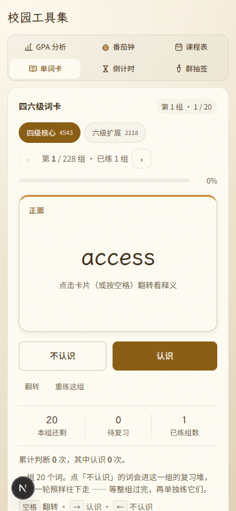
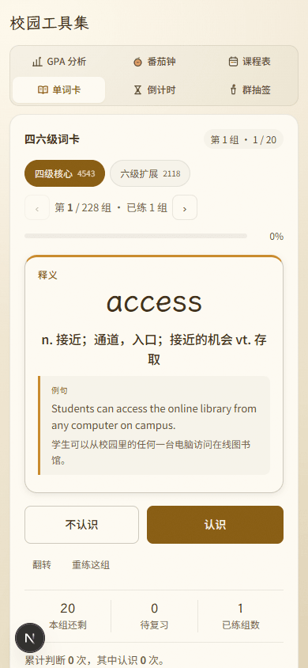
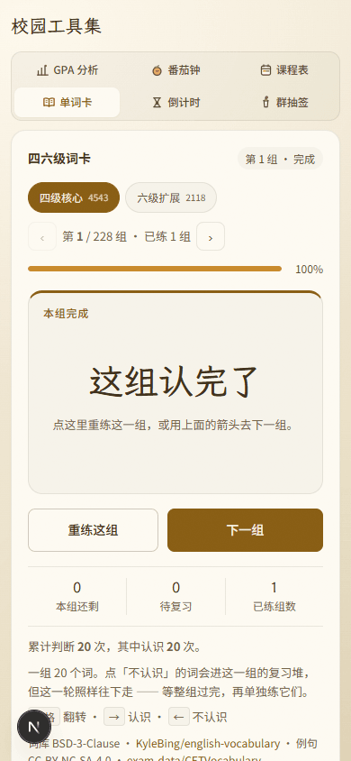
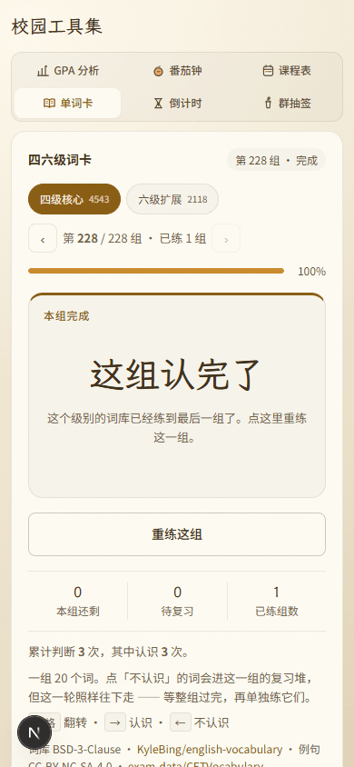
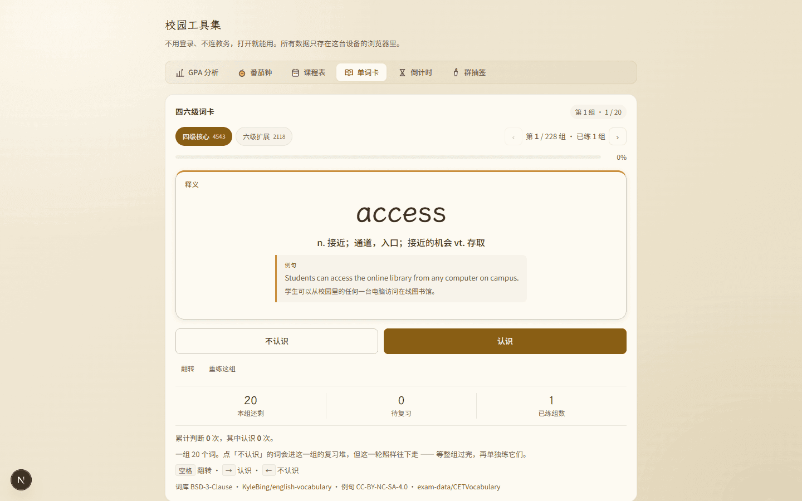
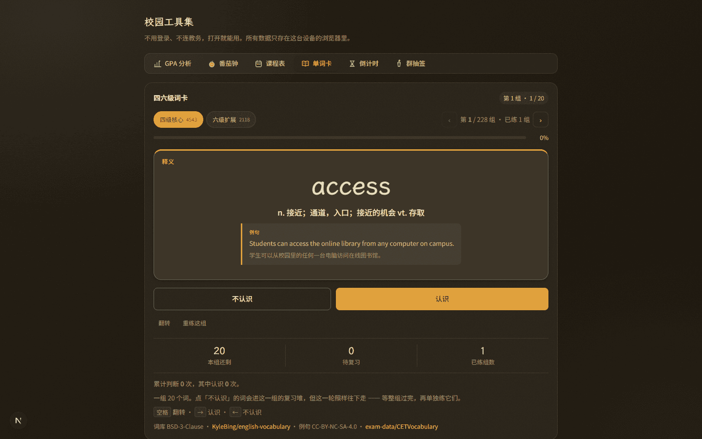

# 审核报告 · 单词卡视觉层级重构（只改这一个面板）

| 项 | 内容 |
| --- | --- |
| 报告日期 | 2026-11-08 |
| 开发者 | 橙子 |
| 审核人 | @baomi888 |
| 分支 | `school-tools` |
| 板块版本 | 从 `0.6.9` → `0.7.0`（已落地：`VERSION` 与 `CHANGELOG` 均已更新并随批推送） |
| 关联条目 | 用户反馈：「页面区分度太低了，视觉冲击力不够」→ 追加约束「我只想修改单词卡这个页面，不要改动其他的」 |

---

## 1. 做了什么

打开单词卡，能一眼看出「现在该干什么」：词卡是整页唯一抬起来的物体，
上面一个大词、下面是金底的「认识」和描边的「不认识」两个大按钮，
再往下是三格读数（本组还剩 / 待复习 / 已练组数）。

## 2. 为什么做

负责人的原话是「页面区分度太低了，视觉冲击力不够」。先把问题落到可核对的位置：

| 原来 | 具体表现 |
| --- | --- |
| 页头 | 标题 14px、状态行 13px，两者同档同色，`第 1 组 · 1 / 20` 要读第二遍才认出是状态 |
| 级别 chip | 选中态是「浅金底 + 金字」，与旁边未选中的灰字只差一点明度 |
| 进度 | 4px 细条，看不出还剩多少 |
| 词卡 | 底是 `--fill-3`（0.035 的墨，几乎透明），和面板纸底分不开，整张卡没有「卡」的感觉 |
| 按钮 | 四个按钮同款并排（翻转 / 认识 / 不认识，复习 / 重来这组），「认识」只是换了底色，四个一样重 |
| 底部 | 累计 / 规则 / 键盘 / 词库来源四行同色同号灰字，margin 全是 0，连成一块 |
| 整体 | 全页最大的色差来自例句块那点淡底，没有任何一处「比其他地方重」 |

追加约束是「只改单词卡」。所以这份改动**不碰** `ToolNav`、不碰其他五个工具、
不给工具设身份色（那需要改共享导航），全部收在一个面板内部。

## 3. 改动文件

| 文件 | 改动 |
| --- | --- |
| `frontend/src/campus/tools/words/WordsTool.tsx` | 状态行改胶囊；进度条外包一层带百分比的 `.campus-words-meter`；词卡左上角加「正面 / 释义 / 本组完成」标记；按钮区按「进行中 / 已完成」两种形态渲染（认识=金实底主按钮，不认识=描边；完成后换成下一组 / 重练这组）；三格读数替代原来的一行灰字 |
| `frontend/src/campus/styles/campus.css` | 新增「单词卡 · 面板内部的视觉层级」一整段，**全部挂在 `#campus-panel-words` 下**，不改任何共用类 |

**板块外文件**：无。`tokens.css`、`ToolNav.tsx`、其他五个 `tools/*`、路由薄壳均未改动。

### 3.1 为什么用 `#campus-panel-words` 下钻

`.campus-flip`、`.campus-chip`、`.campus-btn` 都是**五个面板共用**的类。
直接改它们等于把改版顺带铺到番茄钟、GPA、倒计时上，违反「不要改动其他的」。
用 ID 下钻后，这 200 行样式的作用域只有单词卡一个面板：

```
grep -c "campus-panel-words" campus.css   → 40 处，全部在新段落内
git diff --stat campus.css                → 304 行新增、0 行删除（没有任何共用类被改写）
```

## 4. 验证方式

| 验证项 | 命令 / 操作 | 结果 |
| --- | --- | --- |
| 类型检查 | `npx tsc --noEmit` | 通过（exit 0，无输出） |
| 代码规范 | `npx eslint src/campus` | 通过（exit 0，无输出） |
| 构建 | `npm run build` | 通过 |
| 手机实测 | Playwright MCP，390×844，浅色 | 词卡 301px 高、主按钮 48px、`scrollX = 0`（无横向滚动） |
| 桌面实测 | Playwright MCP，1440×900，浅色 | 词 52px / 释义 16px、卡顶 3px 金条、例句块左 3px 金线 |
| 深色实测 | `html.dark` 后同上 | 词卡 `color-mix` 后比面板亮一档，金条 `rgb(224,160,58)`，主按钮金底深字 |
| 完成态 | 连点「认识」20 次走完一整组 | 卡片转淡底无投影、标记「本组完成」、主按钮变「下一组」、读数 0 / 0 / 1、进度 100% |
| 最后一组边界 | 进度注入到第 228 组（该组只有 3 个词）后点完 | 只剩「重练这组」一个按钮，`:only-child` 把它铺满整行，没有被压在 1fr 窄列里 |
| 其他面板未牵连 | 依次点 GPA / 番茄钟 / 课程表 / 倒计时 / 群抽签 | `.campus-card` 圆角仍为 16px，颜色与改动前一致 |

复现方式（本地）：

```bash
cd frontend && npx next dev -p 3000
# 打开 http://localhost:3000/tools → 点「单词卡」
# 390 / 1440 两档、浅色 / 深色各截一张；连点「认识」20 次看完成态
```

## 5. 风险与未做的事

- **已知限制**：三格读数里的「已练组数」由 `learned.length` 提供，跨级别不合并统计（原逻辑如此，本次只换了呈现位置）。
- **可能的回归点**：`翻转` 从主按钮行挪到了次要小字行。键盘用户不受影响（空格仍翻转），
  触屏用户点卡片本体也能翻 —— 这一点在 390 实测里验过。
- **按钮左右位置**：主操作一律放右边的宽列（`1fr 1.2fr`）。
  进行中是「不认识 | 认识」，完成后是「重练这组 | 下一组」，位置语法一致；
  练到最后一组只剩一个按钮时由 `:only-child` 铺满整行（已实测）。
- **本次没做（但相关）**：
  - 给六个工具配身份色（会改到共享导航，与「只改单词卡」冲突，留作下一批）；
  - 页头金色眉题与大标题（`CampusToolsHub` 是板块级容器，同样越界）；
  - 词卡翻面的过渡动效（需要新增 keyframes，且要过 `prefers-reduced-motion`，单独提）。
- **无障碍**：本次没有引入任何颜色作为唯一区分手段 —— 状态靠文字（正面 / 释义 / 本组完成）、
  主次靠填充与描边、进度额外给了百分比数字。深色主题两处对比度均用现成令牌
  （`--campus-btn-solid` 已按深浅主题配过 AA）。

## 6. 截图 / 录屏

截图放 `campus/previews/shots/words-redesign/`，生成时间晚于最后一次代码改动。
已做调色板 PNG 重编码：7 张 2.9MB → 720KB，单张最大 241KB。

<table>
  <tr>
    <td align="center"><b>手机 390 · 浅色（正面）</b><br>
      <br>
      <a href="../previews/shots/words-redesign/words-390-front.png">点开原图</a></td>
    <td align="center"><b>手机 390 · 浅色（释义）</b><br>
      <br>
      <a href="../previews/shots/words-redesign/words-390-back.png">点开原图</a></td>
  </tr>
  <tr>
    <td align="center"><b>完成态（一组认完）</b><br>
      <br>
      <a href="../previews/shots/words-redesign/words-390-done.png">点开原图</a></td>
    <td align="center"><b>最后一组 · 只剩一个按钮</b><br>
      <br>
      <a href="../previews/shots/words-redesign/words-390-lastgroup.png">点开原图</a></td>
  </tr>
  <tr>
    <td align="center"><b>桌面 1440 · 浅色（释义）</b><br>
      <br>
      <a href="../previews/shots/words-redesign/words-1440-back.png">点开原图</a></td>
    <td align="center"><b>桌面 1440 · 深色</b><br>
      <br>
      <a href="../previews/shots/words-redesign/words-1440-dark.png">点开原图</a></td>
  </tr>
</table>

完整截图清单：

| 文件 | 说明 |
| --- | --- |
| `words-390-front.png` | 390×844 浅色，未翻面：词卡 301px，主按钮 48px，`scrollX=0` |
| `words-390-back.png` | 390×844 浅色，已翻面：释义 16px + 例句块 |
| `words-390-done.png` | 390×844 浅色，一组认完：淡卡 + 「重练这组 / 下一组」+ 读数 0/0/1 |
| `words-390-lastgroup.png` | 390×844 浅色，第 228 组练完：只剩一个按钮且铺满整行 |
| `words-390-dark.png` | 390×844 深色 |
| `words-1440-back.png` | 1440×900 浅色，桌面版式：词 52px、卡顶 3px 金条 |
| `words-1440-dark.png` | 1440×900 深色，词卡比面板亮一档 |

## 7. 审核结论（由负责人填写）

- [x] **通过** —— 可以合并并推送
- [ ] **有条件通过** —— 条件：
- [ ] **打回** —— 不通过条目（对照 `docs/03` 编号）：

审核意见：负责人 2026-11-09 确认通过（开发者转述「他通过了」）；闸门 4 上传前优化已于 2026-11-08 完成并复核，逐条见整合版报告 §8。

审核日期：2026-11-09

---

## 8. 上传记录（审核通过后填写）

| 项 | 内容 |
| --- | --- |
| 开发者授意上传 | ✅ 2026-11-09 12:05 橙子说「上传吧」 |
| **上传前优化**（`docs/05` 闸门 4） | ✅ 已做（2026-11-08 22:55–23:19），11 条逐项对账见整合版报告 §8 |
| 推送时间 | 2026-11-09 12:11（北京时间） |
| 推送分支 | `school-tools`（`44c58dc → 6bc8c0b`） |
| 推送提交 | `1abf099` feat · `ae6631c` style · `02ed8ef` docs · `6bc8c0b` docs（4 个提交、2 次推送；本次为第 3 次，回填签章） |
