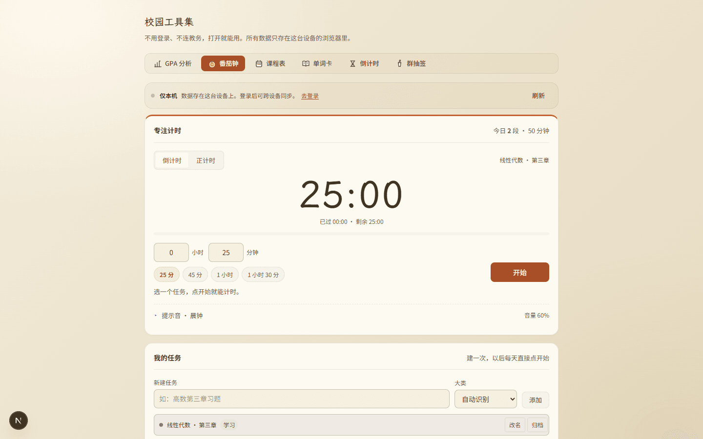
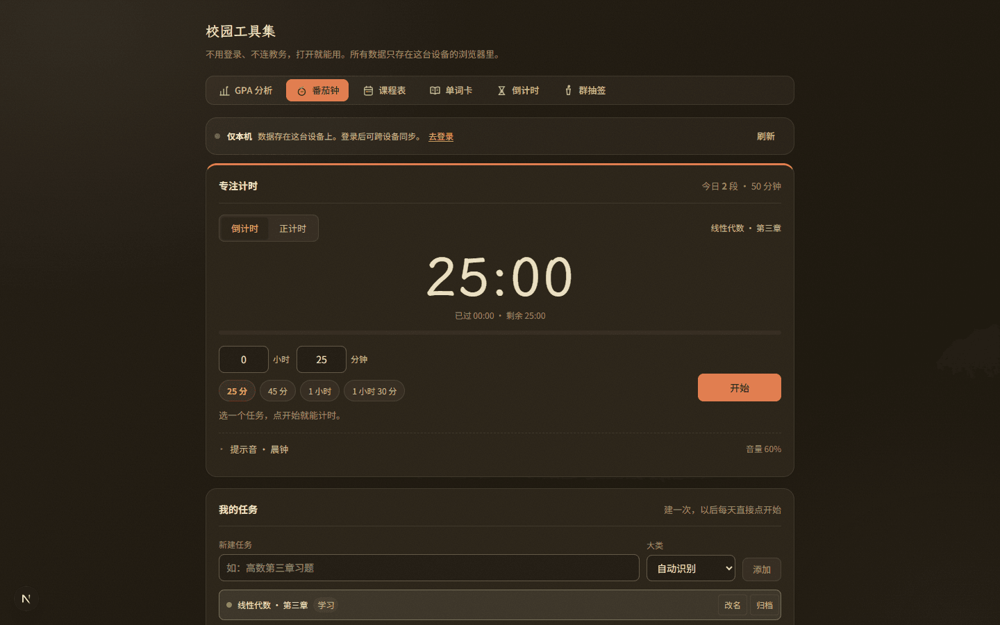
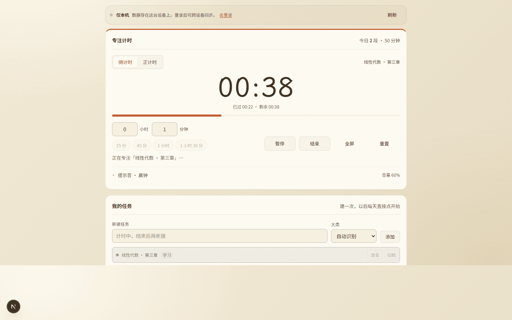
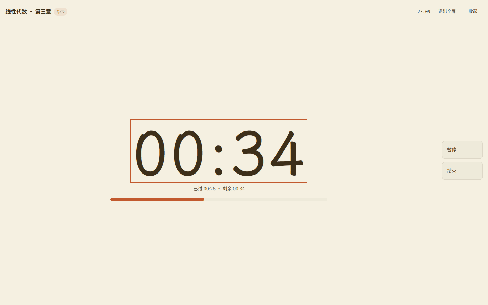
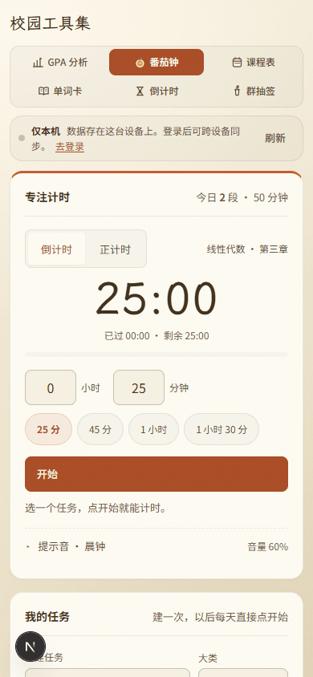
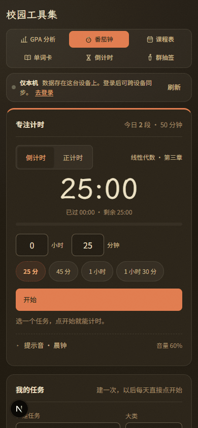
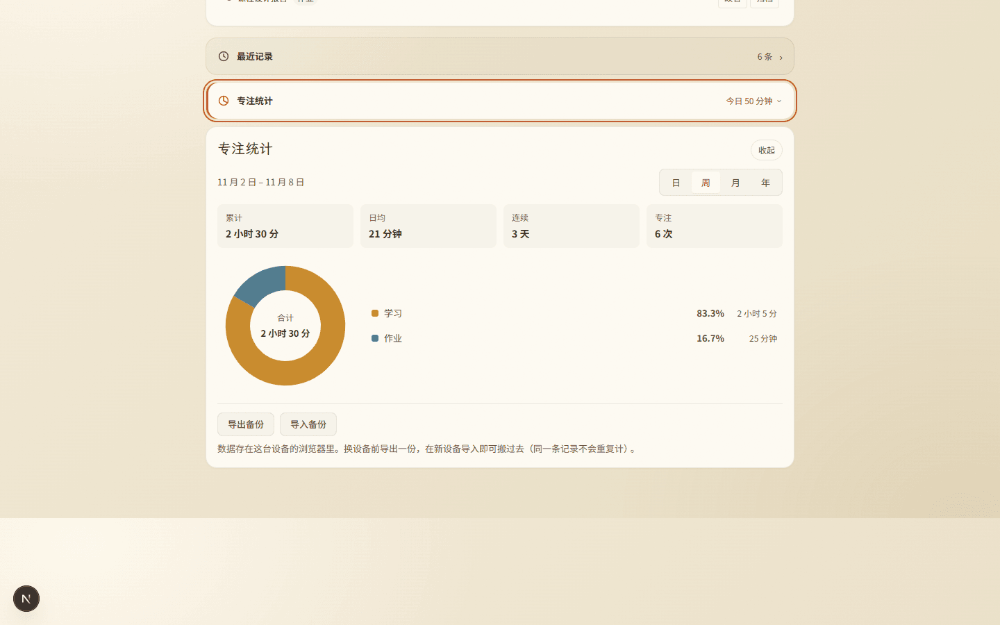
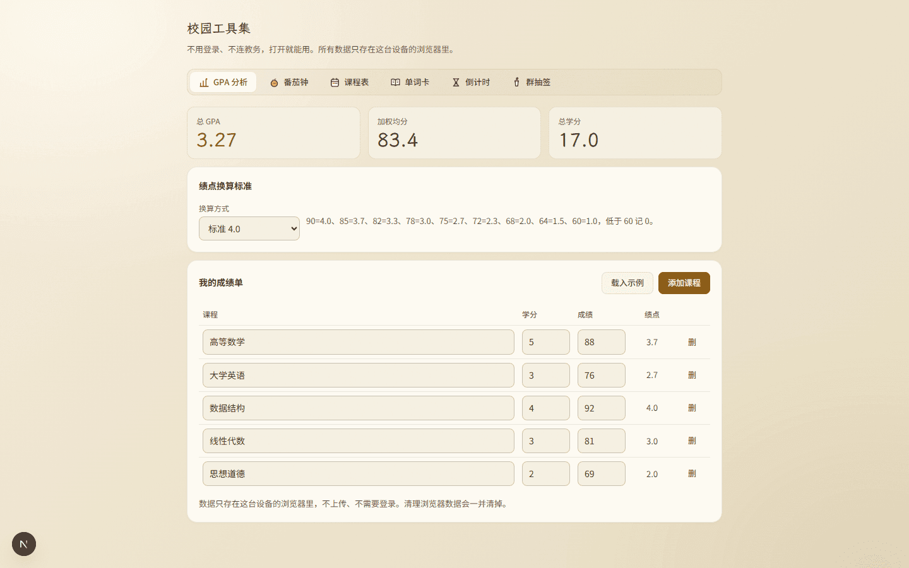

# 审核报告 · 番茄钟换成「工具身份色」（赤陶），其余五工具不动

| 项 | 内容 |
| --- | --- |
| 报告日期 | 2026-11-08 |
| 开发者 | 橙子 |
| 审核人 | @baomi888 |
| 分支 | `school-tools` |
| 板块版本 | `0.6.9` → **`0.7.0`**（已落地：`VERSION` 与 `CHANGELOG` 均已更新并随批推送；与同日单词卡三批合并进同一版） |
| 关联条目 | 负责人原话「方案C_工具身份色_切换换色 … 番茄钟换成这种配色」；追加约束「其他暂时不改动」 |

> 这次要的不是「再好看一点」，是**把当时方案 C 的那套身份色真正落到一个工具上**。
> 方案 C 的原文是「每个工具有一个莫兰迪身份色，页头/导航/内容卡都跟着它走」，
> 当时给了六个色：GPA 草绿、番茄钟赤陶、课表金、单词卡蓝、倒计时赭红、抽签紫。
>
> 本次只把**番茄钟那一支（赤陶 #C25A2E）**接上。其余五个工具的颜色、结构、任何一个像素都不动 ——
> 这是负责人明确加的约束，也是本报告第 4 节花了 9 条断言去守的东西。

---

## 1. 做了什么

番茄钟这一页从板块的金色换成了它自己的颜色（赤陶）。点进番茄钟，标签是赤陶的、计时卡顶边是赤陶的、进度条和「开始」按钮也是赤陶；切去别的工具，那些页面仍然是原来的金色。

## 2. 为什么做

- 六个工具共用一套金 accent，六个页面看起来是同一个页面的六个部分，不是六个工具，这是当时负责人提「区分度太低」的原始动因。
- 方案 C 是当时给出的三条路线之一，负责人选了 A+C 的组合，但后续几批都在处理单词卡，身份色一直没落地。
- 这次负责人明确指名要「番茄钟换成这种配色」，并把范围收窄到「其他暂时不改动」，所以只动这一支。

## 3. 改动文件

| 文件 | 改动 |
| --- | --- |
| `frontend/src/campus/styles/campus.css` | `.campus-shell` 增加 5 个 `--pomo-*` 身份色变量（浅色 + 深色两套）；`#campus-panel-pomodoro` 内把 `--accent` 一族重映射到赤陶；新增专注卡 3px 赤陶顶边；新增番茄钟标签的选中态 |
| `frontend/src/campus/components/ToolNav.tsx` | 标签按钮增加 `data-tool={tool.id}`（一行属性，无样式影响） |

**板块外文件**：无。`tokens.css`、`CornIcon.tsx`、路由薄壳都没碰。

### 3.1 两个必须说明的技术点

**① 为什么在面板根节点重映射变量，而不是逐条改选择器**

面板里所有强调色本来就写在 `var(--accent*)` 上（进度条、主按钮、分段选中、提示链接、聚焦态）。在 `#campus-panel-pomodoro` 上把这族变量改一遍，等于一次性换了这页所有强调色，且**天然不外泄**——变量随面板挂载生效、随卸载消失，其他工具那几页拿到的仍是 `.campus-shell` 上的金。

**② 为什么还要单独补 `--campus-btn-solid` 这一行**

`.campus-shell` 上写的是 `--campus-btn-solid: var(--accent-ink)`。CSS 自定义属性的 `var()` 替换发生在**声明它的那个元素**上，也就是说 `.campus-shell` 这一层就已经把值算成了字面量 `#875B10`，子元素之后改 `--accent-ink` 不会让它回头重算。漏了这一行，主按钮会一直是金底，而进度条已经变赤陶——这种「一半变色」最难查。

### 3.2 取色与对比度

| 用途 | 浅色 | 深色 | 对比度 |
| --- | --- | --- | --- |
| 装饰（进度条、卡顶边） | `#C25A2E` | `#E07B4E` | 不承载文字 |
| 文字与实底（主按钮、选中标签） | `#A84B24` | 亮赤陶压深字 | 浅 7.6:1 / 深 4.9:1 |
| 淡底（提示条、选中态衬底） | `rgba(194,90,46,.10)` | `rgba(224,123,78,.14)` | — |

标签之所以用深一档而不是赤陶原色：`#C25A2E` 压纸白只有 **4.2:1**，14px 的标签压不住 AA 的 4.5 线；深一档的 `#A84B24` 是 7.6:1。深色主题镜像过来，亮赤陶 `#E07B4E` 压深棕字 4.9:1。

## 4. 验证方式

| 验证项 | 命令 / 操作 | 结果 |
| --- | --- | --- |
| 类型检查 | `npx tsc --noEmit` | 通过（exit 0，无输出） |
| 代码规范 | `npx eslint src/campus` | 通过（exit 0，无输出） |
| 构建 | `npm run build` | 通过，15/15 页，BUILD_ID `4OmiIO9TQeANy3RfEKwd5` |
| 视觉实测 | `.workbuddy/tmp/pomo-verify.mjs`（Playwright + 真实浏览器） | **28 条断言全过** |
| 双端 | 1440×900 / 390×844 / 768×900 | 均无横向滚动 |

### 4.1 断言做了什么（28 条，逐条可复现）

浅色 8 条：标签选中底 `rgb(168,75,36)`、字为纸白、专注卡顶边 `3px rgb(194,90,46)`、主按钮底深赤陶、按钮字纸白、进度条赤陶、面板 `--accent` 为 `#c25a2e`、**板块 `--accent` 仍为 `#c8892a`**。

深色 5 条：标签底 `rgb(224,123,78)`、字 `rgb(46,38,24)`、主按钮亮赤陶、进度条亮赤陶、卡顶边亮赤陶。

统计 1 条：区间切换选中字为深赤陶。

计时 3 条：分钟框可写入、进度条走到 20% 以上且为赤陶。

全屏 3 条：专注层已打开、层内 `--accent` 继承为赤陶、进度条赤陶。

**外泄检查 4 条**：GPA / 课程表 / 单词卡 / 倒计时 / 抽签 五个工具逐个切过去量 —— accent 全为 `#c8892a`、标签选中全为纸底金字、四个工具的卡片圆角仍 16px、切走后 `#campus-panel-pomodoro` 已卸载。

窄屏 4 条：390 与 390 深色无横向滚动且标签仍为赤陶、768 无横向滚动。

> 为什么对「外泄」这么较真：这次改的是**没有作用域选择器兜底的变量**，
> 变量一旦写到 `.campus-shell` 或 `:root` 上，六个工具会一起变色，而这种回归
> 只在切到别的 tab 时才看得见，光截图番茄钟是发现不了的。

### 4.2 截图时效

截图 17:21–17:26，晚于最后一次代码改动（17:16）；`tsc` / `eslint` / `build` 在截图之后重跑。
截图统一调色板 PNG 重编码，8 张共 0.86MB（原 4.54MB）。

## 5. 风险与未做的事

- **`:has()` 依赖**：卡顶边用 `.campus-card:has(.campus-pomo-clock)` 定位，没有给组件加类名。项目里已有先例（`.campus-shell:has(#campus-panel-words)`），不支持 `:has()` 的浏览器整条规则失效 —— 退化成「没有顶边」，不影响任何功能。
- **标签满色偏重**：方案 C 的导航是「当前工具满色填充」，本次照做了。整行六格里只有一格实心，视觉锚点很强，但比其余五格重。如果负责人觉得跳，可以降成「淡赤陶底 + 赤陶字」，改一条规则即可。
- **饼图仍是金色**：统计里的分类色板（`--pie` 系列）没动。它承载的是「学习 / 作业 / 其他」的类别区分，不是本工具的身份色；染成赤陶会让分类之间失去区分度。
- **全屏专注层只让进度条与焦点框承担身份色**：那一层是极简界面，加色块会破坏沉浸感，故保持克制。
- **本次没做**：其余五个工具的身份色（草图见方案 C，需要逐个确认后分批接）。

## 6. 截图

<table>
  <tr>
    <td align="center"><b>桌面 1440 · 浅色（默认态）</b> 
       
      <a href="../previews/shots/pomo-identity/1440-light.png">点开原图</a></td>
    <td align="center"><b>桌面 1440 · 深色</b> 
       
      <a href="../previews/shots/pomo-identity/1440-dark.png">点开原图</a></td>
  </tr>
  <tr>
    <td align="center"><b>计时中（进度条 46%）</b> 
       
      <a href="../previews/shots/pomo-identity/1440-running.png">点开原图</a></td>
    <td align="center"><b>全屏专注</b> 
       
      <a href="../previews/shots/pomo-identity/1440-stage.png">点开原图</a></td>
  </tr>
  <tr>
    <td align="center"><b>手机 390 · 浅色</b> 
       
      <a href="../previews/shots/pomo-identity/390-light.png">点开原图</a></td>
    <td align="center"><b>手机 390 · 深色</b> 
       
      <a href="../previews/shots/pomo-identity/390-dark.png">点开原图</a></td>
  </tr>
  <tr>
    <td align="center"><b>专注统计（展开）</b> 
       
      <a href="../previews/shots/pomo-identity/1440-stats.png">点开原图</a></td>
    <td align="center"><b>对照：切回 GPA，仍是金</b> 
       
      <a href="../previews/shots/pomo-identity/1440-gpa-control.png">点开原图</a></td>
  </tr>
</table>

完整清单：

| 文件 | 内容 |
| --- | --- |
| `1440-light.png` | 桌面 1440 浅色默认态：标签赤陶满色、卡顶边、开始按钮、25 分快选 |
| `1440-dark.png` | 桌面 1440 深色：亮赤陶 |
| `1440-running.png` | 计时中：进度条走到 46%，赤陶 |
| `1440-stage.png` | 全屏专注：进度条赤陶、时钟焦点框赤陶 |
| `1440-stats.png` | 统计展开：区间选中字为赤陶；饼图分类色未动 |
| `390-light.png` / `390-dark.png` | 手机 390 浅色 / 深色，标签为 2×3 网格 |
| `1440-gpa-control.png` | 对照组：切回 GPA，强调色仍为金 |

---

## 7. 审核结论（由负责人填写）

- [x] **通过** —— 可以合并并推送
- [ ] **有条件通过** —— 条件：
- [ ] **打回** —— 不通过条目（对照 `docs/03` 编号）：

审核意见：负责人 2026-11-09 确认通过（开发者转述「他通过了」）；闸门 4 上传前优化已于 2026-11-08 完成并复核，逐条见整合版报告 §8。

审核日期：2026-11-09

---

## 8. 上传记录（审核通过后填写）

| 项 | 内容 |
| --- | --- |
| 开发者授意上传 | ✅ 2026-11-09 12:05 橙子说「上传吧」 |
| **上传前优化**（`docs/05` 闸门 4） | ✅ 已做（2026-11-08 22:55–23:19），11 条逐项对账见整合版报告 §8 |
| 推送时间 | 2026-11-09 12:11（北京时间） |
| 推送分支 | `school-tools`（`44c58dc → 6bc8c0b`） |
| 推送提交 | `1abf099` feat · `ae6631c` style · `02ed8ef` docs · `6bc8c0b` docs（4 个提交、2 次推送；本次为第 3 次，回填签章） |
