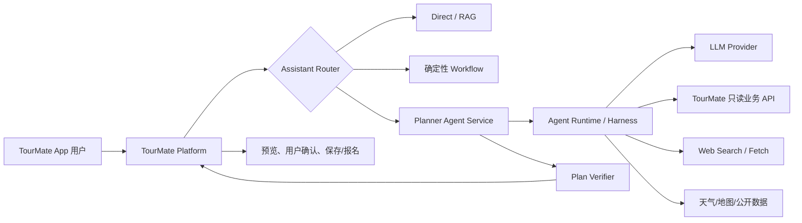

# Agent 开发绿皮书：从 Tool Calling 到可持续迭代

> 面向 Java 开发者的 Agent 产品全景、工程方法与 TourMate 落地指南  
> 版本：v1.0  
> 日期：2026-10-14  
> 适用项目：DeepSeek Harness Java、TourMate Platform C 端助手  
> 本文是概念与架构学习材料，不是本轮代码改造方案。

---

## 0. 先说结论

你现在并不是“完全没有做 Agent”，而是已经跨过了最容易被忽略的一步：**你在 TourMate C 端高级规划里已经手写出了一个受控的工具调用循环**。

你真正缺少的，不是“会不会调用大模型”，而是一张把现有经验放到正确位置的地图：

- 哪些是模型厂商协议；
- 哪些是通用 Agent 决策循环；
- 哪些是 Harness/Runtime 工程能力；
- 哪些是 TourMate 旅游业务独有的编排；
- 哪些能力必须由确定性 Java 代码控制，不能交给模型；
- 做到什么程度可以称为原型、内测产品、生产级助手。

本书的核心结论可以压缩为五句话：

1. **Tool Calling 是模型与应用之间的协议，不等于完整 Agent。**
2. **ReAct/Agent Loop 是一种常见决策循环，不是所有 Agent 必须照抄的唯一标准。**
3. **Guard、Hook、审批、超时、会话事件、恢复、观测和评测，属于生产级 Agent Runtime 的工程治理。**
4. **业务规则、业务状态、事实来源与最终验收标准属于业务系统，框架不会替你生成。**
5. **最实用的 Agent 产品通常是“确定性工作流在外、有限自治循环在内”，而不是把所有事情都交给模型。**

你反复提到的流程：

```text
用户输入
  → Agent / ReAct 循环
  → 调用 LLM
  → 模型产生 tool_call
  → ToolRegistry 查找工具
  → Guard / Hook / 审批
  → ToolExecutor 执行工具
  → tool_result 写回会话
  → 再次调用模型
  → 最终回答
```

可以认为是**工具型 Agent 的经典主干**。但它只描述了“运行一轮时怎么动”，还没有覆盖“产品为什么可用、出了错怎么找、上线后怎么持续变好”。完整产品还需要：路由、上下文、状态、记忆、事实依据、验证、权限、安全、可恢复性、观测、评测、成本与用户体验。

---

## 1. 先把三个项目边界说清楚

这是阅读整本书的前提。

### 1.1 DeepSeek Harness Java（DSH-Java）

DSH-Java 的定位是通用 **Agent Harness / Runtime**。它不负责某一个旅游业务答案，而是为多种 Agent 提供运行底座：

- 模型接入与流式调用；
- ReAct/工具调用循环；
- 工具注册、解析、执行、并发、超时；
- Hook、权限矩阵和运行期审批；
- 会话事件、回放、取消与续步；
- 插件、Skill、MCP、任务、终端、沙箱等扩展能力。

它回答的是：**“一个 Agent 如何安全、可追踪地运行？”**

### 1.2 TourMate Platform C 端助手与高级规划

TourMate C 端助手是面向游客的垂直业务产品。它已有：

- 意图识别与多轮补槽；
- 活动搜索、天气、详情、路线可行性等业务工具；
- RAG、会话上下文和用户记忆；
- 普通工作流与高级规划模式；
- 真实活动卡片、确认边界、审计与反馈；
- 行程规划、找搭子、活动报名等业务流程。

它回答的是：**“怎样利用 TourMate 的真实数据，帮用户完成一次可信的旅行决策？”**

### 1.3 `tourmate-ops-plugin`

`tourmate-ops-plugin` 是 TourMate B 端运营报表助手接入 DSH-Java 的插件适配层。它的职责是：

- 把 TourMate 已有 B 端 API 暴露成 DSH 工具；
- 转换参数和结果；
- 声明风险、超时与配置；
- 让 DSH Agent 选择并执行这些工具。

它不是 TourMate C 端高级规划，也不应该把 C 端完整业务搬进去。

一句话区分：

```text
DSH-Java：通用运行底座
TourMate C 端高级规划：垂直业务 Agent
tourmate-ops-plugin：B 端业务能力接入 DSH 的薄适配器
```

---

## 2. Agent 到底是什么

### 2.1 从聊天模型到 Agent

只有文本输入、文本输出的模型，本质上是聊天或生成能力：

```text
用户问题 → LLM → 文本答案
```

加入 RAG 后，模型可以基于检索材料回答：

```text
用户问题 → 检索知识 → 拼接上下文 → LLM → 文本答案
```

加入工具调用后，模型能够提出“我要调用哪个函数、参数是什么”的请求：

```text
用户问题 + 工具定义 → LLM → tool_call
应用执行工具 → tool_result → LLM → 最终回答
```

当应用允许模型根据中间结果再次决定下一步，并用停止条件、状态和治理能力控制这个循环时，就进入了典型 Agent 范畴：

```text
感知当前状态 → 决策下一动作 → 执行动作 → 观察结果 → 更新状态 → 再决策
```

### 2.2 一个实用定义

可以把 Agent 定义为：

> 在目标、上下文、工具和约束范围内，由模型动态决定部分下一步动作，并由应用执行、观察、校验和终止的系统。

这里有三个重点：

- **模型负责建议动作，不直接获得系统权限。**
- **应用负责实际执行，并拥有最终控制权。**
- **自治是局部的、有边界的，不等于模型想做什么就做什么。**

Spring AI 官方文档也明确指出：模型只请求工具调用，真正的工具执行逻辑归应用所有，模型不会直接接触工具背后的 API。这是理解 Agent 安全边界的关键。[Spring AI Tool Calling](https://docs.spring.io/spring-ai/reference/api/tools.html)

### 2.3 Agent、Workflow 和 Agentic Workflow

三个词经常混在一起：

| 类型 | 下一步由谁决定 | 优点 | 缺点 | 适合场景 |
|---|---|---|---|---|
| 固定 Workflow | Java/流程图 | 稳定、可测、成本可控 | 灵活性低 | 报名、支付、退款、固定审批 |
| Agent Loop | 模型动态决定 | 能处理开放问题和不确定步骤 | 难预测、需治理 | 调研、探索、多工具规划 |
| Agentic Workflow | 外层代码，局部模型 | 稳定与灵活折中 | 设计要求高 | 生产级业务助手 |

Anthropic 将两者区分得很清楚：Workflow 是预先定义的代码路径，Agent 则让模型动态指导过程；同时建议先选择能解决问题的最简单方案，再逐步增加自治。[Building Effective Agents](https://www.anthropic.com/engineering/building-effective-agents)

对 TourMate 最合适的不是“全 Agent 化”，而是：

```text
外层确定性业务流程
    ├─ Direct：直接回答
    ├─ Workflow：固定业务流程
    └─ Agent：仅在高级规划、研究型任务中动态选择只读工具
```

---

## 3. 那条链路是不是 Agent 的标准流程

### 3.1 是“事实标准主干”，不是完整强制标准

OpenAI 官方把工具调用描述为五步：

1. 应用把可用工具连同请求发给模型；
2. 模型返回一个或多个工具调用；
3. 应用执行工具；
4. 应用把工具输出再次发给模型；
5. 模型给出最终答案，或继续请求更多工具。

这与你写出的主干完全一致。[OpenAI Function Calling Flow](https://developers.openai.com/api/docs/guides/function-calling#the-tool-calling-flow)

但需要分三层理解：

| 层次 | 是否接近标准 | 内容 |
|---|---|---|
| 模型协议层 | 是，事实标准 | messages、tools、JSON Schema、tool_call、tool_result |
| Agent 循环层 | 常见模式 | 判断是否有 tool_call、执行、回喂、继续、停止 |
| 生产运行时层 | 非模型标准 | Registry、Hook、Guard、审批、超时、重试、事件、恢复、审计 |

也就是说：

- `tool_call/tool_result` 是模型 API 协议的一部分；
- ReAct 是一种决策方法和循环模式；
- ToolRegistry、Hook、审批是工程实现；
- TourMate 的活动真实性、报名确认、路线规则是业务实现。

### 3.2 ReAct 不是“必须输出思维链”

ReAct 最初表达的是 Reasoning + Acting 交替：模型基于观察决定动作，再根据动作结果继续。原始论文见 [ReAct: Synergizing Reasoning and Acting in Language Models](https://arxiv.org/abs/2210.03629)。

工程中不需要把模型的私有思维过程保存或展示给用户。生产系统通常只需要记录：

- 输入摘要；
- 模型请求了什么工具；
- 参数摘要或安全哈希；
- 工具结果状态；
- 停止原因；
- 面向用户的简短进度事件。

### 3.3 不是每个 Agent 都要具备所有部件

以下系统都可能被市场称为 Agent：

- 只调用一个搜索工具后回答的研究助手；
- 固定执行“检索 → 总结 → 校验”的 Workflow；
- 自己选择几十种开发工具的 Coding Agent；
- 能暂停等待审批、隔天恢复的长任务 Agent；
- 多个专职 Agent 协作的系统。

所以“是不是 Agent”不是最值得争论的问题。更有用的问题是：

1. 它解决什么用户任务？
2. 哪些决定交给模型？
3. 哪些决定必须由代码控制？
4. 失败时能否解释、恢复、回归测试？
5. 成本和风险是否与业务价值匹配？

---

## 4. 一轮 Agent 到底发生了什么

下面是一个最小而完整的受控循环：

```java
messages = buildContext(userInput, session, memory);
tools = selectAllowedTools(user, intent, riskLevel);

for (int step = 0; step < maxSteps; step++) {
    response = model.chat(messages, tools);

    if (!response.hasToolCalls()) {
        return verifyAndRender(response.text(), state);
    }

    messages.add(response.asAssistantMessage());

    for (ToolCall call : response.toolCalls()) {
        definition = registry.find(call.name());
        args = validate(call.arguments(), definition.schema());
        policy = authorize(user, definition, args);

        if (policy.requiresApproval()) {
            pauseAndWaitForApproval();
        }

        result = executeWithTimeoutRetryAndIdempotency(definition, args);
        recordEvent(call, result);
        messages.add(toolResultMessage(call.id(), result));
    }
}

return safeFallback(MAX_STEPS_REACHED);
```

这段伪代码背后有四种不同职责：

1. **模型决策**：根据上下文选择工具、参数和是否结束；
2. **运行时治理**：注册、校验、超时、并发、重试、审批、事件；
3. **业务真相**：工具访问真实业务 API，业务系统做权限和一致性；
4. **产品体验**：进度、卡片、澄清、失败提示、确认与恢复。

不要把这四种职责塞进一个 `AssistantService`，也不要误以为换成某个框架就会自动拥有后面三种能力。

---

## 5. 一个 Agent 产品要做到什么程度

下面是一套便于学习和验收的成熟度模型。它不是行业认证标准，而是本绿皮书给出的工程分级。

### L0：单次模型调用

能力：Prompt → LLM → 文本。

能做：润色、分类、摘要、开放问答。

不能保证：最新事实、业务真实性、动作执行。

完成标志：有超时、错误处理、敏感信息保护和基本日志。

### L1：上下文增强与确定性 Workflow

能力：RAG、规则路由、固定流程、结构化输出。

能做：基于知识库问答、固定步骤业务助手。

完成标志：检索来源可追踪，结构化输出能校验，流程可测试。

### L2：Function Calling / 工具型助手

能力：注册工具，模型产生 tool_call，应用执行并回喂一次或少量几次。

完成标志：

- 工具有明确名称、描述和 JSON Schema；
- 参数服务端校验；
- 工具只返回结构化事实；
- 模型没有直接系统权限；
- 未知工具和错误结果也能安全回喂。

### L3：受控 Agent Loop

能力：模型可依据中间结果多步选择工具。

完成标志：

- 最大步数、最大模型调用数、最大工具调用数；
- 重复调用检测；
- 工具白名单和副作用分级；
- 明确停止原因；
- 每步审计；
- 事实必须来自工具结果；
- 失败有退路，不会无限循环。

TourMate C 端高级规划当前已进入这一层，而不是“只把工具注册给模型”。

### L4：生产级 Agent Runtime

能力：把 L3 变成可长期运行的平台能力。

完成标志：

- 模型 Provider 抽象、重试、限流、流式协议；
- ToolRegistry、ToolExecutor、超时、并发和取消；
- Hook、Guard、权限、审批；
- 会话事件、持久化、回放、压缩与恢复；
- Trace、指标、告警、成本与版本记录；
- 沙箱、凭证、租户隔离；
- 可重复的离线评测与回归。

DSH-Java 的主要目标就在这一层。

### L5：垂直领域 Agent 产品

能力：不仅“循环能跑”，而且真正完成某类用户任务。

完成标志：

- 有领域状态和任务成功定义；
- 有高质量的垂直工具与事实来源；
- 业务规则、权限和确认边界可靠；
- 输出可验证，能诚实表达不确定性；
- 用户体验、转化、满意度与安全指标可度量；
- 基于真实 badcase 持续迭代。

TourMate 的目标应该是 L5，而不是为了看起来先进去追求“工具更多、循环更长”。

### L6：多 Agent / 企业级 Agent 平台

能力：多个角色、长任务、跨系统、人工协作、资源隔离和平台治理。

只有在任务天然需要专职分工、上下文隔离或独立生命周期时才值得做。多 Agent 不是 L3/L4 没做稳时的补救手段。

---

## 6. 完整 Agent 产品的能力地图

### 6.1 产品目标与任务成功定义

第一步不是选框架，而是回答：

- 用户到底要完成什么？
- 成功结果能否被判断？
- 哪些结果必须来自实时数据？
- 哪些失败应该追问，哪些应该降级，哪些必须拒绝？
- 一次成功任务值多少钱，能接受多少延迟和 Token？

对于 TourMate，高级规划的成功不是“生成了一篇好看的游记”，而可能是：

- 覆盖用户指定的全部目的地；
- 推荐的活动真实存在且卡片可打开；
- 日期、预算、天气和空间可行性不冲突；
- 没有把未实现的查票能力说成已实现；
- 信息不足时会追问或输出部分方案；
- 用户能继续修改、确认或转入后续业务流程。

### 6.2 模式路由：Direct / Workflow / Agent

路由器决定一条请求走哪条路径：

```text
简单知识或闲聊 ───────→ Direct
确定性业务流程 ───────→ Workflow
开放、多步、需动态工具 → Agent
高风险写操作 ─────────→ Workflow + Confirmation/Approval
```

路由错误是许多“模型看起来不聪明”的根因。比如用户只问“报名规则是什么”，没必要启动多步规划；用户要求跨三个目的地权衡活动和天气，才适合进入高级规划。

### 6.3 模型协议与 Provider 适配

必须理解：

- system/user/assistant/tool 消息角色；
- 工具定义与 JSON Schema；
- tool_call id 和 tool_result 的对应关系；
- 并行工具调用；
- 流式增量中的文本与工具参数拼接；
- finish reason、Token 截断、上下文窗口；
- 不同模型 Provider 的字段差异与兼容策略。

框架可以替你做序列化和适配，但你仍需知道协议，否则出了“模型明明调用了工具却没有继续回答”的问题时无法定位。

### 6.4 Context Engineering

上下文不是“把所有历史都塞进去”，而是为当前一步组装足够且可信的信息：

```text
系统边界
+ 当前用户请求
+ 本轮结构化意图/槽位
+ 相关会话历史
+ 用户偏好摘要
+ 当前任务状态
+ 可用工具及其 schema
+ 必要的 RAG/业务事实
+ 已执行工具及结果
```

需要防止：

- 历史越来越长导致成本与注意力稀释；
- 把过期偏好当硬约束；
- 把不可信网页文本当系统指令；
- 工具结果被截断后丢失关键字段；
- 多个任务的上下文互相污染。

### 6.5 Session、State 与 Memory

这三个概念不要混用：

| 概念 | 含义 | TourMate 例子 |
|---|---|---|
| Session | 当前对话及事件容器 | 这次规划的全部消息与工具步骤 |
| State | 当前任务进行到哪里 | 目的地、天数、预算、候选活动、缺失信息 |
| Memory | 可跨轮次或跨会话复用的信息 | 偏好自然风光、不吃辣、常从上海出发 |

Memory 至少分三类：

- 工作记忆：当前回合/任务所需；
- 会话记忆：当前对话的摘要与事件；
- 长期记忆：稳定偏好、事实和历史经验，可检索、可修正、可删除。

不要把模型每句话都写入长期记忆。需要来源、置信度、过期时间、用户可见性和纠错机制。

### 6.6 Planner / 决策循环

规划不只有一种：

- **一次性计划**：先生成完整步骤，再依次执行；
- **逐步计划**：每获得一个结果，再决定下一步；
- **工作流模板**：代码规定骨架，模型只填局部决策；
- **Orchestrator-Workers**：主模型拆任务，多个工作单元并行完成；
- **Evaluator-Optimizer**：生成后再由校验器反馈重做。

TourMate 更适合逐步计划与模板混合：Java 保存目标和约束，模型每一步只选择下一项只读工具，最终由验证器检查覆盖度和真实性。

### 6.7 Tool Registry

Registry 不只是 `Map<String, Function>`。每个工具至少应声明：

- 工具名、版本、描述；
- 输入 JSON Schema；
- 输出结构与错误码；
- 允许的意图、用户、租户或角色；
- 副作用等级：READ / LOW_WRITE / HIGH_RISK；
- 超时、重试、幂等策略；
- 是否可并行；
- 是否需要确认或审批；
- 数据来源和新鲜度；
- 结果大小与脱敏规则。

工具描述是给模型看的路由说明，不能只写 Java 方法含义。一个好描述要说明“什么时候用、什么时候不用、参数从哪里来、结果能证明什么”。

### 6.8 Guard、Hook 与 Approval

这三个词用途不同：

| 机制 | 回答的问题 | 示例 |
|---|---|---|
| Guard/Policy | 允许不允许 | 当前意图只能用只读工具 |
| Hook | 在生命周期节点附加什么逻辑 | 执行前审计，执行后指标、脱敏 |
| Approval | 需要谁明确批准 | 退款、下单、删除前等待用户/管理员 |

“把这些交给 DSH”不是让 DSH 约束模型的思想，而是：**即使模型请求了危险动作，Runtime 也能在真正执行前拦住、暂停或拒绝。**

正确安全模型是双层甚至三层：

```text
Prompt 告诉模型不要做
    ↓
Agent Runtime 在工具入口做权限/审批
    ↓
业务系统 API 再做身份、权限、一致性和审计
```

Prompt 不是安全边界。最终防线必须在确定性代码和业务系统中。

### 6.9 Tool Executor

执行器需要负责：

- 参数解析与 Schema 校验；
- 工具查找与版本解析；
- 权限、审批与 Hook；
- 超时、取消、并发、限流、重试；
- 幂等键与重复调用防护；
- 统一成功/空结果/错误/拒绝结构；
- 结果截断、脱敏和附件管理；
- tool_call/tool_result 成对记录。

特别注意：超时返回不等于底层任务一定停止。如果线程或远程调用无法被安全取消，执行器还要防止迟到结果重新写入状态。

### 6.10 Grounding、RAG 与 WebSearch

三者解决的问题不同：

- RAG：从已管理知识库中找相关材料；
- 业务工具：从权威业务系统获取结构化真相；
- WebSearch：从开放网络发现外部信息与候选来源。

搜索结果标题和摘要不等于证据。完整 Web 研究通常需要：

```text
生成查询
  → web_search 发现候选 URL
  → 来源筛选/去重
  → web_fetch 获取正文
  → 提取 claim + evidence + publishedAt + appliesTo
  → 交叉验证与冲突处理
  → 证据覆盖度检查
  → 带来源生成答案
```

Web 工具必须由服务端控制：

- SSRF 防护和私网地址阻断；
- 域名、协议、重定向、内容类型白名单；
- 页面大小、下载时间和总任务时间限制；
- 查询次数、抓取页数、Token 和费用预算；
- 网页文本视为不可信数据，防提示注入；
- 记录 URL、抓取时间、发布日期和适用日期；
- 不足时返回“证据不足”，不能让模型补齐事实。

### 6.11 Verifier / 输出验证

最终回答不能只靠模型自觉。至少需要四层验证：

1. **结构校验**：字段、格式、长度；
2. **事实校验**：活动 id、价格、日期是否来自工具结果；
3. **业务校验**：预算、时间、路线、报名状态是否冲突；
4. **安全校验**：是否泄露敏感信息、越权承诺或执行未确认动作。

验证失败不一定都重试模型。可以：

- 删除无依据段落；
- 降级为卡片和事实列表；
- 追问缺失条件；
- 只输出部分方案；
- 返回明确错误和重试入口。

### 6.12 Event、Trace 与 Observability

日志不是把 Prompt 全打印出来。应围绕一次任务建立 trace：

- requestId / traceId / sessionId / userId（脱敏）；
- router 决策；
- model/provider/version/promptVersion；
- step/turn；
- toolCallId、toolName、参数哈希；
- status、errorCode、latency、retryCount；
- stopReason；
- Token、费用、总延迟；
- evidence 引用；
- approval 状态；
- 最终评测和用户反馈。

可观测性要回答“错在哪一层”，而不是只回答“模型答错了”。

### 6.13 Eval 与持续迭代

没有 Eval，Prompt 和模型升级就只能靠感觉。

至少需要：

- 黄金用例；
- 历史 badcase；
- 对抗和安全用例；
- 工具契约测试；
- 模拟模型的确定性循环测试；
- 少量真实模型集成评测；
- 线上抽样、用户反馈和回归门禁。

评测对象不只看最终文字，还要看轨迹：

- 路由是否正确；
- 工具选择是否正确；
- 参数是否完整；
- 是否重复调用；
- 是否越权；
- 是否引用真实结果；
- 是否在合理步骤内停止。

---

## 7. DSH-Java 是怎样实现 Agent 的

### 7.1 它没有使用 Spring AI、Google ADK、LangChain4j，为什么仍然能做 Agent

因为这些框架不是调用模型的必要条件。模型厂商 API 本身已经提供：

- 聊天消息协议；
- Tool/Function Calling；
- 流式响应；
- Token 与完成原因。

开发者完全可以自己实现：

- Provider Adapter；
- 消息和工具协议对象；
- ReAct 循环；
- ToolRegistry/Executor；
- Session/Event；
- Hook/Approval/Trace。

DSH-Java 实际上正在做一部分“Agent 框架本身会做的事”。所以它不是“没用 Agent 框架”，而是**自己实现了一个面向 Java、DDD 六边形架构和插件生态的 Agent Harness**。Spring Boot 是它的应用与依赖注入基础，但 Agent Runtime 是项目自己的领域实现。

### 7.2 当前源码中的真实主链路

根据当前仓库源码，核心可以概括为：

```text
Trigger / UseCase
  → AgentRunFactory 创建一次运行所需对象
      ├─ SessionLog
      ├─ ToolRegistry
      ├─ ToolCallExecutor
      ├─ HookService
      ├─ MatrixRuntimeApprovalGate（端口具备时装配）
      └─ ReactLoopAgent
  → ReactLoopAgent.turn/step
      → 组装上下文和工具 Schema
      → LLM 流式调用
      → 解析 tool_call
      → ToolCallExecutor.execute
          → 参数解析/执行模式
          → PRE_TOOL_USE Hook
          → 运行期审批
          → 工具执行、并发、超时、取消
          → POST_TOOL_USE Hook
          → 写入 tool_result 事件
      → midTurnContinuation 再次调用模型
      → 无 tool_call 时完成最终回答
```

关键源码位置：

- `ReactLoopAgent`：Agent 回合和续步循环；
- `AgentRunFactory`：每次 Agent 运行的对象装配；
- `ToolCallExecutor`：工具治理和执行；
- `MatrixRuntimeApprovalGate`：权限矩阵和人工审批；
- `SessionLog`：会话事件与回放基础；
- `ToolRegistry`：工具发现与执行模式；
- `HookService`：工具生命周期扩展点。

当前 `ReactLoopAgent` 代码有单回合步数上限，并对 Token 截断续写次数做限制；工具完成后通过 `midTurnContinuation` 继续推理，保证 tool_result 真正回到模型上下文。`ToolCallExecutor` 则处理有序提交、并行/串行、超时、取消、Hook 和审批。

### 7.3 包存在，不代表能力一定已在主链生效

评估一个 Agent 项目时必须做“装配追踪”：

1. 类是否存在；
2. 是否创建实例；
3. 是否注入到主执行对象；
4. 运行时条件是否满足；
5. 失败分支是否真的记录并返回；
6. 是否有测试或事件能证明生效。

例如：

- `ToolCallExecutor` 默认审批门可以是 allow-all；
- `AgentRunFactory` 只有在权限与审批端口存在时才装配 `MatrixRuntimeApprovalGate`；
- 因此不能仅看到 `approval` 包就断言任何部署都启用了审批；
- `GuardService` 作为独立治理能力存在，也不能未经调用链核实就说每个工具都必经 Guard。

这是你以后阅读任何开源 Agent 项目的通用方法。

### 7.4 DSH-Java 帮你解决什么，不帮你解决什么

| DSH 擅长 | 仍需业务系统负责 |
|---|---|
| 通用 ReAct 循环 | 旅游规划目标和成功标准 |
| 模型路由与调用 | 活动、订单、用户等业务真相 |
| Tool Registry/Executor | 业务 API 的权限和一致性 |
| Hook、审批、事件 | 哪些动作必须用户确认 |
| 插件、MCP、Skill | 旅游工具的语义和质量 |
| 会话运行与控制台 | 推荐排序与路线业务规则 |
| 通用 Trace 基础 | 业务 Eval 数据集和产品指标 |

DSH 的价值不是“比 TourMate 更懂旅游”，而是把每个 Agent 都会重复遇到的运行时问题抽成通用底座。

---

## 8. TourMate C 端助手目前到底做到哪一步

### 8.1 当前已有的真实能力

当前 `AssistantApplicationService` 里的高级规划不是一个假概念，而是已有真实 Function Calling 循环：

- 仅当 `agent.enabled`、意图为 `MAKE_TRAVEL_PLAN`、模式为 `ADVANCED` 时进入；
- 向模型提供意图范围内的只读工具白名单；
- 模型返回 tool_call；
- Java 执行工具；
- 以 `role=tool` 把结果回喂模型；
- 循环到模型终答或最大迭代数；
- 收集的活动卡片只来自真实工具结果；
- 记录每一步工具审计和停止原因。

当前只读工具包括：

- `search_activities`；
- `get_weather`；
- `get_activity_detail`；
- `check_leg_feasibility`。

当前已有的治理还包括：

- 意图门控；
- 工具白名单；
- 写工具显式禁止；
- 相同工具参数的重复调用检测；
- 路线校验的单轮额度；
- `HIT / EMPTY / ERROR / POLICY_BLOCKED / DUPLICATE_CALL / RATE_LIMITED` 等结果语义；
- `FINAL / MAX_ITERATIONS / TOOL_ERROR` 等停止原因；
- stepIndex、toolCallId、参数哈希、结果状态、错误码、耗时和预览审计。

所以准确评价是：

> TourMate C 端高级规划已经是 L3“受控 Agent Loop”，并拥有部分 L4 治理能力；它不是只有“注册工具让模型随便选”。

### 8.2 它与 DSH 的差距在哪里

差距主要不是“有没有 Agent”，而是抽象层次和工程完备性：

| 维度 | TourMate C 端当前 | DSH-Java |
|---|---|---|
| 目标 | 旅行助手业务闭环 | 通用 Agent 运行底座 |
| Loop | 规划场景内局部循环 | 通用 ReactLoopAgent |
| 工具 | 少量旅游只读工具 | 注册表、插件、MCP、系统工具 |
| 超时/取消 | 依赖具体调用和现有业务实现 | 通用执行器级控制 |
| Hook/审批 | 业务代码门控与确认 | 运行期通用 Hook/Approval |
| Session Event | 业务审计为主 | 事件化会话与运行回放 |
| 扩展性 | 新工具常改业务服务 | 通用契约和插件机制 |
| 业务正确性 | 强，掌握 TourMate 真相 | 不自带旅游规则 |

这不是“你的项目比 DSH 差太多”，而是二者做的是不同层：

- DSH 横向更深：运行时、插件、审批、会话、工具治理；
- TourMate 纵向更深：用户意图、旅行状态、真实活动、业务确认和产品体验。

真正合理的方向是让两者互补，不是把一方全部重写成另一方。

### 8.3 当前最值得补的能力

按收益和风险排序，TourMate C 端下一阶段更需要：

1. **把 Agent Trace 从审计记录升级为可回放的运行轨迹**；
2. **统一每工具超时、重试、取消和错误契约**；
3. **引入显式 AgentState 与 MissingInformation，而不是只依赖消息历史**；
4. **增加最终方案 Verifier，检查活动、日期、预算、覆盖度和来源**；
5. **把 WebSearch 做成证据管道，而不是一个返回搜索摘要的万能工具**；
6. **补齐真实模型轨迹评测、badcase 回归和版本门禁**；
7. **在业务量和边界稳定后，再独立部署高级规划服务**。

现有 A7 相关设计只是 WebSearch/独立攻略的草案方向，不能写成已上线能力。

---

## 9. 市面框架究竟替你做了什么

### 9.1 框架对比

| 方案 | 主要价值 | 通常可提供 | 仍要自己做 |
|---|---|---|---|
| 直接模型 API | 最透明、最可控 | 原始消息、工具调用、流式协议 | Loop、Registry、治理、会话、评测 |
| Spring AI | Spring 生态集成 | Provider、Tool、Advisor、Memory、RAG、MCP、观测 | 业务状态、权限、审批语义、业务 Eval |
| LangChain4j | Java 高层 AI API | AI Services、Tools、Memory、RAG、事件/监听 | 生产 Runtime 和业务正确性 |
| Google ADK | Agent/Workflow 开发套件 | LLM Agent、Sequential/Loop/Parallel Workflow、Session、Callback、Runtime | 业务工具与生产边界 |
| OpenAI Agents SDK | 轻量 Agent 原语 | Agent、Tools、Handoff、Guardrail、Session、Tracing、Loop | 跨厂商适配和业务治理 |
| LangGraph | 有状态图运行时 | 节点/边、持久化、暂停恢复、人工介入 | Tool 语义、业务规则、最终质量 |
| DSH-Java | 自研 Java Harness | ReAct、Registry/Executor、Session Event、Hook、Approval、Plugin/MCP | TourMate 领域设计与产品闭环 |

OpenAI Agents SDK 将核心原语概括为 Agent、Handoff、Guardrail 和 Session，并由 SDK 处理 Agent Loop、Tracing 等运行问题。[OpenAI Agents SDK Foundations](https://developers.openai.com/tracks/building-agents#foundations-of-the-agents-sdk)

Google ADK 则明确区分了由 LLM 动态决定行为的 `LlmAgent`，以及不依赖模型编排、按固定规则执行的 Sequential/Loop/Parallel Workflow Agent。[ADK LLM Agents](https://adk.dev/agents/llm-agents/) · [ADK Workflow Agents](https://adk.dev/agents/workflow-agents/)

LangChain4j 的 AI Services 提供更高层的 Java 接口抽象，并可组合 Tools、Chat Memory、RAG 和结果元数据；其工具文档也描述了自动工具执行与动态 ToolProvider。[LangChain4j AI Services](https://docs.langchain4j.dev/tutorials/ai-services/) · [LangChain4j Tools](https://docs.langchain4j.dev/tutorials/tools/)

### 9.2 框架不会替你完成的事情

无论选择哪一个框架，它都不会自动知道：

- “高级规划”何时应该启动；
- 赛里木湖和青海湖不适合同日安排；
- 哪个活动 id 真实存在；
- 用户说“帮我报上”是否构成有效确认；
- 哪个网页足以支持一条旅行事实；
- 当前回答是否达成 TourMate 的产品目标；
- 某次模型升级是否让转化率下降。

框架主要减少**协议样板代码和通用运行时重复建设**，不会替代领域建模和产品判断。

### 9.3 MCP 是什么，不是什么

MCP 解决的是 AI Host 如何标准化发现并调用外部工具、资源和 Prompt。它是一种集成协议，不是 Planner，也不会自动提供 ReAct、审批、记忆或业务正确性。[MCP Architecture](https://modelcontextprotocol.io/docs/learn/architecture)

可以这样理解：

```text
MCP：插座标准
Tool：插到插座上的设备
Agent Loop：决定何时使用哪台设备的人
Runtime：供电、保险丝、记录和安全管理
业务系统：设备真正服务的业务世界
```

### 9.4 什么时候该用框架

适合引入框架：

- 需要快速支持多个模型 Provider；
- Tool Calling、Memory、RAG 等已有成熟实现；
- 团队愿意遵守其扩展方式；
- 框架版本和依赖风险可接受；
- 自研能力没有形成明显差异化。

适合保留自研 Runtime：

- 需要精确控制每一步事件、审批、暂停和恢复；
- 已有稳定领域模型和插件生态；
- 框架抽象与现有 DDD 边界冲突；
- 有能力维护协议变化、测试和文档。

不要因为“别人都用框架”而重写，也不要因为“能自己写”就拒绝复用。正确问题是：**这部分是不是我们的核心差异化，长期维护成本是否值得？**

---

## 10. 不同 Agent 产品通常怎样落地

### 10.1 客服/业务助手

典型结构：意图路由 + 知识检索 + 少量业务工具 + 严格写操作确认。

重点：事实准确、权限、转人工、用户身份、审计。

### 10.2 Research Agent

典型结构：查询规划 + 搜索 + 网页抓取 + 证据提取 + 交叉验证 + 带引用写作。

重点：来源质量、时效性、提示注入、证据覆盖、预算和引用。

### 10.3 Coding Agent

典型结构：读仓库 + 搜索 + 编辑 + 执行测试 + 观察错误 + 再编辑。

重点：沙箱、文件边界、命令审批、补丁可回滚、长上下文压缩。

### 10.4 Browser/Computer Agent

典型结构：屏幕观察 + 动作规划 + 点击/输入 + 新观察。

重点：页面状态不确定、误操作、敏感动作确认、视觉和 DOM 双重定位。

### 10.5 旅行规划 Agent

典型结构：

```text
解析目标与约束
  → 判断缺失信息
  → 查询平台活动/天气/交通/POI
  → 构造候选
  → 检查时间、空间、预算与可用性
  → 生成可解释方案
  → 用户修改/确认
  → 确定性业务流程完成报名或保存
```

重点不是让模型“想象一个完美旅行”，而是把开放规划与真实库存、时间和交易边界连接起来。

---

## 11. TourMate 推荐的目标架构

### 11.1 总体原则

建议采用：

> **TourMate 主业务系统掌握业务真相；独立 Planner Agent Service 负责研究与规划；通用 Harness 负责循环与治理；写操作回到 TourMate 的确定性确认流程。**

### 11.2 推荐边界



边界要求：

- Planner Service 不直连 TourMate 数据库；
- 使用服务身份调用 TourMate API；
- 只读规划工具可由 Agent 动态选择；
- 保存、报名、退款、付款由 TourMate 主系统接管；
- 高风险操作必须重新校验权限、数据版本和明确确认；
- 规划结果携带来源、生成版本、事实时间和可验证结构。

### 11.3 为什么最终建议独立服务

高级规划服务与 TourMate 主业务服务的运行特征不同：

- 模型调用慢，失败模式多；
- 需要流式事件与长连接；
- 可能有多轮工具、网页抓取和长任务；
- 需要独立限流、熔断、扩缩容和成本预算；
- 模型/Prompt/工具版本迭代速度更快；
- 安全面更大，适合独立凭证和网络策略。

但独立服务应该在契约与评测稳定后实施。**先拆概念和接口，再拆进程；不要为了“微服务化”提前复制一套不稳定逻辑。**

### 11.4 DSH-Java 在目标架构中的三种选择

#### 选择 A：Planner Service 直接复用 DSH Runtime

优点：复用循环、事件、工具执行、审批和控制台。

难点：需要设计稳定的嵌入/API 方式、租户身份、会话映射和领域输出契约。

#### 选择 B：独立服务自行实现小型受控 Runtime

优点：与 TourMate 领域贴合、依赖少、演进直接。

难点：会重复建设会话、超时、取消、Hook、Trace、评测等能力。

#### 选择 C：DSH 作为独立 Agent 服务，TourMate 通过 API 接入

优点：运行时完全隔离，可服务多个业务。

难点：当前插件/会话/API 契约是否适合 C 端低延迟、多租户、高并发，需要专门验证。

当前建议不是立刻选死，而是做一个契约型验证：拿“高级规划 + 四个只读工具 + WebSearch”跑通会话、取消、超时、证据和结果结构，再根据数据决定 A 或 C。不要把 C 端能力塞进 `tourmate-ops-plugin`。

### 11.5 WebSearch 在 TourMate 中应如何加入

建议把 Web 能力拆成至少两个工具：

```text
web_search(query, filters) → 候选来源
web_fetch(url) → 页面正文与元数据
```

再由 Java 控制：

- 哪些事实优先查 TourMate/天气/地图等权威 API；
- 哪些事实允许查公开网页；
- 每轮最大查询和抓取页数；
- 域名与网络安全；
- 证据抽取格式；
- 最低覆盖度；
- 冲突和过期信息的降级策略。

推荐的结果对象：

```json
{
  "claim": "10 月景区开放时间为……",
  "evidence": "页面中支持该结论的短摘要",
  "url": "https://...",
  "sourceType": "OFFICIAL|MEDIA|UGC",
  "publishedAt": "2026-09-30",
  "retrievedAt": "2026-10-14T10:00:00+08:00",
  "appliesTo": "2026-10",
  "confidence": "HIGH|MEDIUM|LOW"
}
```

最终回答只能使用达到覆盖标准的 claim。证据不够时返回 `PARTIAL`，而不是让模型用常识填空。

---

## 12. 什么时候算“做完了”

### 12.1 可演示原型 Definition of Done

- 10～30 个代表性用例能跑通；
- 工具调用与结果真实；
- 有最大步骤和错误回退；
- 不执行危险写操作；
- 能看到每步轨迹；
- 已知限制写清楚。

### 12.2 内测版 Definition of Done

- 有路由、状态和多轮澄清；
- 工具 Schema、错误码和超时统一；
- 有用户级权限与数据隔离；
- 有最小 badcase 回归集；
- 有 p50/p95 延迟、成功率和成本指标；
- 模型/Prompt/工具版本可追踪；
- 支持取消、降级和人工兜底。

### 12.3 生产只读 Agent Definition of Done

- 关键事实全部可追溯；
- 输出通过结构、事实和业务验证；
- WebSearch 有来源和提示注入防护；
- 会话可恢复，工具调用成对记录；
- 有容量、熔断、限流和告警；
- 有安全测试、回归门禁和灰度方案；
- 隐私、保留期、删除和脱敏规则明确。

### 12.4 生产写操作 Agent Definition of Done

在只读标准上额外要求：

- 所有写工具分级；
- 用户明确确认与审批状态可证明；
- 幂等键、版本校验、事务和补偿；
- 执行前重新读取最新业务状态；
- 模型不能伪造确认；
- 业务系统独立鉴权和审计；
- 可撤销操作有撤销路径，不可撤销操作有更严格门禁。

---

## 13. 出问题时怎么排查

### 13.1 先用分层法，不要先改 Prompt

```text
用户表达
  ↓
Router/Intent
  ↓
Context/State/Memory
  ↓
Model Decision
  ↓
Tool Schema/Arguments
  ↓
Policy/Approval
  ↓
Tool/API/Data
  ↓
tool_result 回喂
  ↓
Verifier/Renderer
```

先找错在哪一层，再决定修改什么。

### 13.2 常见故障表

| 症状 | 先看什么 | 常见原因 | 优先修复 |
|---|---|---|---|
| 不该进高级规划却进了 | router、intent、mode | 路由边界模糊 | 加确定性门控和路由 Eval |
| 该调工具却直接回答 | tools 列表、描述、system | 工具未暴露或描述不清 | 校验装配，优化工具语义 |
| 调错工具 | 可用工具过多、描述重叠 | 工具边界不清 | 按意图裁剪工具、做冲突用例 |
| 参数缺失/格式错 | 原始 tool_call、schema | Schema 宽松、上下文不足 | 服务端校验、追问、收紧 schema |
| 一直重复调用 | 参数哈希、结果状态、step | 模型没看到结果或结果含糊 | 重复检测、明确结果语义、步数上限 |
| tool_result 后不继续 | 消息角色、call id、历史 | 协议关联错误 | 检查 assistant tool_call 与 tool result 配对 |
| 工具超时后系统卡死 | timeout、线程/HTTP 状态 | 只超时等待，没做取消/隔离 | 连接超时、读取超时、任务隔离、迟到结果丢弃 |
| 最终答案编造活动 | evidence/card ids | 没做 grounding 验证 | 只允许引用工具 id，Verifier 删除越界内容 |
| 记忆导致错误偏好 | memory 来源/时间/置信度 | 把推测当事实 | 记忆类型、过期、可纠错、仅作软偏好 |
| 搜索结论过期 | publishedAt/appliesTo | 只看摘要或忽略日期 | fetch 正文、时效过滤、冲突提示 |
| 成本突然升高 | step、Token、工具数 | 循环失控或上下文膨胀 | 预算、摘要、工具裁剪、停止条件 |
| 审批一直等待 | approval event/state | 请求未送达或恢复协议缺失 | 审批超时、可恢复状态、明确拒绝结果 |
| 换模型后质量下降 | model/prompt/tool 版本 | 行为分布变化 | 固定 Eval 集、灰度、回滚 |

### 13.3 一个 badcase 的标准处理方式

1. 保存脱敏后的输入、上下文、模型版本和完整结构化轨迹；
2. 给问题分类：路由、上下文、决策、工具、数据、验证、体验；
3. 写成可重复评测用例；
4. 修最小责任层，不要所有问题都加进 system prompt；
5. 运行全量回归，防止修 A 坏 B；
6. 灰度上线；
7. 观察线上指标并保留回滚能力。

---

## 14. 如何持续迭代 Agent

### 14.1 闭环

```text
线上观测
  → badcase 分类
  → 变成 Eval 用例
  → 定位责任层
  → 最小修改
  → 离线评测
  → 灰度/对照实验
  → 指标验证
  → 全量或回滚
```

### 14.2 必须版本化的东西

- 模型和 Provider；
- system prompt / planner prompt；
- 工具名称、描述、Schema 和返回契约；
- 路由与策略；
- Memory 提取规则；
- Verifier 规则；
- Eval 数据集和评分器；
- Web 来源策略。

否则你只能知道“今天好像比昨天差”，却不知道哪项变化造成。

### 14.3 指标体系

#### 用户价值

- 任务完成率；
- 用户采纳率/继续操作率；
- 追问后完成率；
- 满意度、差评原因、人工转接率。

#### Agent 质量

- 路由准确率；
- 工具选择与参数准确率；
- Groundedness/证据覆盖率；
- 计划可执行率；
- 越权与幻觉率；
- 平均步骤数、重复调用率、异常停止率。

#### 系统质量

- 模型和工具成功率；
- p50/p95/p99 延迟；
- 超时、重试、熔断率；
- 单任务 Token 和费用；
- 会话恢复成功率；
- 审批等待与通过率。

### 14.4 不要只做“LLM-as-a-Judge”

模型评分适合评价语气、完整性和开放质量，但关键事实应使用确定性检查：

- id 是否来自工具结果；
- 日期是否在用户范围内；
- 总价是否超过预算；
- 是否覆盖每个目的地；
- 是否调用了禁止工具；
- 引用 URL 是否真实存在且支持 claim。

最可靠的是“规则评分 + 轨迹评分 + 模型评分 + 人工抽检”的组合。

---

## 15. 建议的学习路线

不要一开始同时学十个框架。按下面顺序会更扎实。

### 阶段一：模型与 Tool Calling 协议

目标：能不依赖框架解释一轮 tool_call/tool_result。

要掌握：

- 消息角色；
- JSON Schema；
- tool_call id；
- 流式响应；
- 多工具调用；
- Token、上下文窗口、完成原因。

练习：手画 TourMate 一次 `search_activities → tool_result → 最终回答` 的消息序列。

### 阶段二：手写受控 Agent Loop

目标：理解你现有 TourMate 高级规划每一行为什么存在。

要掌握：

- 最大迭代；
- 工具白名单；
- 参数校验；
- 重复检测；
- 统一状态和停止原因；
- 事实绑定。

### 阶段三：读懂 DSH Runtime

建议顺序：

1. `ReactLoopAgent`：循环状态机；
2. `ToolCallExecutor`：执行和治理；
3. `SessionLog`：事件如何记录；
4. `AgentRunFactory`：能力如何装配；
5. `MatrixRuntimeApprovalGate`：审批如何暂停/继续；
6. 插件、MCP、Skill：能力如何扩展。

每读一个类都回答：输入是什么、输出是什么、状态放哪、失败怎么表示、谁调用它、有没有进入主链。

### 阶段四：业务 Agent 设计

目标：把 Agent 技术转成 TourMate 产品能力。

要掌握：

- 领域目标和状态；
- Direct/Workflow/Agent 路由；
- MissingInformation；
- 事实来源优先级；
- Verifier；
- 确认与写操作边界。

### 阶段五：Web Research 与安全

目标：做出可引用、可追溯、不过期的公开信息规划。

要掌握：搜索与抓取分离、来源评级、时效、证据、冲突、SSRF、提示注入和预算。

### 阶段六：Eval 与生产运维

目标：模型或 Prompt 改动后，知道产品是变好还是变坏。

要掌握：轨迹评测、badcase、黄金集、灰度、指标、告警、回滚、成本和隐私。

### 阶段七：再比较框架

到这一步再用 Spring AI、LangChain4j、ADK 或 Agents SDK 实现同一小用例。你会清楚看到它们帮你省了哪层，而不是被 API 名称牵着走。

---

## 16. 你最终需要具备的知识清单

### 模型基础

- Prompt、上下文窗口、Token、采样参数；
- Tool Calling、Structured Output、Streaming；
- 模型幻觉、非确定性、能力与成本差异。

### Agent 设计

- ReAct、Plan-and-Execute、Routing；
- Workflow、Agentic Workflow、Multi-Agent；
- 状态、停止条件、预算、恢复与补偿。

### Java 工程

- 并发、Future、超时、取消；
- HTTP 连接池、重试、熔断、限流；
- JSON Schema、序列化、SSE/WebSocket；
- DDD、六边形架构、端口适配器；
- 事件溯源、幂等、事务和可观测性。

### 数据与知识

- RAG、Embedding、召回与重排；
- 结构化业务数据与非结构化文档；
- 搜索、抓取、证据与时效；
- Memory 的写入、检索、纠错和删除。

### 安全与治理

- 身份、租户、最小权限；
- Prompt Injection、数据泄露、SSRF；
- 沙箱、凭证、审批和审计；
- PII、数据保留与合规。

### 评测与产品

- 任务成功定义；
- 离线 Eval、线上指标、A/B 与灰度；
- badcase 分类；
- 延迟、费用、用户体验和商业价值。

你不需要先把所有知识学完再开始。正确方式正是你现在采用的：**先跑通一条真实链路，再围绕遇到的问题补理论；但每补一层，都要形成契约、测试和评测，而不是只积累代码。**

---

## 17. 常见误区

1. **“用了框架就是 Agent。”**  
   框架只是能力组件，Agent 是否成立取决于目标、循环、工具、状态和控制。

2. **“让模型选更多工具就更高级。”**  
   工具过多会降低选择准确率、增加上下文和安全面。

3. **“Prompt 写了禁止，就不会执行。”**  
   Prompt 不是权限系统。

4. **“ReAct 就是保存模型思维链。”**  
   生产系统应记录结构化动作和观察，不依赖公开私有思维过程。

5. **“RAG、Memory、WebSearch 是一回事。”**  
   它们分别解决受管知识、历史信息和开放网络事实。

6. **“没有 LangChain/ADK 就不专业。”**  
   DSH 证明了可以自建 Runtime；是否专业看工程质量，不看依赖名称。

7. **“所有请求都走 Agent。”**  
   简单请求走 Direct，确定性业务走 Workflow，开放多步任务才走 Agent。

8. **“只看最终回答评估 Agent。”**  
   同一句正确答案可能来自错误、昂贵或危险的轨迹。

9. **“有类和配置就等于能力已启用。”**  
   必须追踪装配、条件、调用链和测试。

10. **“先拆微服务，能力自然会清晰。”**  
    服务边界不能替代领域边界；先稳定契约，再拆部署。

---

## 18. TourMate 的分阶段推进建议

### 第一阶段：把现有 L3 做扎实

- 为当前高级规划画出完整事件序列；
- 建立 50～100 条轨迹 Eval；
- 统一 ToolResult 和 stopReason；
- 补齐工具超时、取消和上下文预算；
- 增加最终方案确定性验证。

### 第二阶段：加入受控 Web Research

- 只读 `web_search + web_fetch`；
- 先覆盖一个明确场景，如“平台无活动时生成公开攻略”；
- 建立来源等级、时效、证据和覆盖门槛；
- 对提示注入、SSRF、超时和费用做专项测试。

### 第三阶段：验证独立 Planner Service

- 先定义 API、事件流、会话、取消和结果契约；
- 用真实流量回放验证延迟、成本和恢复；
- 比较复用 DSH 与小型自研 Runtime 的维护成本；
- 不迁移业务真相，不直连业务库。

### 第四阶段：生产治理

- 独立部署、扩缩容、限流、熔断；
- Prompt/模型/工具版本管理；
- 灰度、回滚、告警和成本预算；
- 用户反馈闭环与定期 Eval 门禁。

### 第五阶段：谨慎开放写能力

- 从“生成草稿/预览”开始；
- 用户明确确认后由 TourMate Workflow 执行；
- 完整幂等、权限、版本校验、补偿和审计；
- 不让开放式 Agent 直接拥有退款、付款、删除等权限。

---

## 19. 推荐阅读顺序

### 先读协议和基本模式

1. [OpenAI Function Calling Flow](https://developers.openai.com/api/docs/guides/function-calling#the-tool-calling-flow)
2. [ReAct 论文](https://arxiv.org/abs/2210.03629)
3. [Anthropic: Building Effective Agents](https://www.anthropic.com/engineering/building-effective-agents)

### 再读框架如何抽象

4. [Spring AI Tool Calling](https://docs.spring.io/spring-ai/reference/api/tools.html)
5. [Spring AI Chat Memory](https://docs.spring.io/spring-ai/reference/api/chat-memory.html)
6. [LangChain4j Tools](https://docs.langchain4j.dev/tutorials/tools/)
7. [LangChain4j AI Services](https://docs.langchain4j.dev/tutorials/ai-services/)
8. [LangChain4j Observability](https://docs.langchain4j.dev/tutorials/observability/)
9. [Google ADK Agents](https://adk.dev/agents/)
10. [Google ADK Runtime](https://adk.dev/runtime/)
11. [Google ADK Sessions](https://adk.dev/sessions/)
12. [Google ADK Callbacks](https://adk.dev/callbacks/)
13. [OpenAI Agents SDK Foundations](https://developers.openai.com/tracks/building-agents#foundations-of-the-agents-sdk)
14. [MCP Architecture](https://modelcontextprotocol.io/docs/learn/architecture)

### 最后回到自己的项目

15. [DSH-Java Agent Harness 教程](https://dsh-java.xiaofuge.cn/document/index.html)，再按 `ReactLoopAgent → ToolCallExecutor → SessionLog → AgentRunFactory → Approval → Plugin/MCP` 阅读源码
16. TourMate ADR-058、ADR-065、A1a/A6/A7 规格与 `AssistantApplicationService` 的高级规划主链
17. 用真实 badcase 对照本书第 13、14 章建立自己的排错和迭代手册

---

## 20. 术语速查

| 术语 | 简明解释 |
|---|---|
| LLM | 负责理解和生成，也可提出工具调用请求的模型 |
| Tool Calling | 模型以结构化方式请求应用执行函数的协议 |
| Agent | 在边界内动态决定部分下一步动作的系统 |
| ReAct | 推理/决策、行动、观察交替的模式 |
| Workflow | 由代码预定义步骤和分支的流程 |
| Harness/Runtime | 承载 Agent 循环、工具、状态和治理的运行底座 |
| Registry | 保存并解析可用工具定义的目录 |
| Executor | 实际执行工具并处理超时、并发、结果的组件 |
| Guard | 对输入、输出或动作做策略判断 |
| Hook | 在生命周期节点插入扩展逻辑 |
| Approval | 在风险动作前暂停并等待授权 |
| Session | 一段对话/任务及其事件容器 |
| State | 当前任务的结构化进度和变量 |
| Memory | 可跨轮次或会话复用的信息 |
| RAG | 从受管知识源检索材料后增强生成 |
| Grounding | 要求输出以可验证来源为依据 |
| MCP | AI 应用连接外部工具/资源/Prompt 的标准协议 |
| Trace | 一次任务从路由到最终结果的结构化轨迹 |
| Eval | 用数据和评分规则衡量 Agent 质量 |
| HITL | Human in the Loop，人在关键节点确认或审批 |

---

## 21. 最后的判断

你现在不应该得出“DSH-Java 比我的 TourMate 好太多，所以我的设计不行”这个结论。

更准确的判断是：

- DSH-Java 把**通用 Agent Runtime**做得比 TourMate 内部的局部循环完整；
- TourMate 把**旅行领域目标、数据与业务体验**做得比通用 Harness 深；
- 你的 C 端高级规划已经具备真实 Agent Loop，只是还没有被抽象成完整运行时；
- `tourmate-ops-plugin` 是另一条 B 端接入路线，不能拿来代表 C 端规划；
- 下一步不是推翻重写，而是补齐状态、验证、Web 证据、Trace/Eval 和独立服务边界，再决定复用 DSH 到什么程度。

判断一个 Agent 产品是否成熟，最终只看三件事：

1. **有用**：是否稳定完成用户真正的任务；
2. **可控**：模型出错时，系统是否仍守住事实、权限和成本边界；
3. **可进化**：每个问题是否能被观测、复现、评测、修复和回归。

做到这三点，比“用了多少 Agent 名词、多少框架、多少模型”更重要。

---

## 附录 A：一页式 Agent 设计审查表

在设计任何新 Agent 前，逐项回答：

### 任务

- 用户任务是什么？
- 成功和失败如何判定？
- 是否真的需要动态决策？

### 边界

- 哪些步骤由 Java/Workflow 控制？
- 哪些步骤允许模型选择？
- 哪些动作永远不能自动执行？

### 工具

- 工具的权威数据源是什么？
- Schema、错误码、超时、重试、幂等是什么？
- 权限、副作用、审批、并发规则是什么？

### 状态与记忆

- 当前任务状态有哪些字段？
- 缺失信息怎样表示？
- 哪些信息可进入长期记忆，如何纠错和删除？

### 事实与验证

- 每条关键事实如何追溯？
- 最终输出有哪些确定性验证？
- 证据不足时怎样降级？

### 运行

- 最大步骤、时间、Token、工具调用和费用是多少？
- 如何取消、恢复和重放？
- 如何处理审批等待和服务重启？

### 评测

- 黄金集和 badcase 在哪里？
- 评哪些轨迹指标？
- 模型/Prompt/工具升级怎样灰度和回滚？

如果这些问题大多没有答案，就还处于 Demo；如果都有明确契约、测试和指标，才开始接近生产级 Agent 产品。

---

## 附录 B：本文使用的项目材料

本文综合整理并重新组织了以下既有笔记中的观点，同时以当前 DSH-Java 与 TourMate 源码核实“已实现”和“拟规划”的区别：

- `TourMate agent 对比 DSH-java能力.md`
- `ChatGPT 记忆功能分析.md`
- `模型编排推进问题分析.md`
- `智能助手升级计划.md`

这些材料是背景与思考来源；本文给出的分层、成熟度、排错与推进方法是面向后续学习和产品建设重新形成的统一框架。
