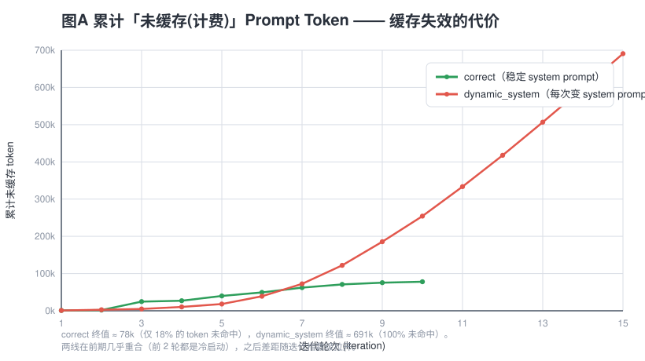
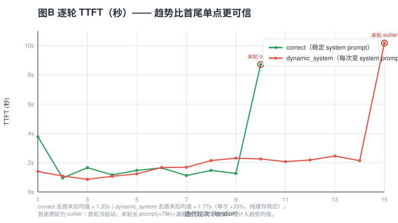

# KV Cache 失效实验与上下文工程最佳实践

- 日期：2026-10-17
- 实验来源：`ai-agent-book / chapter2 / kv-cache`（`KVCacheMode` 对比实验）
- 模型：`deepseek-chat`（DeepSeek，支持自动前缀缓存 / Automatic Prefix Caching）
- 实验任务：让 ReAct Agent 分析并总结 `chapter1`（week1）与 `chapter2`（week2）全部项目
- 对比模式：`CORRECT`（稳定 system prompt）vs `DYNAMIC_SYSTEM`（每次请求注入变化的 system prompt）
- 报告定位：以一次真实的 cache 失效实验为样本，提炼「如何做好上下文工程」的可复用最佳实践

---

## 一、背景与实验设计

**KV Cache / 前缀缓存**是推理服务端的加速机制：当两次请求的 prompt **前缀（prefix）完全一致**时，服务端可以复用已计算好的 Key/Value 张量，省去重复 prefill，直接降低首 token 延迟（TTFT）和计费输入 token。

`kv-cache` 项目内置了 6 种模式：`CORRECT` + 5 个反模式（`dynamic_system`、`shuffled_tools`、`dynamic_profile`、`sliding_window`、`text_format`）。本次实验只跑了其中两组对照：

- `CORRECT`：system prompt 全程不变，工具定义顺序固定 → 前缀稳定，每轮只 prefill 新增内容。
- `DYNAMIC_SYSTEM`：每轮在 system prompt 里注入变化的当前时间 / 状态 → 前缀不再匹配，服务端**无法复用**任何 KV。

两组的 Agent 能力、任务、工具、模型完全一致，唯一变量是「system prompt 是否稳定」。这正是观察上下文工程对成本/延迟影响的干净切口。

---

## 二、核心数据对照

| 指标 | `correct` | `dynamic_system` | 变化 |
|---|---:|---:|---:|
| 迭代次数 | 10 | 15 | +50% |
| 工具调用 | 29 | 46 | +58.6% |
| **Cache Hits / Misses** | 9 / 1 | **0 / 15** | 命中率 90% → 0% |
| Cached Tokens | 357,504 | **0** | — |
| Prompt Tokens（总量） | 435,516 | 690,801 | +58.6% |
| Completion Tokens | 3,617 | 4,536 | +25.4% |
| Cache Ratio | 82.1% | 0.0% | — |
| 总执行时间 | 23.65s | 35.08s | +48.3% |
| 首次 TTFT | 3.78s | 1.40s | **−62.9%（噪声，见 §三）** |
| 末次 TTFT | 8.71s | 10.18s | 均属 outlier |

> 数据来源：两份结果文件 `result_correct_20261017_102725.json`、`result_dynamic_system_20261017_103155.json`，与运行日志逐项核对一致。

---

## 三、证据可信度分级（先分清楚，再下结论）

并不是表里所有数字都能直接拿来讲故事。按「机制决定 vs 行为/环境复合」分级：

### ✅ 强证据（几乎可以确定是 cache 造成的）

1. **缓存命中率 90% → 0%**：由 `DYNAMIC_SYSTEM` 的定义直接决定——每轮前缀都不匹配，服务端无法复用任何 KV。这是实验的核心论点，数据完美支持。
2. **Prompt token 总量 +58.6%**（435,516 → 690,801）：因为每轮 prompt 都无法命中缓存，模型必须重新处理全部前缀；而 `correct` 模式下只有 78,012 个 token 真正未缓存（435,516 − 357,504）。因果链直接、可靠。
3. **TTFT 逐轮趋势**（见 §六 图 B）：`correct` 除首尾外稳定在 0.9–1.7s；`dynamic_system` 从 0.87s **单调爬升**到 2.5s。趋势比首尾单点更有说服力，是最该拿来做图的一条证据。
4. **实际成本（钱，不是 token 数）**：见 §四，成本差约 **3.8×**，远大于 token 数 58% 的差。

### ⚠️ 需谨慎（存在混淆变量，不能直接归因）

5. **总执行时间 +48%**：它同时受「cache 失效」和「迭代数 10→15」影响，二者纠缠。若按「每次迭代平均耗时」算，`correct` = 2.36s/iter，`dynamic_system` = 2.34s/iter，**几乎一样**——时间差主要来自迭代数变多，而非单次变慢。
6. **迭代数 10 vs 15、工具调用 29 vs 46**：这是**行为差异**，不是 cache 的直接结果。`dynamic_system` 在 system prompt 里注入了变化内容，可能让模型做出不同决策。属于实验设计引入的变量，**不能算作 cache 的功劳或罪过**，需单独标注。

### ❌ 不能用的结论（噪声或受截断影响）

7. **「首次 TTFT 3.78s vs 1.40s」**：反直觉——`correct` 首轮也是冷启动，不应比坏模式慢 2.4s。首 token 时间受网络抖动、API 冷启动、排队影响极大，**单样本不可用**，应跑 5–10 次取中位数。
8. **Completion Tokens 3617 vs 4536**：两次末轮 `completion=2000` 均撞上 `max_tokens=2000` 上限，**final answer 被截断**，不能反映真实输出量。
9. **末次 TTFT 8.71s / 10.18s**：两次末轮都伴随「超长 prompt(≈79k) + 满额输出(2000)」，是共同的长上下文/长生成开销，**非 cache 模式造成**，画图时应标为 outlier，不混入均值。

---

## 四、成本换算：缓存失效真正「贵」在哪里

缓存命中的 token 通常按约 1/10 计价。按 DeepSeek 官方当前公开价格估算（缓存命中 ≈ $0.07/M、未命中 ≈ $0.27/M、输出 ≈ $1.10/M，**价格以官网实时为准**）：

| 项 | `correct` | `dynamic_system` |
|---|---:|---:|
| 缓存命中 token | 357,504 | 0 |
| 未命中输入 token | 78,012 | 690,801 |
| 输出 token | 3,617 | 4,536 |
| 命中费用 | $0.025 | $0 |
| 未命中输入费用 | $0.021 | $0.187 |
| 输出费用 | $0.004 | $0.005 |
| **合计** | **≈ $0.050** | **≈ $0.192** |

**成本差约 3.8×**，远大于 token 数 58% 的差。这才是 kv-cache 真正要传达的工程结论——**「缓存失效」不是慢一点，是贵几倍**。读者关心的是账单，不是原始 token 数。

---

## 五、归一化后的真相

单看总量会被迭代数（10 vs 15）带偏。至少算这几个比值：

| 归一化指标 | correct | dynamic_system | 说明 |
|---|---:|---:|---|
| prompt_tokens / iteration | 43,552 | 46,053 | 接近，说明**每次请求规模相当**，差异全在「是否命中」 |
| TTFT / iteration（去首末） | ≈ 1.33s | ≈ 1.77s | 坏模式**单次也慢约 33%**，这才是纯 cache 效应 |
| 实际成本（按官方价） | ≈ $0.050 | ≈ $0.192 | **3.8×**，最有说服力 |

归一化后看清根因：**token 规模差不多，但「未缓存 token 占比」从 18% 飙到 100%**。

---

## 六、两组趋势图

> 图比列表直观。建议报告里永远附这两张图。

- **图 A**：`correct` 的累计未缓存 token 很快走平（终值 ≈ 78k，仅 18% 未命中）；`dynamic_system` 一路爬到 ≈ 691k（100% 未命中）。前期两线几乎重合（前 2 轮都是冷启动），之后差距随迭代指数级拉开。
- **图 B**：`correct` 平稳、`dynamic_system` 单调爬升——**趋势本身就是论点**。首尾两轮已标为 outlier（首轮冷启动、末轮长 prompt+满额输出），不计入趋势均值。

---

## 七、从实验中提炼的上下文工程最佳实践

以下内容是本次实验「该做 / 不该做」的可复用结论。每条都对应上面的数据证据。

### 实践 1：保持 system prompt 前缀稳定 —— 缓存生命线
前缀缓存命中的**唯一前提**是前缀逐字节一致。`DYNAMIC_SYSTEM` 每轮在 system prompt 里塞变化的当前时间/状态，直接把命中率从 90% 打到 0%。
**做法**：system prompt（角色设定、指令、工具 schema、示例）写成常量；任何「会变」的东西都不要拼进前缀。

### 实践 2：把易变内容移出前缀
时间、用户状态、运行上下文这类**每轮都变**的信息，应放进 `user` message、工具返回结果、或独立的请求字段，**绝不要拼进 system prompt**。这样既保留信息，又不破坏前缀匹配。

### 实践 3：工具定义顺序也要固定
`kv-cache` 框架里 `shuffled_tools` 是另一个反模式——工具 schema 顺序一变，前缀同样失配。工具列表、字段顺序、示例顺序都属于「前缀」，都要稳定。

### 实践 4：把 cache 指标当核心健康度来监控
上线 Agent 后，应持续观测 **cache hit rate、cached tokens、cache ratio**。它们由机制直接决定、可信度最高，能第一时间暴露「某个看似无关改动悄悄破坏了上下文结构」。本次实验最强事实就是这三个指标从正常跌到 0。

### 实践 5：用「钱」而不是「token 数」衡量上下文效率
token 数差 58%，成本差 3.8×。未命中 token 占比（18% → 100%）才是根因。做上下文压缩/重构的 ROI 评估，一律按**计费口径**换算，而非裸 token 数。

### 实践 6：看趋势，不看单点
TTFT 的逐轮曲线（图 B）比「首末两点」信息量大得多，且对网络抖动等噪声稳健。任何延迟/成本类指标，优先画迭代曲线，再谈均值。

### 实践 7：控制混淆变量再谈归因
本次「迭代数 10 vs 15、工具调用 29 vs 46」是 system prompt 内容变化带来的**行为效应**，与 cache 机制无关，不能算缓存的账。跨组比较前，先问一句：除了我要测的变量，还有没有别的变量在动？

### 实践 8：结论写成因果句，而非相关句
> 动态 system prompt → 前缀不匹配 → cache miss → 未缓存 token 从 18% 升至 100% → **输入成本 3.8×**、**单次 TTFT +33%**。（迭代数 +50% 是内容变化带来的行为效应，与缓存机制无关，单独讨论。）

把「因为 A 导致 B，证据是 C」写清楚，比「A 时 B 更高」专业得多。

> 补充：`kv-cache` 项目还定义了另外 3 个反模式（`dynamic_profile`、`sliding_window`、`text_format`），与本文的 `dynamic_system`、`shuffled_tools` 共同构成「破坏前缀缓存的五种写法」。正式落地前建议通读该项目 README，把五种反模式列进代码评审清单。

---

## 八、本次实验设计的三个缺陷与改进方案

报告要可信，必须诚实标注局限：

1. **每个模式只跑了 1 次**——单样本无法区分「模式效应」和「运行噪声」。
2. **两次运行相隔几分钟**——API 负载/网络状态不同，首 TTFT 尤其受影响。
3. **`dynamic_system` 同时改了 system prompt 的内容和长度**——所以它的「行为差异（迭代数）」和「cache 差异」混在一起，因果不干净。

**改进（让它变成能发表的结论）：** 每个模式至少跑 **5 次**（最好 10 次），记录 cache_hit_rate、prompt_tokens、ttft_per_iteration、total_time、成本，然后：

- 取**中位数**而非均值（对 outlier 稳健）；
- 报告**四分位距（IQR）**，说明波动范围；
- 用 **Mann-Whitney U 检验**（非参数，适合小样本）看两组 cache_hit_rate / 归一化 TTFT 是否显著不同；
- 首 TTFT 这类高噪声指标**单独列一张表**并标注样本数。

有了 5 次重复，才能理直气壮地说「命中率差异稳定在 90% vs 0%，不是偶然」。

---

## 九、拿到任意实验日志的分析方法清单

1. **先分机制 vs 行为**：cache_hit_rate、cached_tokens 由机制直接决定（可信度最高）；total_time、iterations 是行为/环境的复合结果（可信度低）。
2. **找混淆变量**：本例是「迭代数不同」。不控制它，时间差就没法归因。
3. **归一化再比较**：总量 → 每轮/每次/每 token 的比值，消除规模差异。
4. **看趋势不看单点**：TTFT 逐轮曲线比首尾两点信息量大得多，且对噪声稳健。
5. **单样本不下结论**：至少 5 次，报中位数 + 波动范围 + 显著性。
6. **结论写成因果句**：「因为 A 导致 B，证据是 C」，而不是「A 时 B 更高」。
7. **诚实标注局限**：截断、outlier、单次、环境差异，写清楚读者才信。

---

## 十、一句话总结

这次实验**最强的客观事实**是：**动态 system prompt 把缓存命中率从 90% 打到 0，未缓存 token 占比从 18% 升到 100%，带来约 3.8× 的输入成本和持续上升的 TTFT 趋势**。而「迭代数变多」「首轮更慢」「总时间 +48%」这些**不能直接归因于 cache**——要么是混淆变量，要么是噪声，报告里要分开写。想让它变成能发表的结论，补 **5 次重复 + 两张趋势图 + 成本换算** 就够了。

**给团队的行动清单**：
- [ ] 代码评审加一条：system prompt / 工具 schema 是否稳定（防 `dynamic_system`、`shuffled_tools`）
- [ ] 监控面板加 cache hit rate / cached tokens / cache ratio
- [ ] 所有上下文效率评估按计费口径换算
- [ ] 任何延迟/成本对比实验，先画迭代曲线、再做 5 次重复
