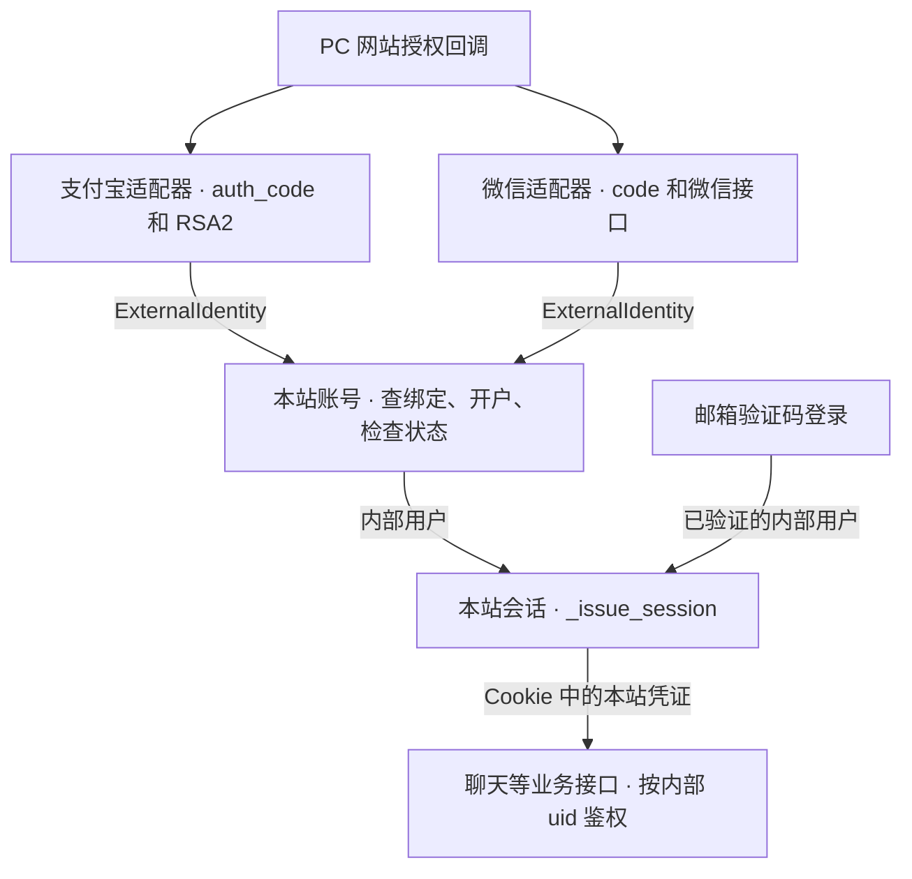
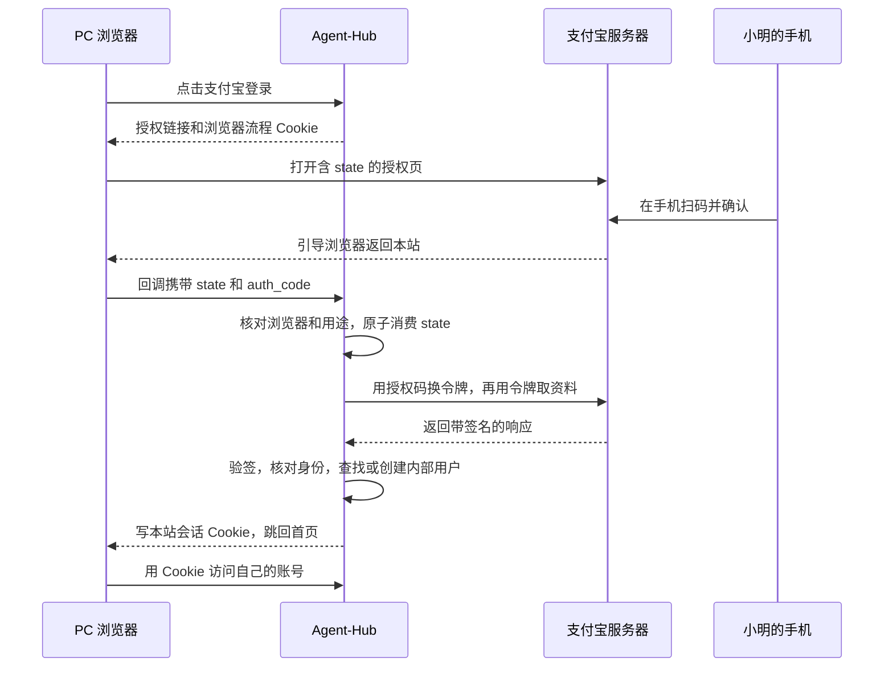

# 怎样判断 Agent-Hub 的支付宝登录做得好不好

2026-11-27 · PC 网站 · 代码审查与离线验证

**先看三个变量。** 打开 [共用回调](../api/external_login.py)，搜下面三行。每行结束后，本站知道的事情都不一样。

| 回调中的代码 | 已确定什么 | 怎样判断这一步成立 |
| --- | --- | --- |
| `identity = adapter.authenticate(codes[0])` | 支付宝确认了哪个外部身份 | SDK 验签通过，令牌与资料响应里的指定身份字段一致，资料接口报告成功 |
| `user = external_accounts.complete(identity, flow)` | 这个身份对应哪个本站用户 | 按平台、应用和身份标识查绑定。首次获准注册时，内部账号和绑定在同一事务中写入；已有账号要通过状态检查 |
| `_issue_session(user, request, response)` | 浏览器收到本站登录凭证 | 带返回的 HttpOnly Cookie 请求 `/api/auth/me/`，应读到上一步的内部 ID |

## 图一 · 谁能决定什么



这里的“低耦合”可以用改需求来判断。假设支付宝改了昵称字段，应该改支付宝适配器及其测试；假设以后调整所有第三方账号的解绑条件，应该改共享账号层。聊天接口只需要当前内部 uid。邮箱直接验证本站已有账号，在签发会话处汇合，因而保留自己的验证码流程。

## 图二 · 小明第一次用支付宝登录



图中的扫码属于正式授权页预期的用户操作。本轮测试从本站入口走到最后一次取用户，支付宝网络由本地测试替身接管。流程 Cookie 用来识别发起扫码的浏览器；最后的会话 Cookie 才能用于访问账号。当前选择首次直接开户，用户无需停下来填写邮箱，因此这条路径只保存授权流程记录，无需另存“等待完成注册”的凭证。

## 为什么这样改

你的[低耦合架构研究](https://chatgpt.com/library?file_id=libfile_3edb76df858081919db00a956c784bad&account_id=personal)提出按业务划分边界，也讨论过 Java 网关。[登录架构决策](https://chatgpt.com/library?file_id=libfile_0124ae8069bc81918174971a72adb0dd&account_id=personal)把选型系于谁掌握用户和 JWT。[PC 登录调查](https://chatgpt.com/library?file_id=libfile_867ba3e1bf348191b1095cf0669c62eb&account_id=personal)要求沿浏览器会话验证这个前提。源码现在给出了答案：FastAPI 已拥有账号、密码和会话签发入口。合并重复回调只需改 Python，额外部署网关还需要跨服务传递已核验身份。

| 参考实现 | 借鉴了什么 | Agent-Hub 自己的取舍 |
| --- | --- | --- |
| [JustAuth 支付宝实现](https://github.com/justauth/JustAuth/blob/master/src/main/java/me/zhyd/oauth/request/AuthAlipayRequest.java) | 适配器认识 `auth_code`，调用 SDK 换令牌、取资料，再映射为通用用户对象 | 本站仅传递 `provider / app_id / subject / nickname`，令牌和原始资料在适配器内用完 |
| [Casdoor 支付宝实现](https://github.com/casdoor/casdoor/blob/master/idp/alipay.go) | 各平台返回统一的用户信息；支付宝资料接口单独检查成功码 | 该实现从资料中优先选 user_id，再尝试 open_id。本站按应用固定字段，并在关联键中保存种类，避免字段变化导致另建账号 |

原来两份路由各管一遍浏览器 Cookie、限流、回调和会话。现在两份平台入口只声明平台差异，共用 [浏览器流程](../api/external_login.py)。[支付宝适配器](../core/alipay.py) 依赖小型[身份数据契约](../core/external_identity.py)，无需导入账号数据库模块。业务层仍拥有[绑定表与事务](../core/external_accounts.py)。支付宝请求签名、响应验签继续交给[官方 Python SDK](https://github.com/alipay/alipay-sdk-python-all)。

## 怎样给这次改动下结论

| 判断题 | 可以观察的证据 | 本轮结论 |
| --- | --- | --- |
| 首次授权和再次授权能否找到正确的人？ | 新账号没有安全邮箱和可用密码。清空浏览器 Cookie 再登录，`/me/` 仍返回同一个 uid；不同平台的同名标识各自独立 | 隔离数据库中通过 |
| 用户中途取消，会不会留下还能继续使用的流程？ | 登录取消回登录页，绑定取消回设置页。响应无新会话 Cookie，平台调用次数为零；再用同一 state 被拒绝 | 两个平台、两种用途均通过，本轮新增 4 例 |
| 支付宝返回了身份，是否就能开户？ | 资料响应即使签名有效、身份也一致，只要缺少成功码就拒绝；用户表无新增行 | 本轮新增 1 例。成功的换令牌响应仍可省略业务码 |
| 账号刚被撤销会话，旧的授权结果还能继续用吗？ | 在账号事务完成和签 Cookie 之间提升鉴权版本，随后访问 `/me/` 得到 401；重新走完登录得到 200 | 第三方会话采用事务确认的版本，本轮新增 1 例 |
| 真实用户现在能否扫码登录？ | 需要正式应用在已登记域名完成授权，并在真实浏览器用 Cookie 访问 `/me/` | 待联调。离线签验使用临时密钥，无法确认正式密钥归属、应用权限、实际返回字段和代理后的 Cookie 行为 |
| 高峰期查询绑定会不会排队？ | `is_bound()` 和 `identity_exists()` 都只查询，但当前共用的 SQLite 事务会执行 `BEGIN IMMEDIATE`，读取也会争用写锁 | 功能测试通过，峰值等待时间未测。出现并发压力时，先测绑定查询延迟，再决定是否单独使用只读连接 |

**复验结果：125 项通过，Ruff 检查通过。** 其中 65 项覆盖两平台与共享账号，另 60 项覆盖邮箱、密码重置、JWT 和 Cookie。运行时有一条知识库依赖弃用提示。已有的停用账号、绑定冲突、先设置密码再解绑，以及隔离库内注销后重新注册也在覆盖范围内。完整业务数据注销仍由维护入口执行。此次范围为认证回归，前端浏览器交互与全项目回归尚未在本轮验证。

在项目根目录、装有项目依赖和支付宝 SDK 的 Python 环境中复跑：

```powershell
python tools/run_isolated_tests.py tests/test_alipay_login.py tests/test_external_accounts.py tests/test_wechat_login.py tests/test_email_login.py tests/test_email_registration.py tests/test_password_reset.py tests/test_jwt_login_flow.py tests/test_auth_cookie_secure.py -q
```

**下次审代码时，只选一条承诺来查。** 例如“绑定取消不会改变账号”。在[回归测试](../tests/test_alipay_login.py)中搜 `test_cancelled_authorization_ends_flow_at_original_page`，看它有没有同时检查返回页面、会话 Cookie、数据库绑定和旧 state。只看页面跳转，最多能证明用户看到了哪一页；检查这四处，才有依据判断账号实际发生了什么。
